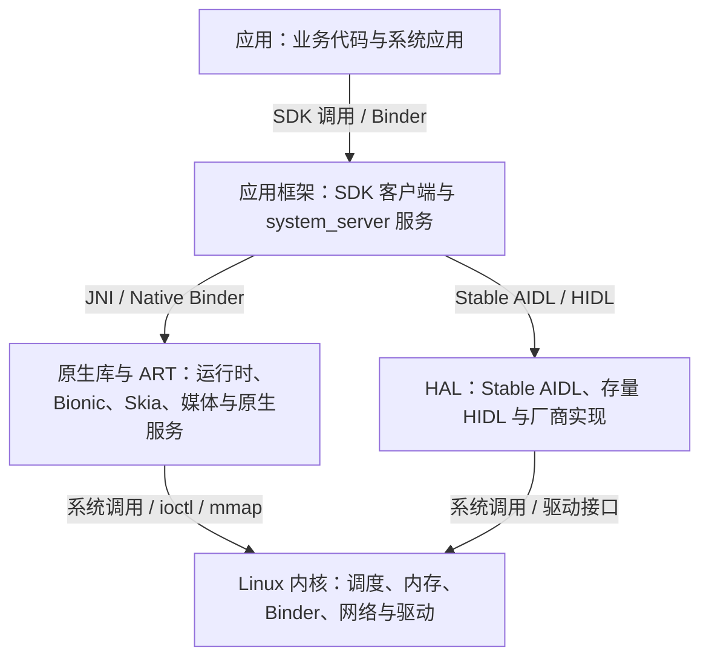

# Android 分层架构、进程模型与线程协作

Android 建立在 Linux 内核之上，整体架构自底向上依次为 Linux 内核、硬件抽象层（HAL）、原生库与 ART 运行时、应用框架（Framework）以及应用五个层次。Linux 内核提供进程与线程调度、内存管理、Binder 驱动、网络栈与设备驱动等底层能力；硬件抽象层（HAL）向系统上层暴露标准化的硬件功能接口，将框架逻辑与底层驱动实现解耦；原生库与 ART 运行时包含 Android 运行时（ART）、Bionic C 库、图形与媒体等原生组件，为系统和应用提供执行环境与底层支撑；应用框架通过系统服务与公开 API 组织组件生命周期、窗口管理、包管理与系统资源调度；最上层的应用层则包含系统应用与第三方应用，借助框架接口实现具体界面与业务逻辑。

系统运行时，应用和系统服务分布在不同的进程中。进程内的模块可以通过方法调用或 JNI 交互，进程之间则通过 Binder 等机制通信。

从各层组件在运行时的落点来看，普通应用一般拥有各自独立的应用进程，其中不仅运行应用自身的业务代码，还包含用于对接系统服务的 Framework 客户端代码，以及提供执行环境与基础能力的 ART 和原生库。应用框架中负责全局调度与策略裁决的核心部分，则集中运行在 `system_server` 进程中——它是系统启动阶段拉起的核心进程，承载着组件、窗口、包管理等大量 Java 系统服务，并加载对应的 JNI 原生库以衔接底层能力。部分原生系统服务则运行在 `system_server` 之外的独立进程中，例如专门负责显示合成的 SurfaceFlinger，它在图形显示链路中与 `system_server` 内的窗口管理等服务跨进程协作。再往下到硬件抽象层，HAL 既有以独立服务形式运行、通过 Binder（如 Stable AIDL 或服务化 HIDL）提供跨进程调用的实现，也有以存量共享库形式直接加载到调用方进程中的实现。

因此，定位卡顿、启动延迟或权限受限等运行时问题时，需要先确认调用跨过了哪些进程与接口边界，再沿着进程重要性评估、冻结与回收机制以及进程内部的线程调度与等待链寻找根因。

> 源码基线：AOSP `android-17.0.0_r1`；内核 Android Common Kernel（ACK）`android17-6.18-2026-06_r6`。量产设备通常还会在 ACK 之上叠加片上系统（SoC）驱动、通用内核镜像（Generic Kernel Image，GKI）厂商模块与厂商调度策略，排查具体设备问题时仍应结合目标设备的内核版本与构建配置。

## 系统分层、进程边界与跨层接口

### 五层架构与实际进程边界

下图展示了五层之间自上而下的常规调用路径：



实际请求也常常跳过中间层级直接进入下层：应用代码可以通过 Bionic 直接发起文件系统调用；SurfaceFlinger 可以直接与 Composer HAL 以及 Linux DRM 显示子系统或显示驱动交互；媒体数据流则常借助共享缓冲区在进程间流转。

如果把逻辑分层投影到实际的操作系统进程上，各模块的空间分布如下图所示：

<!-- gracker-diagram: ch01-01-process-boundaries -->


图：应用代码、Framework 客户端、ART 与原生库可以处在同一个进程；WMS 与 SurfaceFlinger 分属不同进程。箭头列出常见接口，HAL 的直通式实现另见下文。

结合运行时分布与性能分析视角，五层在 Android 17 中的典型对象与边界如下：

| 层次 | Android 17 中的典型对象 | 主要边界 | 性能分析入口 |
| --- | --- | --- | --- |
| 应用 | `Activity`、Compose/View、业务线程、RenderThread | SDK、Binder、JNI、文件与网络 API | 应用主线程、RenderThread、自定义跟踪事件（trace）、FrameTimeline |
| 应用框架 | `ActivityTaskManagerService`、`WindowManagerService`、`PackageManagerService` 等 `system_server` 服务 | Java Binder、原生 Binder、系统服务内部锁 | `system_server` Binder 线程、服务跟踪时间片（slice）、锁与调度状态 |
| 原生库与 ART | ART、Android C 标准库 Bionic、Skia、SQLite、SurfaceFlinger、AudioFlinger、媒体服务 | JNI、原生 Binder、共享内存、系统调用 | ART 垃圾回收（GC）/即时编译（JIT）、原生代码时间片、调用栈、原生堆与系统调用 |
| HAL | Stable AIDL HAL、存量 HIDL HAL、厂商服务或同进程实现 | Binder、hwbinder、快速消息队列（FMQ）、共享缓冲区、设备节点 | HAL 服务进程、Binder 事务、锁、输入输出（I/O）与硬件同步栅栏（fence） |
| Linux 内核 | 调度器、内存管理、Binder 驱动、网络栈、文件系统、DMA-BUF 与设备驱动 | 系统调用、`ioctl`、`mmap`、中断 | ftrace 内核跟踪、线程状态、CPU 频率、I/O、Binder 与驱动事件 |

### 系统启动如何串联各层

系统开机时，内核启动用户空间的第一个进程 `init`，`init` 按第一阶段（first stage）、SELinux 访问控制初始化、第二阶段（second stage）的顺序执行。第二阶段的 `init` 解析 `.rc` 启动脚本，拉起 SurfaceFlinger 等核心原生服务以及 Zygote 进程（预加载 Android 运行环境并派生后续 Java 进程的模板进程）。

`init.zygote64.rc` 将 `zygote` 服务定义为 `/system/bin/app_process64 ... --zygote --start-system-server --socket-name=zygote`，`init.rc` 中的 `zygote-start` 动作再执行 `start zygote`。[来源: https://juejin.cn/post/7679264879620374568；已验证: system/core/rootdir/init.zygote64.rc 与 init.rc @ android-17.0.0_r1] 随后进程进入 `frameworks/base/core/java/com/android/internal/os/ZygoteInit.java` 的 `main()`，按以下四步推进：

1. 未启用延迟预加载（lazy preload）时，调用 `preload()` 预加载常用类与共享资源。
2. 创建 `ZygoteServer` 准备接收请求。
3. 主 Zygote 调用 `forkSystemServer()` 派生 `system_server` 进程。
4. 父进程进入 `zygoteServer.runSelectLoop()`，开始监听来自后续应用启动请求的 socket。

这里需要分清两层创建关系：`init` 直接拉起并管理 Zygote，而 `system_server` 则由主 Zygote 在进入 `runSelectLoop()` 之前通过 `forkSystemServer()` 直接派生，并不走后续普通应用冷启动时先经 `system_server` 再写入 Zygote socket 的请求路径。[已验证: frameworks/base/core/java/com/android/internal/os/ZygoteInit.java @ android-17.0.0_r1] 无论派生 `system_server` 还是后续派生普通应用，Zygote 的 `fork()` 都借助 Linux 写时复制（Copy-on-Write）机制让父子进程共享未修改的预加载内存页面；直到后续写入、ART 运行或各自初始化发生，子进程才会逐步产生私有内存页。

在进入 `SystemServer.main()` 之前，`system_server` 子进程会先完成身份专化（specialize）。`nativeForkSystemServer()` 在 `pid == 0` 分支调用 `SpecializeCommon(..., is_system_server=true, ...)`，依次配置控制组与 task profile、补充组和资源限制、seccomp 过滤规则、`setresgid()`/`setresuid()`、capabilities、SELinux 上下文以及 post-fork hooks；随后 `handleSystemServerProcess()` 经由 `ZygoteInit.zygoteInit()` 和 `RuntimeInit.applicationInit()` 反射定位到 `com.android.server.SystemServer.main()`。[来源: https://juejin.cn/post/7679264879620374568；已验证: frameworks/base/core/jni/com_android_internal_os_Zygote.cpp、ZygoteInit.java 与 RuntimeInit.java @ android-17.0.0_r1]

`zygoteInit()` 还会先调用 `nativeZygoteInit()`，触发 `app_process/app_main.cpp` 中 `AppRuntime::onZygoteInit()` 执行 `ProcessState::self()->startThreadPool()`。因此，`system_server` 接收 Binder 事务的线程池在进入 `SystemServer.main()` 之前就已经启动。[已验证: frameworks/base/cmds/app_process/app_main.cpp @ android-17.0.0_r1]

#### `SystemServer.main()` 之后的装配过程

到达 `SystemServer.main()` 时，`system_server` 已经具备专化后的进程身份、ART 运行时、Framework JNI、预加载页面以及 Binder 线程池；而 System Context、主 `Looper` 循环、`SystemServiceManager` 以及 AMS、PMS、WMS 等系统服务对象，则由 `SystemServer.run()` 组织建立。[来源: https://juejin.cn/post/7681897078311108623；已验证: frameworks/base/core/jni/com_android_internal_os_Zygote.cpp、frameworks/base/cmds/app_process/app_main.cpp 与 frameworks/base/services/java/com/android/server/SystemServer.java @ android-17.0.0_r1]

这里需要分清几个相近的称呼：`system_server` 是操作系统进程名，`SystemServer` 是 `main()` 中 `new SystemServer().run()` 启动的 Java 装配总控，AMS 等是运行其中的系统服务实例，而它们向全局 `ServiceManager` 注册发布的是对外的 Binder 服务端对象。[来源: https://juejin.cn/post/7681897078311108623；已验证: frameworks/base/services/java/com/android/server/SystemServer.java @ android-17.0.0_r1]

`SystemServer.run()` 的装配流程分为四段：首先设置系统进程规则，例如 Binder 阻塞告警、SQLite/Parcel 策略、Binder 后台调度与最大线程数；接着准备主线程 `Looper` 与 `SystemServerInitThreadPool`；随后加载 `android_servers` 原生库、建立 System Context 与 System UI Context，并执行每进程 Mainline 模块初始化；最后创建 `SystemServiceManager`，依次启动以下四组服务（相比早期只列前三组的旧版本，Android 17 额外包含第四个 `startApexServices()` 阶段，用于拉起 APEX 可更新系统模块中的服务）：[来源: https://juejin.cn/post/7681897078311108623；已验证: frameworks/base/services/java/com/android/server/SystemServer.java @ android-17.0.0_r1]

```java
// AOSP android-17.0.0_r1
// frameworks/base/services/java/com/android/server/SystemServer.java
startBootstrapServices(t);
startCoreServices(t);
startOtherServices(t);
startApexServices(t);
```

`SystemServiceManager` 是 `system_server` 内部的 Java 管理对象及 `LocalServices` 注册载体。调用它的 `startService(Class<T>)` 时，它会传入 `Context` 构造 `SystemService`、将其登记到 `mServices`，再调用服务的 `onStart()`；它负责已纳管 `SystemService` 的启动及后续 Boot Phase、User 生命周期分发，而各服务的创建顺序仍由 `SystemServer.run()` 的调用序列决定，部分遗留服务也并未交由它创建。[来源: https://juejin.cn/post/7681897078311108623；已验证: frameworks/base/services/core/java/com/android/server/SystemServiceManager.java @ android-17.0.0_r1]

从线程协作看，启动过程中的 `system_server` 存在三条执行路径：主线程按 `SystemServer.run()` 顺序推进，末尾进入 `Looper.loop()` 开启长期消息循环；Binder 线程池各自独立响应远端 transaction；`SystemServerInitThreadPool` 与各服务自有线程则承载允许并行的初始化任务或服务内部逻辑。[来源: https://juejin.cn/post/7681897078311108623；已验证: frameworks/base/services/java/com/android/server/SystemServer.java 与 frameworks/base/services/core/java/com/android/server/SystemServiceManager.java @ android-17.0.0_r1] 因此，主线程进入 `Looper.loop()` 仅说明启动主控制流进入了长期消息循环，判断系统是否真正就绪以及定位开机耗时，还要结合 `SystemServerTiming`、init 服务事件、具体服务的 `StartService ...` 时间片、Binder 线程状态以及 Boot Phase/`systemReady()` 事件还原实际执行。[来源: https://juejin.cn/post/7681897078311108623；已验证: frameworks/base/services/java/com/android/server/SystemServer.java 与 frameworks/base/services/core/java/com/android/server/SystemServiceManager.java @ android-17.0.0_r1]

取证进程关系时，可以通过 `ps -A -o PID,PPID,NAME,ARGS`（或读取 `/proc/<pid>/status` 的 `PPid`）确认 `system_server` 的父进程指向 Zygote。若 `system_server` 异常退出，Zygote 的 `SIGCHLD` 处理路径会经 `waitpid()` 匹配 `gSystemServerPid` 并终止 Zygote 自身，随后由 `init` 对 Zygote 服务的监督链路拉起新一轮重启。[已验证: frameworks/base/core/jni/com_android_internal_os_Zygote.cpp 与 system/core/rootdir/init.zygote64.rc @ android-17.0.0_r1]

系统就绪后，应用冷启动则会沿着另一条混合链路反向串联起多个进程：桌面或调用方通过 Binder 请求 `system_server` 中的 Activity/Task 管理服务，系统服务再通过 Zygote 本地 socket 请求派生新进程，子进程进入 `ActivityThread.main()` 后再次经由 Binder 向 `system_server` 完成 attach。这条路径同时跨越了 Binder 与本地 socket，不宜笼统归为单一的“Binder 调用”。

### 三类跨边界接口

#### Binder：跨进程传递控制命令

Binder 由用户态 `libbinder` 与内核 Binder 驱动共同实现。`frameworks/native/libs/binder/ProcessState.cpp` 定义了用于接收 Binder 事务的内存映射区大小，以及通过 `BINDER_SET_MAX_THREADS` 传递给驱动的动态增线程上限：

```cpp
// AOSP android-17.0.0_r1
#define BINDER_VM_SIZE ((1 * 1024 * 1024) - sysconf(_SC_PAGE_SIZE) * 2)
#define DEFAULT_MAX_BINDER_THREADS 15
```

`DEFAULT_MAX_BINDER_THREADS = 15` 限制的是驱动通过 `BR_SPAWN_LOOPER` 允许动态请求的最大增线程数；`ProcessState::startThreadPool()` 启动的首个池内线程，以及手工调用 `IPCThreadState::joinThreadPool()` 加入的线程，均不计入这 15 个名额。默认路径下，内核向用户态发送 `BR_SPAWN_LOOPER` 需同时满足四个条件：当前没有等待中的空闲线程、没有尚未完成的增线程请求、驱动已请求启动的线程数低于 `max_threads`，且当前线程已进入 Binder looper。ACK 还提供了 `trace_android_vh_binder_spawn_new_thread()` 厂商钩子；若钩子设置了 `force_spawn`，则可绕过这组默认判断，排查设备时需结合厂商内核实现确认。此外，调用 `setThreadPoolMaxThreadCount()` 会通过 `BINDER_SET_MAX_THREADS` 配置驱动，一旦线程池启动，该上限便无法再向下调低。

实际配置线程池容量时需要权衡长事务阻塞与并发锁竞争、内存开销。借助 Perfetto 系统跟踪与服务日志，可以从四个角度判断是否存在线程池瓶颈：

- 调用方是否正在同步等待 Binder 回复；
- 目标进程是否已经耗尽空闲 Binder 线程；
- 目标处理线程处于运行、等待 CPU、等锁还是等 I/O 状态；
- 长事务究竟源自少数异常请求，还是稳定的高并发容量不足。

在数据传输方面，Binder 驱动会将事务载荷从发送方用户空间直接复制到接收方可映射的 Binder 内核缓冲区，这就是常说的“一次拷贝”。不过，一次完整 Binder 请求的端到端延迟还包括文件描述符转换、Binder 对象解析、权限检查、线程唤醒与调度以及目标服务自身的逻辑执行。

安全授权同样嵌在驱动事务路径中。ACK `android17-6.18-2026-06_r6` 的 `security/selinux/hooks.c` 中，`selinux_binder_transaction()` 会执行 `BINDER__CALL` 检查；当当前线程的 SELinux 安全标识符（SID）与事务发起方凭据的 SID 不一致时，还会先检查 `BINDER__IMPERSONATE`，通过后再继续检查 `BINDER__CALL`。

需要留意的是，Framework Java API 所在的进程位置未必等于服务端进程。以启用 A/B 系统更新的设备为例，`android.os.UpdateEngine` 是带有 `@SystemApi` 和 `@hide` 的 Framework 客户端类，它通过 `ServiceManager` 查找 `android.os.UpdateEngineService`，再经 Binder 转发请求；而真正执行升级的服务端由 `init` 拉起为独立原生进程 `/system/bin/update_engine`，并在 `DaemonAndroid::OnInit()` 中注册该 Binder 服务，并不运行在 `system_server` 里。排查升级问题时，需先在进程列表中确认 `update_engine`，再沿 Binder 事务追踪双方线程。[来源: 2026-11-03-77028958-AOSP 14 OTA 升级指导（三）：.md；已验证: frameworks/base/core/java/android/os/UpdateEngine.java、system/update_engine/update_engine.rc 与 system/update_engine/aosp/daemon_android.cc @ android-17.0.0_r1]

#### JNI：同一进程内的托管与原生边界

与跨进程的 Binder 相比，JNI 是同一进程内部从 ART 托管执行环境进入原生函数的应用二进制接口（ABI）边界——跨过 JNI 边界本身仍留在原进程中，也不会触发系统调用或 Binder 通信。JNI 调用的成本主要来自调用约定适配、线程状态切换、局部/全局引用管理、参数与字符串或数组的复制或固定（pinning），以及原生函数自身的工作。

降低 JNI 开销通常围绕减少跨边界次数与数据转换展开：

- 将循环中的细粒度跨边界调用合并为单次批量调用，同时权衡批处理带来的内存与单次延迟；
- 对大块二进制数据采用直接缓冲区（direct buffer）或共享原生内存表示，减少频繁构造托管对象；
- 对满足严格约束的高频短方法，使用 `@FastNative` 或 `@CriticalNative`（两者互斥，同一方法只能选其一）。从 Android 14（API 34）起，这两个注解已成为经过 CTS 测试的公开 API。

其中 `@CriticalNative` 仅适用于既没有托管对象参数或返回值、也没有隐式 `this` 的静态原生方法，并会改变原生函数签名（省去 `JNIEnv` 和 `jclass` 参数）。在这两个注解修饰的方法执行期间，ART 的 GC 无法按常规 JNI 路径挂起当前线程，因此方法体必须短小且耗时有界，应避开大量 I/O 或可能长时间持有的原生锁。若需兼容旧版本系统，还应注意版本差异：Android 8–13 虽然已有底层实现，但不具备 API 34 起的 CTS 保证；Android 8–11 要求通过 `RegisterNatives` 显式注册，Android 12 起才支持动态查找（官方仍建议显式注册）；Android 7 及更早版本会忽略这些注解，`@CriticalNative` 的 ABI 不匹配可能导致参数传递错误或崩溃，详细约束见 [JNI tips](https://developer.android.com/ndk/guides/jni-tips#fast_critical_native)。实际优化前，应在目标设备上用真实业务参数（包含字符串、数组或锁竞争）测量收益。

#### 系统调用与共享缓冲区：内核边界与大数据量通道

用户空间进程与 Linux 内核之间的交互通过系统调用跨越用户态/内核态边界：例如应用或原生库经由 Bionic 发起文件与网络读写，驱动客户端通过 `ioctl` 下发控制命令（包括 Binder 驱动交互），通过 `mmap` 映射设备内存或缓冲区，以及通过 `epoll_wait` 等接口阻塞等待事件。

对于高吞吐的图像、相机帧与音频数据，跨进程传递同样不宜反复序列化进 Binder `Parcel`。这类子系统普遍采用“控制面与数据面分离”的协作方式：用 Binder 传递控制命令与句柄，再通过 BufferQueue、DMA-BUF、共享内存、快速消息队列（FMQ）或硬件缓冲区传递大块数据与同步信息。

排查图形或媒体延迟时，需要把控制往返、系统调用与缓冲区流转以及同步栅栏（fence）拆开观察。例如一次相机请求可以很快完成 Binder 控制往返，却仍可能长时间等待传感器曝光、ISP 处理或缓冲区同步栅栏；同样，一次显示提交在 SurfaceFlinger 侧耗时很短，GPU 渲染或 HWC 合成完成的时间也可能更晚。

### Treble、HIDL 与 Stable AIDL

在应用框架与厂商实现之间，Project Treble 从 Android 8.0 开始引入了清晰的分区接口契约。VINTF（Vendor Interface）清单声明一方提供的接口，兼容性矩阵描述另一方所需的接口：设备清单匹配框架兼容性矩阵，框架清单匹配设备兼容性矩阵，两组校验共同约束 `system` 与 `vendor` 分区的升级与组合。

接口定义语言方面，HIDL 时代区分两种传输模式：

- **服务化（binderized）HIDL HAL**：以服务进程形式运行，通常经由 `/dev/hwbinder` 通信。
- **直通式（passthrough）HIDL HAL**：以共享库形式加载到调用方进程，调用路径中没有独立的 HAL 服务进程。

在 Android 17 基线下，HIDL 已处于废弃状态，但既有实现仍受支持；新开发的 HAL 接口应优先采用 Stable AIDL，若上游接口规范仍定义为 HIDL 则按其实现。用于 `system`/`vendor` 分区边界的 Stable AIDL HAL 以 Binder 服务形式运行，要求在接口类型上标记 `@VintfStability`，在 `aidl_interface` 构建配置中设置 `stability: "vintf"`，写入 VINTF 清单并满足接口冻结等 VTS 检查。出于兼容已有 `vendor` 镜像的考虑，Android 17 设备上仍可能保留部分旧 HIDL HAL。

Stable AIDL 同时严格约束不同分区可用的语言后端：位于 `vendor` 分区的原生代码必须使用 NDK 后端并链接 `libbinder_ndk` 经 `/dev/binder` 通信，不稳定的 `libbinder` C++ 接口仅向 `system`/`system_ext` 开放；Java 后端从 `vendor` 分区无法连接 `ServiceManager`；从 API 34 起，新增的 System API 也对 `vendor` 分区关闭。

因此，定位 HAL 性能或超时问题时，需先识别该接口的实际传输模式，再沿着对应路径推进：

1. 从应用框架或原生客户端确认调用的接口名与目标服务；
2. 若为基于 Binder 的服务实现（如用于 `system`/`vendor` 边界的 Stable AIDL HAL 或服务化 HIDL HAL），沿 Binder 事务进入目标服务进程，检查其工作线程、锁、系统调用与同步栅栏；
3. 若为直通式 HIDL HAL，则留在调用方进程内部检查原生调用栈与共享库中的等待点；
4. 涉及高吞吐数据时，在控制命令返回之外继续追踪缓冲区、FMQ、DMA-BUF 与内核驱动事件。

### Android 15 到 Android 17 的三个架构边界

#### 16 KB 页大小

从 Android 15 开始，AOSP 支持将设备内核配置为 16 KB 内存页大小。如果应用及其全部依赖库和 SDK 仅包含 Java/Kotlin 代码，通常无需调整 ELF（Android 原生可执行文件与共享库二进制格式）对齐，但仍需在 16 KB 环境中回归验证；若包含 NDK 原生库或通过 SDK 间接引入 `.so`，则必须确保 ELF 的 `LOAD` 段对齐以及 APK 内未压缩原生库的 ZIP 对齐符合 16 KB 要求。

设备运行时的实际页大小可以通过以下命令直接读取（`4096` 表示 4 KB，`16384` 表示 16 KB）：

```bash
adb shell getconf PAGE_SIZE
```

官方文档公布的冷启动速度、功耗与系统启动收益来自 Google 的初期测试样本，实际设备上因硬件和负载不同会有差异。在分发政策上，Google Play 要求目标版本为 Android 15（API 35）或更高的应用支持 64 位设备上的 16 KB 页大小；自 2027 年 2 月 1 日起，未满足该要求的应用更新将无法发布。具体到某台 Android 15、16 或 17 设备，其出厂内核仍可能运行在 4 KB 或 16 KB 模式下。

#### Mainline 模块

Project Mainline 将部分核心系统组件封装为 APEX 或 APK 模块，使其能够通过 Google Play 系统更新或厂商 OTA 独立升级。前文提到的 `SystemServer.run()` 也会显式执行每进程所需的 Mainline 模块初始化，并在常规服务组之后通过 `startApexServices()` 拉起模块服务。

需要注意的是，Android 11 及以下版本的 Mainline 更新支持已于 2025 年第四季度结束，分析老旧设备时应先核对模块支持状态（参见 [Mainline 支持说明](https://source.android.com/docs/core/ota/modular-system)）。由于模块实现可以独立于系统大版本迭代，定位 ART、Media、Wi-Fi 或 Bluetooth 等模块问题时，除了记录 Android 大版本号，还应同时记录构建指纹（build fingerprint）、相关 APEX/APK 模块版本与复现时间；模块内部实现虽然可变，但对外边界仍受稳定 SDK/System API、稳定 C API 或 Stable AIDL 约束。

#### VNDK 废弃与动态链接器命名空间

用于约束 `system` 与 `vendor` 分区共享原生库的 VNDK（Vendor Native Development Kit），已从 Android 15 开始废弃。新的 `vendor` 或 `product` 分区不再声明 `ro.vndk.version`，原有 VNDK 库改按厂商分区可用库（vendor-available library）直接安装进 `vendor` 或 `product` 镜像；为兼容旧厂商镜像而保留的 VNDK APEX 仍可能在部分设备上见到。

尽管 VNDK 已废弃，动态链接器命名空间（linker namespaces）隔离机制依然有效。`bionic/linker/linker_namespaces.cpp` 中的 `android_namespace_t::is_accessible()` 会在加载共享库前校验 `allowed_libs_`、库搜索路径与 `permitted_paths_`。至于 `dlopen()` 的实际启动耗时，则受加载库数量、搜索路径长度、文件系统缓存命中情况、重定位、RELRO 只读重定位保护以及库构造函数执行时间的共同影响。

### SurfaceFlinger 与系统服务的进程分工

在图形与窗口体系中，`WindowManagerService`（WMS）与 `SurfaceFlinger` 各自承担不同职责并运行在两个独立进程中：WMS 运行在 `system_server` 内，负责窗口容器、层级结构、焦点分发、配置变更与窗口策略；SurfaceFlinger 则是由 `init` 直接启动的独立原生服务进程，负责接收各层（layer）状态与图形缓冲区，借助 `CompositionEngine`、`RenderEngine` 和 Composer HAL 完成合成并输出显示。

`frameworks/native/services/surfaceflinger/SurfaceFlinger.cpp` 中的主刷新路径围绕以下核心环节展开：

- `SurfaceFlinger::commit(...)`：收集并提交本轮事务状态，判断是否需要触发合成；
- `SurfaceFlinger::composite(...)`：进入各个显示设备的合成与显示提交（present）流程；
- `postComposition` 跟踪事件：记录合成完成后的收尾阶段。

分析不同 Android 版本的 Perfetto 跟踪数据时，SurfaceFlinger 主刷新路径的入口名称存在演进差异：

| 版本范围 | 建议先查的 SurfaceFlinger 入口 | 使用范围 |
| --- | --- | --- |
| Android 17 | `commit <vsyncId>`、`composite <vsyncId>`、`postComposition` | 以 `android-17.0.0_r1` 为当前核对版本 |
| Android 15-16 | `commit <vsyncId>`、`composite <vsyncId>`；再按源码标签确认 `post-composition` 标记 | 需按对应版本源码标签核对具体跟踪宏名称 |
| Android 13-14 | `commit`、`composite` 与对应的 `post-composition` 路径 | 名称是否带 VSync ID 以设备实际跟踪数据为准 |
| Android 11-12 | `onMessageInvalidate`、`onMessageRefresh`、CompositionEngine 显示提交路径 | 仍为消息驱动入口 |
| Android 10 及以前 | `onMessageReceived`、`handleMessageRefresh`、`doComposition` | 用于历史设备排查与版本演进对比 |

当跟踪数据中出现 `composite` 耗时变长时，需要结合 HWC 合成决策、present fence 等待、RenderEngine GPU 工作负载、显示模式切换、图层数量变化以及内核驱动等待综合判断 GPU 或合成管线是否过载。

### 在 Perfetto 中沿调用链定位跨层问题

Perfetto 的各个数据源按采集维度切分，与五层架构之间是交叉映射关系：

- `linux.ftrace` 来自内核，记录 CPU 调度、频点变化、I/O、Binder 驱动和部分驱动事件，但它呈现的线程可能属于应用、`system_server`、原生服务或 HAL 进程。
- ATrace 与 TrackEvent 由用户态代码主动打点，应用、应用框架、原生服务和 HAL 都可以输出时间片（slice）；其 category 用于控制采集开关，与具体系统分层没有固定绑定。
- 进程统计、原生/托管堆分析、FrameTimeline 与功耗计数器等数据源各自回答特定维度的问题。

分析一次跨进程同步等待时，可以按以下因果链逐步推进：

1. 在调用方线程找到同步 Binder 时间片，确认发起线程与对应事务。
2. 沿着流向关联（flow）跳到目标进程的实际处理线程；flow 箭头只标记事务关联，统计耗时时应分别计算调用方等待时长、目标线程排队时长以及服务端实际执行时长。
3. 检查目标线程的调度状态：
   - **Running**：线程正在 CPU 上运行，结合调用栈与用户态时间片判断具体工作内容；
   - **Runnable**：线程已就绪但等待分配 CPU，需查看线程优先级、核上负载、CPU 频率与温控限频情况；
   - **Sleeping（可中断睡眠）**：常见于等待 Binder 回复、`futex` 锁、`epoll` 事件或定时器；
   - **Uninterruptible Sleep（不可中断睡眠）**：多与内核 I/O 或驱动等待相关，需结合 `wchan` 记录的内核等待位置及驱动事件确认阻塞对象。

下表汇总了三个典型的跨层排障切入点：

| 现象 | 第一组证据 | 向下追踪 | 不应直接得出的结论 |
| --- | --- | --- | --- |
| 应用主线程同步 Binder 很长 | 调用方 Binder 时间片、目标进程与目标线程 | 目标线程调度、锁、I/O、服务代码与下游 Binder | “Binder 驱动慢” |
| `surfaceflinger` 的 `composite` 变长 | SurfaceFlinger 主线程、CompositionEngine、HWC/RenderEngine 事件 | 合成类型（composition type）、同步栅栏、GPU/HWC、显示模式与图层变化 | “一定是应用绘制慢” |
| Camera 请求返回慢 | 应用框架、CameraService 与 HAL 之间的事务及请求 ID | HAL 线程、FMQ/缓冲区、同步栅栏、驱动与传感器时间 | “HAL 只是接口，不会产生延迟” |

每跨越一层进程或接口边界，建议同时记录事务 ID、线程 ID、精确时间区间与对应源码符号，确保因果链条有据可查。以下固定标签下的源码入口可用于复核本节所述的各条系统路径（平台代码对应 AOSP `android-17.0.0_r1`，内核代码对应 ACK `android17-6.18-2026-06_r6`）：

1. init 三阶段入口：`system/core/init/main.cpp`。
2. Zygote 预加载、创建 `system_server` 与套接字循环：`frameworks/base/core/java/com/android/internal/os/ZygoteInit.java`。
3. `SystemServer` 服务分组：`frameworks/base/services/java/com/android/server/SystemServer.java`。
4. SurfaceFlinger 的 `commit()`/`composite()`：`frameworks/native/services/surfaceflinger/SurfaceFlinger.cpp`。
5. Binder 用户态线程池：`frameworks/native/libs/binder/ProcessState.cpp` 与 `IPCThreadState.cpp`。
6. 动态链接器命名空间：`bionic/linker/linker_namespaces.cpp`。
7. Binder 驱动：`drivers/android/binder.c`。
8. Binder 的 SELinux 安全检查钩子：`security/selinux/hooks.c`。

## 应用进程的创建、状态与回收

单个应用进程从 Zygote 派生后，其创建、优先级调整、冻结与回收由 AMS、OomAdjuster、`lmkd` 与缓存进程冻结器共同驱动。这部分只交代主线机制；组件调度、adj 计算细节与 `system_server` 锁模型由 [1.12](12-activitymanager-process-lock-priority.md) 展开，具体 cgroup 落点见 [1.13](13-cgroup-v1-v2-process-isolation.md)，Binder Freezer 的事务语义见 [1.10](10-binder-scheduling-freezer-threadpool.md)。

虽然应用代码可以自由创建线程，但进程的存续由系统统一裁决。系统会结合进程内部正在运行的组件、与其他进程的绑定或数据依赖、用户对任务的感知程度以及整机内存压力，持续重算进程的重要性。内存吃紧时，重要性靠后的进程会优先进入回收队列。

这一机制直接决定了日常开发中最常碰到的三类现象：

- 目标进程尚未启动时，组件调度必须等待 Zygote 派生进程、应用完成绑定与初始化，冷启动链路随之拉长；
- 保留缓存进程有助于加快用户再次切回时的恢复速度，却会持续占用物理内存，系统需要在切换流畅度与前台可用内存之间权衡；
- 只要进程中缺少系统认可的活跃组件，即使应用自建的工作线程仍在运行，进程依然可能转入缓存态（cached）并遭到冻结或终止。

### 应用进程从哪里来

默认情况下，每个应用拥有独立的 Linux 用户 ID（UID）和默认进程，Activity、Service、BroadcastReceiver 与 ContentProvider 都运行在这个进程中。在 Zygote 执行 `fork()` 的瞬间，子进程只保留发起 `fork` 的那一条线程；而在普通应用进入 `ActivityThread.main()` 之前，`ZygoteInit.zygoteInit()` 已经通过 `nativeZygoteInit()` 拉起了 Binder 线程池。这意味着应用进程从业务入口开始就不止主线程一条线程：生命周期回调通常由主线程分发，而跨进程的远程 Binder 方法和来自其他进程的 ContentProvider 请求则默认落在 Binder 线程池中，相关实现需要保证线程安全。

开发者可以在 `AndroidManifest.xml` 中调整进程边界：

- `<application android:process="...">` 为应用内全部组件指定默认进程名；
- `<activity>`、`<service>`、`<receiver>`、`<provider>` 可以单独覆盖这一配置；
- 以冒号开头的名称（如 `:player`）表示应用私有进程，运行时会自动拼上包名前缀；
- 不以冒号开头的全局进程名，只有当两个应用共享同一个 Linux UID 且签名一致时才可能复用同一进程。自 API 29 起 `android:sharedUserId` 已废弃，新应用应避免使用；已发布应用若直接删除该属性会导致升级安装失败，官方建议旧应用通过 `android:sharedUserMaxSdkVersion="32"` 让新用户安装时不再加入共享 UID。

在代码调用链上，框架层的 `android.os.Process.start()` 只是请求入口，它把 UID、GID、ABI、`targetSdk`、数据目录和运行时参数转交给 `ZygoteProcess.start()`，由 Zygote 完成真正的 `fork()`。子进程启动后再经由 Binder 向 `system_server` 回连，AMS 才能下发 `bindApplication` 与组件启动调度。

#### Zygote socket 与 USAP 创建路径

普通应用冷启动时，是否需要新建进程、整理启动参数由 `system_server` 决定，实际的进程派生则交由 Zygote 处理。`ProcessList` 将 UID/GID、运行时标志、目标 SDK、SELinux `seInfo`、ABI、数据目录、包名与入口类 `android.app.ActivityThread` 传入 `Process.start()`，随后经由 `ZygoteProcess.startViaZygote()` 把参数编码为换行分隔的命令写入本地 `LocalSocket`。[来源: https://juejin.cn/post/7681511201547255842；已验证: frameworks/base/services/core/java/com/android/server/am/ProcessList.java、frameworks/base/core/java/android/os/Process.java 与 ZygoteProcess.java @ android-17.0.0_r1]

Zygote 监听的端点是在系统启动阶段由 `init` 托管的 Unix domain socket。`init.zygote64.rc` 为主 Zygote 声明了 `socket zygote stream 660 root system` 与 `socket usap_pool_primary stream 660 root system`。Zygote 继承这些文件描述符后，在 `ZygoteServer.runSelectLoop()` 中轮询服务端与会话描述符；收到连接后进入 `ZygoteConnection.processCommand()`，依次读取 peer credentials、解析 `ZygoteArguments`、校验参数与身份策略，再执行 `fork` 与身份专化（specialize）。[来源: https://juejin.cn/post/7681511201547255842；已验证: system/core/rootdir/init.zygote64.rc、frameworks/base/core/java/com/android/internal/os/ZygoteServer.java、ZygoteConnection.java 与 Zygote.java @ android-17.0.0_r1]

为缩短冷启动中的派生耗时，系统还提供了 USAP（Unspecialized App Process）进程池，用于复用 Zygote 预先 `fork` 好、尚未专化具体应用身份的空闲进程。`ZygoteProcess.startViaZygote()` 先调用 `openZygoteSocketIfNeeded(abi)`，按目标 ABI 选定主或次 Zygote；对应的 `ZygoteState` 中同时维护了常规 socket 与 USAP pool socket。只有当进程池受支持、已启用、策略允许且当前命令形态兼容时，请求才会尝试走 USAP 路径。如果 `zygoteSendArgsAndGetResult()` 在尝试 USAP 时捕获 `IOException`，它会沿着当前选中的 `ZygoteState` 回退到对应的常规 Zygote socket；如果 USAP 侧返回负 PID，则会直接抛出 `ZygoteStartFailedEx("USAP specialization failed")` 向上传播，不会回退重连。因此排查进程创建失败时，需要区分本地 socket 通信 I/O 异常与身份专化失败，并核对目标 ABI 所对应的 Zygote 实例。[已验证: frameworks/base/core/java/android/os/ZygoteProcess.java 的 startViaZygote()、openZygoteSocketIfNeeded()、zygoteSendArgsAndGetResult() 与 attemptUsapSendArgsAndGetResult() @ android-17.0.0_r1]

在 AOSP Android 17 中，普通应用创建请求经由上述 `init` 托管的 Zygote/USAP 本地 socket 完成，Zygote 本身未暴露为常规 Binder 服务；这一路径的访问控制由 `init` socket 权限、SELinux 策略、peer credentials、Zygote 参数校验及原生 specialize 共同保障（而常规 Binder 通道同样具备调用方身份校验与 SELinux 检查）。[来源: https://juejin.cn/post/7681511201547255842；已验证: frameworks/base/core/java/com/android/internal/os/ZygoteConnection.java、frameworks/base/cmds/app_process/app_main.cpp @ android-17.0.0_r1；drivers/android/binder.c 与 security/selinux/hooks.c @ android17-6.18-2026-06_r6]

无论经由常规 Zygote socket 还是 USAP 池，AMS 都需要维护 `ProcessRecord`、启动序号与 PID 映射。[来源: https://juejin.cn/post/7681511201547255842；已验证: frameworks/base/core/java/android/os/ZygoteProcess.java 与 frameworks/base/services/core/java/com/android/server/am/ProcessList.java @ android-17.0.0_r1] 追踪应用冷启动的“出生点”时，需要把三个时间节点分开观察：`ProcessList` 发出启动请求、Zygote/USAP 返回新进程 PID，以及应用进程进入 `ActivityThread.main()` 并通过 Binder 回连附着到 AMS。实际排查时，可以先通过 `ps -A -o PID,PPID,NAME,ARGS` 确认父子进程关系，再用 `dumpsys activity processes` 核对 AMS 中的进程记录；仅仅看到 PID 返回时，`bindApplication`、组件生命周期与首帧绘制都尚未完成。[来源: https://juejin.cn/post/7681511201547255842；已验证: frameworks/base/services/core/java/com/android/server/am/ProcessList.java 与 frameworks/base/core/java/android/app/ActivityThread.java @ android-17.0.0_r1]

<!-- gracker-diagram: ch01-01-app-birth -->


图：以常规 Zygote 创建路径为主线。USAP 满足条件时可复用预先 fork 的进程；返回 PID、attach、应用绑定和首帧完成是不同边界。

拆分多进程需要谨慎权衡额外开销。配置一个 `android:process=":remote"` 至少会额外引入一套进程地址空间、ART 运行时状态、Java 与原生堆、线程栈、主线程消息循环以及 `Application` 初始化过程，原先的进程内方法调用也可能变成跨进程 Binder 事务。同时，普通 `:remote` 进程默认仍继承应用自身的 UID 与权限，它能隔离开内存地址空间和部分崩溃、内存峰值，适合隔离崩溃风险高或需要随进程销毁一次性释放大块原生/图形内存的独立模块；如果模块之间存在高频同步调用或共享大量可变状态，拆进程往往会推高序列化、Binder 线程池和状态同步成本。若业务需要隔离不可信代码（使其不继承宿主权限），则应使用 `<service android:isolatedProcess="true">` 等系统级隔离进程模型，并严格限制传入的数据、文件描述符与 Binder 接口，防止宿主权限经由接口外泄。

### 组件状态决定进程重要性

应用进程进入运行状态后，开发者文档通常将其重要性概括为前台（foreground）、可见（visible）、服务（service）和缓存（cached）四类；在 AOSP 内部，系统则采用更精细的 `adj` 回收优先级分数来衡量重要性——数值越小，低内存环境下越受保护。在 Android 17 中，这组基准常量已经从早期版本的 `ProcessList` 迁移至 `com.android.server.am.psc.Constants`：

| 典型状态 | Android 17 基准 `adj` | 含义 |
| --- | ---: | --- |
| 顶层/前台（top/foreground） | `FOREGROUND_APP_ADJ = 0` | 用户正在交互，或进程正在执行广播接收器、服务回调等受保护工作 |
| 可见（visible） | `VISIBLE_APP_ADJ = 100` 起 | 内容仍可见；部分策略可以在可见区间内进一步分层 |
| 可感知（perceptible） | `PERCEPTIBLE_APP_ADJ = 200` 起 | 用户能感知中断，例如受认可的媒体播放或前台服务场景 |
| 服务（service） | `SERVICE_ADJ = 500` | 持有已启动服务（started service），但没有更重要组件 |
| 桌面（home） | `HOME_APP_ADJ = 600` | 当前桌面进程 |
| 上一个应用（previous） | `PREVIOUS_APP_ADJ = 700` 起 | 最近离开的应用；Android 17 可按开关对该区间分层 |
| B 类服务（service B） | `SERVICE_B_ADJ = 800` | 重要性进一步降低的老化服务 |
| 缓存（cached） | `CACHED_APP_MIN_ADJ = 900` 到 `CACHED_APP_MAX_ADJ = 999` | 当前没有用户可感知工作，可按系统需要回收 |

上述常量体现了 AOSP 的相对优先级顺序；在具体设备上，可见、上一个应用和缓存区间还可能配合功能开关做进一步细分排序，厂商也会根据产品定位调整进程数量上限、冻结阈值和 `lmkd` 参数。

这套状态评估遵循三条基本规则：

1. **取最活跃组件的最高级别**。只要进程里存在一个可见 Activity，即使它同时运行着已启动服务，整体优先级仍按可见级别计算。
2. **重要性沿依赖关系传播**。当高优先级进程绑定了另一个进程的 Service，或正在访问另一个进程的 ContentProvider 时，被依赖进程会获得足以完成当前请求的保护。最终提升幅度取决于绑定标志（flag）、依赖类型和能力传播规则，仅查看服务端自身组件无法反映完整状态。
3. **组件工作结束即撤回保护**。例如未调用 `goAsync()` 时，`BroadcastReceiver.onReceive()` 一旦返回，接收器通常不再算作活跃状态，进程内残留的普通工作线程无法保住进程。调用 `goAsync()` 可以在 `onReceive()` 返回后暂延保护窗口，但处理完毕必须调用 `PendingResult.finish()`，且整个异步期间仍受广播超时限制；需要可靠执行的后台工作仍应交由 JobScheduler、WorkManager 或符合系统调度语义的组件承担。

此外，从 Android 13 开始，处于缓存态的进程在重新回到活跃生命周期之前，可能只能分到极少甚至为零的 CPU 执行时间。后台代码一旦进入缓存态，应当视为随时可被暂停或终止。

### Android 17 如何计算进程状态

在 Android 17 中，进程状态评估逻辑已归入 `com.android.server.am.psc` 包下，整体计算沿着以下五步完成：

1. Activity、Service、Broadcast 等管理模块将组件与依赖变更提交给 `ProcessStateController`。
2. `ProcessStateController` 汇总待处理事件，触发局部或全量 OOM 优先级调整（adjustment）。
3. `OomAdjusterImpl.computeOomAdjLSP()` 从最高优先条件开始计算 `adj`、`procState`、`schedGroup` 与能力标志（capability）。
4. 遍历进程间的 Service 与 Provider 依赖图，修正被依赖方及其他可达进程的计算结果。
5. 提交最终状态并触发回调，同步更新调度组、缓存进程冻结器（freezer）、统计记录以及 `lmkd` 的 OOM 优先级表。

下面按分支简化的源码片段展示了 `computeOomAdjLSP()` 如何为 top app、广播接收与服务回调分配不同的 `procState` 与 `schedGroup`（片段省略了远程动画、instrumentation 分支、日志及后续 Activity/前台服务/依赖计算逻辑）：

```java
// frameworks/base/services/core/java/com/android/server/am/psc/OomAdjusterImpl.java
// @ android-17.0.0_r1，按分支简化
if (app == topApp && PROCESS_STATE_CUR_TOP == PROCESS_STATE_TOP) {
    adj = FOREGROUND_APP_ADJ;
    schedGroup = useTopSchedGroupForTopProcess()
            ? SCHED_GROUP_TOP_APP : SCHED_GROUP_DEFAULT;
    procState = PROCESS_STATE_TOP;
    // 此处省略后续 else-if 中的远程动画、instrumentation 分支及日志。
} else if (isReceivingBroadcast(app)) {
    adj = FOREGROUND_APP_ADJ;
    schedGroup = app.getReceivers().getBroadcastReceiverSchedGroup();
    procState = ActivityManager.PROCESS_STATE_RECEIVER;
} else if (psr.hasExecutingServices()) {
    adj = FOREGROUND_APP_ADJ;
    schedGroup = psr.isExecServicesFg()
            ? SCHED_GROUP_DEFAULT : SCHED_GROUP_BACKGROUND;
    procState = PROCESS_STATE_SERVICE;
}
```

每次计算产生的四组结果各司其职：

- `adj` 是面向内存回收的优先级分数，提交后同步到 `/proc/<pid>/oom_score_adj` 与 `lmkd` 进程表；
- `procState` 描述更细粒度的进程运行状态，供后台限制、统计采样、应用待机分组（App Standby Bucket）及各子系统策略判断权限与能力；
- `schedGroup` 决定进程归属哪一类 CPU 调度资源组（例如是否进入 top-app cpuset）；
- 能力标志记录进程当前允许继承或持有的特定系统能力，例如冻结策略就会直接检查其中的 CPU 时间能力标志。

排查具体进程待遇时，需要把这四组数值连同组件状态一并对照：`oom_score_adj` 较低说明内存回收保护强，但进程能否使用 top-app CPU 集合取决于 `schedGroup`；同理，前台服务虽然提高了存活保障，其 `procState` 与调度组待遇依然有别于顶层交互中的 Activity。

<!-- gracker-diagram: ch01-01-memory-policy -->


图：组件及依赖关系参与进程状态计算；CPU 分组、冻结和低内存终止各有条件。`mmd` 负责 ZRAM 维护，冻结不会释放进程的全部内存。

### `lmkd` 决定何时杀、杀谁

Android 使用用户态守护进程 `lmkd` 监测内存压力并实施进程回收。自 Android 10 起，`lmkd` 支持基于内核 PSI（Pressure Stall Information，资源压力停顿信息）的模式：内核实时统计任务因 CPU、内存或 I/O 争用而陷入停顿的时间，`lmkd` 则订阅其中的内存压力阈值。值得一提的是，尽管通用官方文档仍列出了历史属性 `ro.lmk.use_psi=true`，但在 `android-17.0.0_r1` 的 `lmkd.cpp` 中已不再读取该属性，`init_monitors()` 会直接初始化 PSI 监视器，失败时返回 `false` 而不会在这里回退到 `vmpressure`。排查 Android 17 设备低内存问题时，应直接核查内核 PSI 支持、监视器初始化日志与产品源码配置。

从框架到内核的联动路径可以在固定源码中直接对应：

- `ProcessList.setOomAdj()` 向 `lmkd` 发送 `LMK_PROCPRIO` 消息，写入 `pid`、`uid`、`adj` 与进程类型等字段；
- `system/memory/lmkd/lmkd.cpp` 维护各进程的 `oomadj`，结合 PSI、swap、页面缓存抖动（thrashing）及 workingset refault 等指标筛选目标；
- ACK `android17-6.18-2026-06_r6` 的 `kernel/sched/psi.c` 负责 PSI 触发器（trigger）的注册与轮询唤醒。

如下片段展示的是 `ProcessList` 向 `lmkd` 同步进程优先级的报文构造过程（此时仅更新优先级表，并不代表触发查杀）：

```java
// frameworks/base/services/core/java/com/android/server/am/ProcessList.java
// @ android-17.0.0_r1
ByteBuffer buf = ByteBuffer.allocate(4 * 6);
buf.putInt(LMK_PROCPRIO);
buf.putInt(pid);
buf.putInt(uid);
buf.putInt(amt);
buf.putInt(0); // PROC_TYPE_APP
buf.putInt(forLmkdOnly ? 1 : 0);
writeLmkd(buf, null);
```

当内存压力触发查杀时，`lmkd` 会综合以下因素挑选目标，常驻内存集（RSS）最大仅仅是候选考量之一：

- 当前内存压力级别与 PSI 记录的停顿时长；
- 进程是否达到本轮允许回收的最低 `oom_score_adj` 门槛；
- swap 剩余空间、页面缓存抖动与工作集页面淘汰后的再次访问（refault）；
- 是否启用了“优先终止最大合格进程”等选杀策略；
- 低内存设备与高配置设备的差异化策略；
- 厂商在产品属性与内存控制组（cgroup）上的定制参数。

官方文档中提及的 `ro.lmk.medium=800`、`ro.lmk.critical=0` 属于特定模式下的默认阈值说明，实际设备在不同压力级别和厂商策略下表现各异。在事后归因上，`ApplicationExitInfo.REASON_LOW_MEMORY` 可以捕获一部分低内存终止记录，但官方 API 文档也指出，某些低内存查杀在设备上可能表现为 `REASON_SIGNALED` 与 `SIGKILL`。因此确认是否由 `lmkd` 终止，仍需把退出记录、`lmkd` 日志、系统跟踪数据和当时的 `oom_score_adj` 对照验证。

### 缓存进程冻结器（Freezer）

与 `lmkd` 直接终止进程并释放资源不同，缓存应用冻结器（Cached App Freezer）通过写入 cgroup v2 控制组的 `cgroup.freeze` 节点来暂停进程内所有任务的调度，进程实体和既有内存分配仍保留在系统中。

虽然 `CachedAppOptimizer.DEFAULT_USE_FREEZER` 默认值为 `true`，但设备真正启用冻结器还需同时满足 DeviceConfig 动态配置、内核以及 `libprocessgroup` 对冻结特性的支持。平台侧 `task_profiles.json` 中的 `Frozen` 与 `Unfrozen` 配置最终写入 `FreezerState`，由 ACK 的 `kernel/cgroup/freezer.c` 与 `kernel/cgroup/cgroup.c` 实现并暴露出 `cgroup.freeze` 接口。

判断是否冻结进程不仅看 `adj >= 900`。常规冻结阈值来自 `ActivityManagerConstants.DEFAULT_FREEZER_CUTOFF_ADJ`：未开启实验开关 `Flags.prototypeAggressiveFreezing()` 时默认为 `CACHED_APP_MIN_ADJ`，开启后可前移至 `HOME_APP_ADJ`，产品配置也可通过 `freezer_cutoff_adj` 进一步调整。此外，`OomAdjuster.getFreezePolicy()` 还会校验进程是否持有显式或隐式的 CPU 时间能力标志。只有当冻结功能启用、进程跨过阈值且策略允许冻结时，AMS 才会安排异步冻结；这中间还包含防抖（debounce）延迟，以及针对待处理消息、Binder 事务与解冻请求的协调处理。

在跨进程通信上，同步 Binder 事务会与 Binder Freezer 协同处理待办事务；但如果应用试图通过持续发送 Binder 事务规避冻结，或者在冻结期间导致异步 Binder 缓冲区耗尽，系统可以直接终止该进程。因此 `ApplicationExitInfo.REASON_FREEZER` 仅对应冻结相关异常引发的进程终止（例如 Binder `ioctl`、同步事务或异步缓冲区耗尽），用以区别于普通的进程冻结或一般的解冻失败。

在 Perfetto 中看到某进程长时间没有任何 `sched_switch` 记录，仅能作为可能被冻结的线索，因为睡眠、等待锁、等待 Binder 或无任务可做同样呈现为空白轨迹。要确认进程是否真正被冻结，需联合以下证据交叉验证：

- `dumpsys activity processes` 中的已冻结/待冻结状态（frozen/pending freeze）、`adj` 与 `procState`；
- 目标进程实际所在 cgroup 目录下的 `cgroup.freeze` 与 `cgroup.events` 状态；
- ActivityManager 的冻结跟踪事件与 CPU 调度轨迹；
- `dumpsys activity exit-info` 中的退出原因（reason）与子原因（subreason）；
- Binder 与 `lmkd` 的系统日志。

同理，Perfetto 轨迹中进程突然消失时，`lmkd` 查杀只是可能原因之一，还需同步排查崩溃、强制停止（force-stop）、用户主动关闭、应用升级以及其他终止信号。

### `mmd` 与 `lmkd` 的分工

Android 17 新增了 `mmd` 服务，专门接管 ZRAM 的初始化配置、参数控制与持续维护（包括重压缩、写回、按进程写回与预取），与负责低内存杀进程的 `lmkd` 各自独立。

系统启动完成后，`mmd_setup` 会尝试完成 ZRAM 配置，随后拉起 `mmd` 守护进程。`system_server` 中的 `ZramMaintenance` 通过 JobScheduler 安排全局 ZRAM 维护任务，默认在设备空闲且电量充足时触发（这两个触发条件支持通过产品属性调整），任务执行时调用 `IMmd.doZramMaintenanceAsync()`。

一旦启用 `mmd.zram.enabled` 由 `mmd` 管理 ZRAM，原有 `swapon_all` 中的 ZRAM 配置步骤将不再执行，`config.xml` 里的 `config_zramWriteback` 以及 `ro.zram.*` 写回属性也会被忽略。迁移或调整 Android 17 设备配置时，需先确认当前实际生效的 ZRAM 管理实现。

针对单个缓存进程，`CachedAppOptimizer` 可以在进程内存压缩之后，经由进程文件描述符（pidfd）请求 `mmd.asyncWritebackProcessZramMemory()` 将冷数据写回后备存储；当用户重新切回该进程时，再调用 `asyncPrefetchProcessZramMemory()` 预先取回页面，从而缓解再次访问时由存储 I/O 引起的主要缺页（major fault）。不过按进程写回与预取取决于产品配置及是否存在后备块设备，并非每台设备都会启用。这套机制优化的是缓存进程的物理内存驻留与冷热切换代价，原有的 OOM 优先级调整、缓存冻结器与 `lmkd` 机制依然照常运作。

### 调度组与任务配置（task profile）

进程重要性不仅影响存活与内存去留，还会调控 CPU、I/O 与定时器调度配置。`OomAdjusterImpl` 计算出 `schedGroup` 后，`libprocessgroup` 会将其映射为 `task_profiles.json` 中定义的任务配置：

- `SCHED_SP_BACKGROUND`：组合节能策略、较低的 I/O 优先级以及更大的定时器容许延迟（timer slack）；
- `SCHED_SP_FOREGROUND`：组合较高性能、较高 I/O 优先级以及正常的定时器容许延迟；
- `SCHED_SP_TOP_APP`：组合 `MaxPerformance`、`MaxIoPriority` 与 `TimerSlackNormal`，分别对应最高性能、最高 I/O 优先级与正常的定时器容许延迟。

这些名称代表平台层的抽象策略，落到具体内核控制组时可能涉及 cpuset、uclamp、I/O 优先级及其他控制器；不同内核版本、`init` 配置与厂商产品定义生成的 `/dev/cpuset/...` 层级与路径也会有所差异。

### 最小诊断方法

排查进程状态、冻结或异常回收问题时，第一步是锚定同一时刻的 `pid`、`uid` 与进程名，再将 AMS 视角、内核 `/proc` 节点、cgroup 状态、历史退出信息与跟踪数据按时间对齐：

```bash
# 找到精确进程；同一包可能有多个 processName
adb shell ps -A -o PID,UID,NAME | grep '<package-or-process>'

# AMS 视角：adj、procState、schedGroup、组件和冻结状态
adb shell dumpsys activity processes

# 内核 / lmkd 使用的当前优先级
adb shell cat /proc/<pid>/oom_score_adj

# 先找进程实际所属 cgroup，再读取相应 controller 文件
adb shell cat /proc/<pid>/cgroup

# 历史退出原因；需要结合日志和 trace 解释
adb shell dumpsys activity exit-info <package>

# 低内存和进程事件。不同产品的日志 tag、可见级别会有差异
adb logcat -b events -b system | grep -Ei 'lmkd|lowmemory|freez'
```

由于单张 `dumpsys` 快照只能反映采样瞬间的状态，采集 Perfetto 跟踪数据时应至少包含问题发生前后的 CPU 调度、进程生命周期、ActivityManager 事件、内存计数器与 PSI 指标，并按以下时序回溯：

1. 进程的活跃组件何时消失，`procState` 与 `adj` 何时随之改变；
2. 调度组（`schedGroup`）与冻结状态是否随后切换；
3. PSI、交换空间（swap）与页面淘汰后的再次访问（refault）是否持续走高；
4. 进程最终是被冻结、被 `lmkd` 终止，还是因其他原因退出；
5. 下次切回应用时，系统是直接解冻原进程、通过 ZRAM 预取恢复，还是重新派生了新进程。

### 版本与实现边界

- **Android 10**：`lmkd` 支持 PSI 模式，默认配置为 `ro.lmk.use_psi=true`，要求内核启用 `CONFIG_PSI=y`。
- **Android 11**：AOSP 引入缓存应用冻结器代码路径，并强化了基于 PSI、交换空间与页面缓存抖动的 `lmkd` 策略。
- **Android 12**：AOSP 将冻结器默认值调整为启用，实际生效仍依赖设备配置与内核能力。
- **Android 13**：缓存进程可能仅获得有限甚至为零的执行时间；`ApplicationExitInfo` 新增冻结相关的退出原因。
- **Android 17**：进程状态计算迁移至 `com.android.server.am.psc`，不再沿用 Android 16 的旧包路径与常量位置；平台新增 `mmd` 接管 ZRAM 与交换空间维护，`lmkd` 继续负责低内存终止决策。

实际分析线上设备时，上述行为仍需结合具体构建中的功能开关、DeviceConfig、产品属性、cgroup 挂载形态与厂商内存策略一并验证。

## 线程协作、调度与性能诊断

进程的重要性与任务配置为整个进程划定了资源边界，而应用的流畅度、响应延迟与并发吞吐，最终落在进程内部各个线程的协作与调度上。在一个典型的 Android 应用进程中，工作分布在主线程、`RenderThread`、Binder 线程池以及各类后台执行器之间；只有理清代码运行在哪个线程、它在等待什么事件以及工作如何跨越线程交接，才能准确排查卡顿与并发问题。

### 主线程负责什么

应用进程由 Zygote 通过 `fork()` 派生后，初始线程会进入 `ActivityThread.main()` 完成主消息循环的初始化。`ActivityThread` 本身是一个普通的 Java 类，充当应用进程的调度中枢。

其启动主干如下（省略了参数解析、日志与调试初始化）：

```java
// frameworks/base/core/java/android/app/ActivityThread.java
// @ android-17.0.0_r1，节选
public static void main(String[] args) {
    // 参数解析可在此前处理 --use-deliqueue。
    Looper.prepareMainLooper();

    ActivityThread thread = new ActivityThread();
    thread.attach(false, startSeq);

    if (sMainThreadHandler == null) {
        sMainThreadHandler = thread.getHandler();
    }
    Looper.loop();

    throw new RuntimeException("Main thread loop unexpectedly exited");
}
```

进入 `Looper.loop()` 后，主线程会持续不断地取出并处理消息，直到进程退出。应用组件和 View 体系的大部分工作都在这条线程上串行执行，包括：

- Activity、Service 与 BroadcastReceiver 的主要生命周期回调；
- 输入事件分发；
- View 的 `measure`、`layout` 以及遍历 View 树记录显示列表（display list）；
- `Choreographer` 驱动的动画与帧回调；
- 投递到主线程 `Handler`、主线程 `Executor` 或 `Dispatchers.Main` 的任务；
- 直接在主线程发起的同步 Binder 调用。

与之相对，来自其他进程的远程 AIDL 回调默认落在进程的 Binder 线程池中，是否再切回主线程取决于具体组件和接口约定。例如 `UpdateEngine.bind(callback, handler)` 在收到远端状态或完成回调时，若调用方传入了非空 `Handler`，客户端 Binder Stub 会通过 `handler.post()` 将业务回调投递到该 `Handler` 绑定的 `Looper` 线程；而单参数重载 `bind(callback)` 等价于 `bind(callback, null)`，此时业务回调会直接在接收 Binder 事务的线程上执行。排查进度界面卡顿时，应记录回调实际所在的线程名、核对 `Handler` 绑定的 `Looper`，再查看对应线程的执行耗时。[已验证: frameworks/base/core/java/android/os/UpdateEngine.java 的 bind() 两个重载与 IUpdateEngineCallback.Stub @ android-17.0.0_r1]

### Looper、MessageQueue 与 Handler

Android 的线程消息机制围绕 `Looper`、`MessageQueue` 与 `Handler` 协作展开。一个线程在调用 `Looper.prepare()` 后，会拥有唯一关联的 `Looper` 和 `MessageQueue`，同时可以有多个 `Handler` 绑定到这个 `Looper`：

- `Handler` 负责投递 `Message` 或 `Runnable` 任务，并在消息出队时执行分发回调；
- `MessageQueue` 存放尚未处理的消息，并计算下一次唤醒时间；
- `Looper` 在循环中不断取出到期消息，交给消息对应的 `msg.target`（即 `Handler`）调用 `dispatchMessage()`。

`Looper` 借助 `ThreadLocal` 绑定到当前线程，它既不会自行新建线程，也不会改变代码的线程归属；回调最终在哪个线程运行，完全取决于 `Handler` 所绑定的 `Looper`。

<!-- gracker-diagram: ch01-01-handler-looper -->


图：多个线程可以向同一个 Handler 投递工作；取消息和执行回调发生在该 Handler 绑定的 Looper 所在线程。到期只代表具备被选择的条件。

循环的核心结构可以概括为：

```java
// frameworks/base/core/java/android/os/Looper.java
// @ android-17.0.0_r1，按调用关系简化
for (;;) {
    if (!loopOnce(me, ident, thresholdOverride)) {
        return;
    }
}

// loopOnce() 内部取得消息后执行：
msg.target.dispatchMessage(msg);
msg.recycleUnchecked();
```

构建 `Handler` 时应显式传入目标 `Looper`，或者改用明确指定执行线程的 `Executor`。早期无参 `Handler()` 以及仅依赖隐式当前线程 `Looper` 的构造函数已经废弃，原因在于一旦调用点切换至没有 `Looper` 的工作线程，或者意外绑定到错误的 `Looper`，故障往往延迟到运行时才会暴露。

```kotlin
private val mainHandler = Handler(Looper.getMainLooper())

fun updateUiLater() {
    mainHandler.post {
        // 这里明确运行在主线程。
    }
}
```

在构造处把目标固定为 `Looper.getMainLooper()` 后，无论从哪条线程调用 `mainHandler.post()`，任务都会进入主线程队列；至于具体何时开始执行，仍取决于队列排队情况与线程调度。

#### Android 17 的 MessageQueue 分层实现

经典的 `LegacyMessageQueue` 以 `mMessages` 为头结点维护一条按执行时间排序的单向链表，这一模型足以说明早期的消息插入、同步屏障（sync barrier，暂时阻塞普通同步消息、只放行异步消息）与 `next()` 流程，但 Android 17 的 `MessageQueue` 引入了两层选择机制：

1. **构建时选择源码实现**：`frameworks/base/core/java/Android.bp` 会排除各候选 `MessageQueue` 实现目录，再由 `messagequeue-gen` 根据默认配置与产品变量选定一套源码生成最终的 `android.os.MessageQueue`。
2. **运行时选择兼容模式**：`CombinedMessageQueue` 与 `CombinedDeliMessageQueue` 会进一步结合兼容性变更（由应用 `targetSdk` 等条件控制）、平台进程身份以及功能开关，在 legacy 路径与新并发路径之间切换。

因此，源码树中虽存在多个同名 `MessageQueue.java` 文件，打包进运行时系统的公开类仍只有一个 `android.os.MessageQueue`。Android 17 会为以 API 37 为目标版本的应用启用新的并发 `MessageQueue` 路径，直接通过反射读取 `mMessages` 等私有字段的代码存在失效风险；测试场景应改用公开同步机制（如通知测试框架队列空闲状态的 `IdlingResource`），避免遍历私有链表。具体数据结构与兼容细节见 §1.8。

#### Looper 空闲时为什么不消耗 CPU

当队列中没有到期消息时，Java 层的 `MessageQueue` 会沉入原生层进入 native poll。`system/core/libutils/Looper.cpp` 在底层创建了一个 `epoll` 实例和用于跨线程唤醒的 `eventfd`，无事可做时便阻塞在 `epoll_wait()` 上。

一旦其他线程投递的新消息改变了下一次唤醒时刻，发送方会向 `eventfd` 写入数据以唤醒正在睡眠的 `Looper`；通过原生 `Looper` 或 `MessageQueue` 注册的文件描述符（fd）监听事件，也会在同一轮 `epoll_wait()` 中被捕获。整个空闲期间线程处于内核阻塞睡眠状态，不会空转轮询。需要区分的是，Binder 线程池采用另一条阻塞路径：Binder 工作线程通过 Binder 驱动的 `ioctl` 等待事务到来，与主线程 `Looper` 的 `epoll_wait` 各自独立。

#### 延迟消息的执行时机

调用 `postDelayed()` 或 `sendMessageAtTime()` 表达的是“到达指定时刻后具备执行资格”，实际的触发时机仍可能受多重因素推后：

- 队列前方存在尚未执行完的长消息；
- 存在有效的同步屏障，使普通同步消息暂时被跳过；
- 线程已变为可运行（Runnable）状态，但仍在等待内核分配 CPU；
- 进程处于冻结状态、受省电策略限制或系统整体负载较高；
- `SystemClock.uptimeMillis()` 作为时间基准时，设备深度睡眠时间不计入该时钟，导致实际挂钟时间延后。

此外，`postDelayed()` 返回 `true` 仅代表消息成功入队；如果所属 `Looper` 在分发之前退出，消息仍可能被丢弃。对于需要持久化、进程重建后继续执行或按系统条件约束调度的任务，应选用 `AlarmManager`、`JobScheduler` 或 `WorkManager`。[已验证: frameworks/base/core/java/android/os/Handler.java 的 postDelayed()、sendMessageDelayed() 与 sendMessageAtTime() @ android-17.0.0_r1]

#### IdleHandler 的适用范围

当所属 `Looper` 的消息队列进入空闲条件时，线程会调用注册的 `MessageQueue.IdleHandler`。在 legacy 路径中，空闲条件要求队列为空或队首消息尚未到期；Android 17 的 `CombinedDeliMessageQueue` 还会分别检查同步队列头与异步队列头，如果队列中存在已到期的同步屏障，空闲检查同样会判定为未空闲。[已验证: frameworks/base/core/java/android/os/LegacyMessageQueue/MessageQueue.java 的 next()、CombinedMessageQueue/MessageQueue.java 的 next() 与 CombinedDeliMessageQueue/MessageQueue.java 的 looperCheckIsIdle() @ android-17.0.0_r1]

系统并不会为 `IdleHandler` 预先划出一段受保护的空闲窗口：回调执行期间如果有新消息入队，这些新消息必须等到当前 `IdleHandler` 返回后才会被分发。因此，无论是一次性初始化还是周期性收尾，`IdleHandler` 都只适合耗时短暂且可控的操作，磁盘扫描、网络请求、大对象反序列化与长循环仍应放在后台线程。回调返回 `false` 会在本次执行后自动注销，返回 `true` 则保留以便下次队列空闲时继续触发。

### 主线程与 RenderThread 如何分工

在硬件加速窗口中，每一帧的绘制由主线程与 `RenderThread` 接力完成：

- **主线程**负责执行动画与 View 回调、完成 `measure` 与 `layout`、遍历 View 树录制显示列表（display list），并将本帧状态同步给渲染管线；
- **RenderThread**负责消费已录制的渲染节点与显示列表、管理 HWUI 渲染上下文、批处理并提交 GPU 渲染指令，同时承担部分可脱离主线程独立推进的属性动画。

`RenderThread::getInstance()` 会按需懒加载名为 `RenderThread` 的原生线程。在 `threadLoop()` 启动时，它会将自身的 Linux 调度优先级（`nice` 值）设为 `PRIORITY_DISPLAY`——这是普通的 `nice` 优先级设置，属于公平调度范畴，有别于 `SCHED_FIFO` 实时调度策略——随后初始化原生 `Looper`、`Choreographer` 与图形后端。

#### `syncAndDrawFrame()` 是主线程与 RenderThread 的交接点

主线程经过 `ThreadedRenderer`、`HardwareRenderer` 与 `RenderProxy`，最终调用 `DrawFrameTask::drawFrame()`，将绘制任务投递给 `RenderThread` 并阻塞等待状态同步完成：

```cpp
// frameworks/base/libs/hwui/renderthread/DrawFrameTask.cpp
// @ android-17.0.0_r1，节选
int DrawFrameTask::drawFrame() {
    mSyncResult = SyncResult::OK;
    mSyncQueued = systemTime(SYSTEM_TIME_MONOTONIC);
    postAndWait();
    return mSyncResult;
}

void DrawFrameTask::postAndWait() {
    AutoMutex _lock(mLock);
    mRenderThread->queue().post([this]() { run(); });
    mSignal.wait(mLock);
}
```

`RenderThread` 在 `run()` 中先同步本帧状态。满足条件时，它可以在向 GPU 提交绘制指令之前唤醒主线程；但如果遇到纹理上传或资源准备等需要继续保持同步的场景，唤醒时机就会延后。因此，主线程解除阻塞并不等于 GPU 已经完成整帧渲染，`syncAndDrawFrame()` 只负责状态同步与工作交接。

<!-- gracker-diagram: ch01-01-render-handoff -->


图：这里画出允许提前唤醒主线程的一种路径。真实唤醒位置取决于帧状态和纹理准备；主线程解除等待不代表 GPU 已完成。横条仅表示阶段关系。

对照 Perfetto 跟踪数据时，渲染瓶颈通常呈现为三种形态：主线程时间片过长，问题多集中在输入处理、业务逻辑、布局或显示列表录制；`RenderThread` 过长，则重点排查渲染准备、图形驱动或 GPU 负载；若主线程长时间卡在同步交接点等待 `RenderThread`，则应顺着唤醒链检查 `RenderThread` 当时是在执行、排队等 CPU、等锁还是等待图形资源。软件渲染窗口走 `ThreadedRenderer` 之外的路径，同一进程中的其他硬件加速窗口仍可能创建 `RenderThread`，具体取决于窗口构成。

### 如何选择后台执行机制

将耗时工作移出主线程时，应先明确任务的四个属性：是否需要立即执行、是否要求进程重启后持久化、是否要求串行与线程亲和性，以及由哪个生命周期组件负责取消。

| 需求 | 首选工具 | 关键边界 |
|---|---|---|
| 很短的 UI 更新 | 主线程 `Handler`、主线程 `Executor`、`Dispatchers.Main` | 不做阻塞 I/O 或长计算 |
| 与生命周期绑定的异步任务 | Kotlin 协程 + `lifecycleScope`/`viewModelScope` | 父任务取消时，子任务也应随之取消 |
| CPU 密集型并行计算 | `Dispatchers.Default` 或有界 `Executor` | 控制并行度，避免超过设备承受能力 |
| 阻塞式磁盘或网络调用 | `Dispatchers.IO` 或专用有界 `Executor` | 线程池不能消除底层阻塞，只是把它移出主线程 |
| 必须在一个带 `Looper` 的专用线程串行执行 | `HandlerThread` | 明确所有权，并安全退出 |
| 必须在约束满足后可靠执行的持久任务 | `WorkManager` | 调度时刻不精确，普通 `Worker` 有运行时长限制 |
| 需要立即运行且用户可感知的长任务 | 前台服务及相应任务 API | 遵守后台启动和通知限制 |

#### HandlerThread：仅在需要 Looper 时使用

当任务需要绑定固定线程（线程亲和性）、保持严格串行顺序，且明确依赖 `Handler`/`Looper` API 时，`HandlerThread` 是合适选择；若仅需普通后台并发、结果回传或灵活取消，`Executor` 与协程会更轻量。

```kotlin
class SerialWorker : Closeable {
    private val thread = HandlerThread(
        "serial-worker",
        Process.THREAD_PRIORITY_BACKGROUND
    ).apply { start() }

    private val handler = Handler(thread.looper)

    fun submit(block: () -> Unit) {
        check(handler.post(block)) { "worker is shutting down" }
    }

    override fun close() {
        thread.quitSafely()
        thread.join()
    }
}
```

关闭时，`quitSafely()` 会处理完已到期的消息再丢弃未来消息并退出，`quit()` 则会更直接地中止消息队列。调用方需保证不在该 `HandlerThread` 自身内部调用 `join()` 以免死锁，并在关闭后停止继续投递任务。

#### 协程与任务结构

Kotlin 协程能用少量工作线程支撑大量可挂起任务，但若协程体内调用了阻塞式接口，仍会占住当前承载它的底层线程。因此需要按工作性质匹配 `CoroutineDispatcher`：

```kotlin
class UserRepository(
    private val api: UserApi,
    private val db: UserDatabase,
) {
    suspend fun refresh(id: String): User = withContext(Dispatchers.IO) {
        val user = api.load(id)   // 阻塞式接口会占用 IO worker
        db.users().upsert(user)
        user
    }
}
```

- `Dispatchers.Main` 承担短小的 UI 操作；
- `Dispatchers.Default` 承担 CPU 密集型计算；
- `Dispatchers.IO` 承担阻塞式网络或磁盘 I/O；
- 专用调度器用于线程亲和、资源隔离或严格限制并发度。

`Dispatchers.Default` 与 `Dispatchers.IO` 内部的线程数量会随 Kotlin 版本、系统属性与运行环境调整，业务代码不应硬编码或依赖固定线程数。由于协程在挂起并恢复后可能切换到线程池中的另一条线程继续运行，跨挂起点传递 `ThreadLocal` 状态需要借助协程上下文或 `ThreadLocal.asContextElement()` 显式完成。

在生命周期管理上，结构化并发要求每个协程都归属于明确的作用域（scope），由页面、`ViewModel`、服务或应用级组件持有；一旦作用域销毁，取消信号就能沿着父子任务链传播。这里需要把“任务在哪个线程跑”（由调度器决定）与“由谁控制任务的生命周期和取消”（由作用域决定）区分开来。

#### WorkManager 用于持久任务调度

`WorkManager` 专为需要在应用退出、进程被杀并重建后仍要继续调度的持久后台任务而设计。它底层根据系统版本衔接 `JobScheduler` 等调度机制，在网络、充电等约束满足后尽力触发执行，但不承诺精确启动时刻，也不保证业务只运行一次。

由于约束变化、进程终止或重试策略的存在，`Worker`（WorkManager 的任务执行单元）可能被多次执行。涉及上传、扣减或远端写入的逻辑应设计为幂等操作，或者由服务端配合去重键。普通 `Worker` 单次运行上限为 10 分钟，超时后会收到停止信号。

需要突破常规时长限制的持久长任务，可以通过 `setForegroundAsync()` 或 `CoroutineWorker.setForeground()` 关联前台服务并展示通知，但仍依赖 `JobScheduler` 调度。从 Android 16 起，这类长任务可能耗尽应用的作业配额；对于符合条件的用户发起的数据传输，可以评估对应的 `JobScheduler` 任务类型，若选择直接启动前台服务，仍须遵守后台启动限制、通知要求、服务类型与权限限制。

在合规声明上，以 Android 14（API 34）及以上为目标版本的应用，所有长任务都必须声明前台服务类型并在 `ForegroundInfo` 中指定运行时类型，系统也会从 Android 14 起按类型校验前置条件；更早的历史目标版本同样有专项约束（目标 API 29 起使用位置的长任务需声明 `location`，目标 API 30 起使用相机或麦克风需声明 `camera` 或 `microphone`），详见 [WorkManager 长任务文档](https://developer.android.com/develop/background-work/background-tasks/persistent/how-to/long-running)。对于仅随当前页面存活、需要立即完成的任务，交由协程配合页面作用域即可，放入 `WorkManager` 反而会增加不必要的调度开销。

#### AsyncTask 与 IntentService 的版本位置

`AsyncTask` 与 `IntentService` 均已在 API 30 正式废弃。`AsyncTask` 将线程池、生命周期与主线程回调耦合在一起，极易引发 `Context` 泄漏、配置变更后回调错乱、取消语义不完整及异常处理不一致等问题，新代码应根据任务特性改用协程或 `java.util.concurrent`。

`IntentService` 废弃的主要原因是 Android 8.0 引入的后台执行限制可能中断后台 Service 的工作。迁移时需按任务性质选择替代方案：持久且可延迟的工作交给 `WorkManager`；需要立即执行且用户可感知的长工作，根据任务语义评估前台服务；仅在进程内短时串行执行的任务改用协程、`Executor`，或在确实依赖 `Looper` 时使用 `HandlerThread`。

### 线程优先级、调度类与任务配置

Android Java 层的 `Process.setThreadPriority()` 直接调整底层的 Linux `nice` 值，向内核调度器传递普通线程的调度权重。常用常量如下：

- `THREAD_PRIORITY_DEFAULT = 0`；
- `THREAD_PRIORITY_BACKGROUND = 10`；
- `THREAD_PRIORITY_FOREGROUND = -2`；
- `THREAD_PRIORITY_DISPLAY = -4`；
- `THREAD_PRIORITY_URGENT_DISPLAY = -8`；
- `THREAD_PRIORITY_AUDIO = -16`。

`nice` 数值越小代表优先级越高。对于普通应用线程，`Process.setThreadPriority()` 比 Java 标准的 `Thread.setPriority()` 更贴合 Android 与 Linux 的调度语义；不过它调整的是相对调度权重，并不保证固定比例的 CPU 时间或立即抢占运行。

在 ACK `android17-6.18-2026-06_r6` 内核中，普通 `SCHED_NORMAL` 与 `SCHED_BATCH` 线程归属公平调度类，`kernel/sched/fair.c` 采用 EEVDF 调度算法，结合任务的调度资格与虚拟截止时间挑选下一个执行的任务，`nice` 值正是通过影响调度权重与虚拟时间推进速率来发挥作用。同时，Android 还通过任务配置（task profile）、cgroup 与 cpuset 管理进程或线程：`task_profiles.json` 为后台、前台、顶层应用（top app）等分组配置不同的性能、I/O、定时器容许延迟（timer slack）与 CPU 容量等多类资源策略；由于设备厂商可以根据硬件拓扑覆盖这些配置，前台线程组具体落在哪些 CPU 核心上会因设备而异。

#### 实时调度与 CPU 亲和性的适用场景

`SCHED_FIFO` 与 `SCHED_RR` 等实时调度类会优先于普通公平调度线程运行，一旦配置失当，可能饿死主线程、系统服务甚至关键内核线程。通常只有受约束的系统组件在具备相应系统权限时才会启用实时策略，一般应用开发很少直接配置。

同样，在应用代码里手工将 `RenderThread` 或业务线程绑定到所谓“大核”也缺乏可移植性：不同 SoC 的大小核拓扑、能效模型、温控降频机制与厂商调度器各不相同，硬编码 CPU 亲和性在换机或高温场景下反而可能降低性能或推高功耗。常规应用更稳妥的做法是缩短关键路径、控制线程并发度，并在需要时借助 Android 动态性能框架（ADPF）等公开接口向系统反馈性能目标。

### 线程数与吞吐量

只有在任务具备并行度、共享资源未饱和且调度开销可控的前提下，增加线程才有助于提升吞吐。线程过多会同时带来以下副作用：

- 额外消耗原生层线程元数据与线程栈虚拟地址空间（具体栈大小与物理内存占用随运行时、CPU 架构、创建方式与实际触达的内存页而变化）；
- 引发更频繁的上下文切换，冲刷 CPU 缓存中的工作集；
- 大量可运行线程竞争有限的 CPU 核心；
- 加剧锁竞争与队列争用，甚至引发高优先级线程等待低优先级线程的优先级反转；
- 不受控的并发 I/O 拖垮本地存储或远端服务端响应；
- 后台线程过多或持有共享锁、占满 Binder 线程池、制造大量 I/O 时，也会间接拖慢主线程的响应与绘制。

因此，CPU 密集型任务应配置有界并行度，结合目标设备的吞吐表现、长尾延迟、功耗与发热情况确定池大小；I/O 密集型线程池规模虽然可以大于 CPU 核数，同样需要设定并发上限，防止耗尽文件描述符、数据库连接池或远端服务配额。

### 用 Perfetto 判断线程为什么慢

在 Perfetto 中观察到一个很长的时间片（slice），只说明这段逻辑的起止跨度较长；要找到真正卡在哪里，需要展开同一时间段内的线程状态：

- **运行（Running）**：线程正在 CPU 上执行代码；
- **可运行（Runnable）**：线程已准备好执行，正在排队等待 CPU；
- **睡眠/可中断睡眠（Sleeping/Interruptible sleep）**：常见于等待消息、Binder 回复、`futex` 锁、I/O 或条件变量；
- **不可中断睡眠（Uninterruptible sleep）**：通常涉及内核存储 I/O、驱动或底层同步等待链。

排查单帧卡顿问题时，可以按以下六步逐步收窄原因：

1. 通过 Perfetto FrameTimeline 或对应帧事件，确认超期发生在应用侧期限还是系统显示合成期限；
2. 同时对比主线程与 `RenderThread` 的轨迹，覆盖完整帧周期；
3. 对超长区间展开线程状态，区分时间究竟花在 CPU 计算（on-CPU）、等待调度（Runnable）还是阻塞等待；
4. 若长期处于 Runnable，检查 CPU 是否被更高优先级任务或大量并发线程占满；
5. 若处于阻塞状态，沿着唤醒事件（wakeup）、`futex`、Binder、I/O 或锁持有者追踪真正阻塞它的上游线程或事件；
6. 回到源码确认时间片对应的执行边界，判断应优化业务逻辑、调整并发度还是修改跨线程协议。

观察主线程轨迹时，主线程睡在 `Looper` 的 `native poll`（`epoll_wait`）中表示当前没有可立即分发的消息，恢复执行通常需要等待其他线程向 `eventfd` 写入唤醒信号、已注册的文件描述符就绪或定时到期。判断这段睡眠的成因时，需要结合帧期限与上下文区分不同可能：应用确实处于无任务可做的空闲期，或者主线程正在等待其他线程的回调、跨进程结果或外部事件唤醒以继续后续工作。导致界面工作错过帧期限的原因同样存在多种可能，既可能是队列前方的长消息或同步等待，也可能是同步屏障延迟了普通同步消息、线程长期处于 `Runnable` 等待 CPU 调度，或是 `RenderThread` 与其他协作线程出现延迟；定位时应结合帧期限、线程状态与唤醒链综合判断。

### Android 17 的虚拟线程边界

Android 17 的 `libcore/api/current.txt` 收录了 `Thread.ofVirtual()`、`Thread.startVirtualThread()` 与 `Executors.newVirtualThreadPerTaskExecutor()`，这组工厂方法带有 `com.android.libcore.virtual_thread_api_v1` 发布开关（`@FlaggedApi`）；而同一文件中的 `Thread.isVirtual()` 并没有这一 `@FlaggedApi` 标记，阅读接口声明时需将两者的开放条件分开看待。

API 是否暴露与运行时是否真正支持可挂起、可恢复的 continuation 也是两层机制。`ContinuationSupport` 会检查 ART 的 `virtualThreadImplV1()` 能力；在支持该能力时 `ThreadBuilders.newVirtualThread()` 创建可调度的 `VirtualThread`，而在运行时不支持且未提供自定义调度器时，则会退回由操作系统平台线程直接承载的 `BoundVirtualThread`。因此，即使工厂方法可用或 `isVirtual()` 返回 `true`，也还需结合实际运行环境确认是否真正实现了少量平台线程对大量任务的复用。

在实际工程中，如果运行环境具备完整的虚拟线程支持，它更适合用于表达高并发的阻塞式任务，但不会突破 CPU 密集计算的处理器核数上限，也没有改变 Android 主线程、`Looper`、组件生命周期作用域与 `WorkManager` 持久调度的基本模型。对于需要跨多个 Android 版本稳定运行的应用，Kotlin 协程与有界 `Executor` 依然是更稳妥的基础设施。

### 版本与实现边界

| 版本 | 与线程模型相关的变化 |
|---|---|
| Android 5.0 | 硬件加速渲染管线进一步采用独立 RenderThread，主线程与渲染提交的分工成为常见分析对象 |
| Android 8.0 | 后台执行限制趋严，后台 Service 不再适合承载任意长任务 |
| Android 11 / API 30 | `AsyncTask` 与 `IntentService` 废弃 |
| Android 12 以后 | 前台服务启动和后台工作的限制持续增加，任务类型必须与系统 API 语义匹配 |
| Android 17 / API 37 | 以 API 37 为目标的应用启用新的并发 MessageQueue 路径；私有字段反射存在兼容风险 |
| Android 17 / API 37 | 虚拟线程工厂 API 的发布开关与 ART continuation 支持分开控制；`isVirtual()` 没有同一发布标记，不能据此推断线程复用能力 |

## 参考资料

- 系统分层与 HAL：[Android 平台架构](https://developer.android.com/guide/platform)、[HAL 总览](https://source.android.com/docs/core/architecture/hal)、[HIDL 概述与废弃警告](https://source.android.com/docs/core/architecture/hidl)、[AIDL HAL 与后端限制](https://source.android.com/docs/core/architecture/aidl/aidl-hals)、[VINTF 清单和兼容性矩阵](https://source.android.com/docs/core/architecture/vintf)。
- 启动与进程入口：[ZygoteInit.java](https://android.googlesource.com/platform/frameworks/base/+/refs/tags/android-17.0.0_r1/core/java/com/android/internal/os/ZygoteInit.java)、[ZygoteProcess.java：ABI 选择与 USAP 回退](https://android.googlesource.com/platform/frameworks/base/+/refs/tags/android-17.0.0_r1/core/java/android/os/ZygoteProcess.java)、[app_main.cpp](https://android.googlesource.com/platform/frameworks/base/+/refs/tags/android-17.0.0_r1/cmds/app_process/app_main.cpp)、[SystemServer.java](https://android.googlesource.com/platform/frameworks/base/+/refs/tags/android-17.0.0_r1/services/java/com/android/server/SystemServer.java)。
- Binder 线程池与权限检查：[ProcessState.cpp](https://android.googlesource.com/platform/frameworks/native/+/refs/tags/android-17.0.0_r1/libs/binder/ProcessState.cpp)、[ACK binder.c](https://android.googlesource.com/kernel/common/+/refs/tags/android17-6.18-2026-06_r6/drivers/android/binder.c)、[SELinux hooks.c](https://android.googlesource.com/kernel/common/+/refs/tags/android17-6.18-2026-06_r6/security/selinux/hooks.c)。
- 系统更新客户端与原生服务边界：[OTA 调用路径材料（Android 14）](https://juejin.cn/post/7702895830290612251)、[Android 17 UpdateEngine.java](https://android.googlesource.com/platform/frameworks/base/+/refs/tags/android-17.0.0_r1/core/java/android/os/UpdateEngine.java)、[update_engine.rc](https://android.googlesource.com/platform/system/update_engine/+/refs/tags/android-17.0.0_r1/update_engine.rc)、[daemon_android.cc](https://android.googlesource.com/platform/system/update_engine/+/refs/tags/android-17.0.0_r1/aosp/daemon_android.cc)。
- 进程与权限边界：[进程和线程](https://developer.android.com/guide/components/processes-and-threads)、[应用沙箱](https://source.android.com/docs/security/app-sandbox)、[isolatedProcess](https://developer.android.com/guide/topics/manifest/service-element#isolated)、[进程生命周期](https://developer.android.com/guide/components/activities/process-lifecycle)、[BroadcastReceiver.goAsync()](https://developer.android.com/reference/android/content/BroadcastReceiver#goAsync())。
- 原生调用与兼容性：[JNI tips](https://developer.android.com/ndk/guides/jni-tips#fast_critical_native)、[16 KB 页大小](https://developer.android.com/guide/practices/page-sizes)、[Mainline](https://source.android.com/docs/core/ota/modular-system)、[VNDK 废弃说明](https://source.android.com/docs/core/architecture/vndk)。
- 内存和调度策略：[Android 17 lmkd.cpp](https://android.googlesource.com/platform/system/memory/lmkd/+/refs/tags/android-17.0.0_r1/lmkd.cpp)、[mmd 配置与迁移](https://source.android.com/docs/core/perf/mmd)、[task_profiles.json](https://android.googlesource.com/platform/system/core/+/refs/tags/android-17.0.0_r1/libprocessgroup/profiles/task_profiles.json)。
- 持久后台任务：[Worker 运行时限](https://developer.android.com/reference/androidx/work/Worker)、[长任务、配额与前台服务类型](https://developer.android.com/develop/background-work/background-tasks/persistent/how-to/long-running)。
- 消息延迟与空闲条件：[Handler.java](https://android.googlesource.com/platform/frameworks/base/+/refs/tags/android-17.0.0_r1/core/java/android/os/Handler.java)、[LegacyMessageQueue](https://android.googlesource.com/platform/frameworks/base/+/refs/tags/android-17.0.0_r1/core/java/android/os/LegacyMessageQueue/MessageQueue.java)、[CombinedMessageQueue](https://android.googlesource.com/platform/frameworks/base/+/refs/tags/android-17.0.0_r1/core/java/android/os/CombinedMessageQueue/MessageQueue.java)、[CombinedDeliMessageQueue](https://android.googlesource.com/platform/frameworks/base/+/refs/tags/android-17.0.0_r1/core/java/android/os/CombinedDeliMessageQueue/MessageQueue.java)。
- Android 17 线程实现：[目标 API 37 的 MessageQueue 变更](https://developer.android.com/about/versions/17/behavior-changes-17)、[libcore API 文本](https://android.googlesource.com/platform/libcore/+/refs/tags/android-17.0.0_r1/api/current.txt)、[ThreadBuilders.java](https://android.googlesource.com/platform/libcore/+/refs/tags/android-17.0.0_r1/ojluni/src/main/java/java/lang/ThreadBuilders.java)、[ContinuationSupport.java](https://android.googlesource.com/platform/libcore/+/refs/tags/android-17.0.0_r1/ojluni/src/main/java/jdk/internal/vm/ContinuationSupport.java)。
