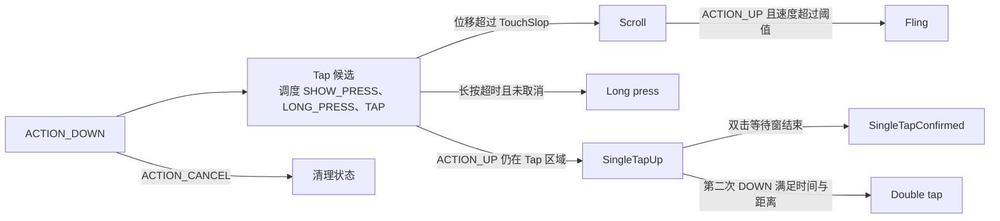

# 手势识别算法与性能优化

手势识别既是状态机问题，也是事件所有权归属问题。动手优化手势体验之前，需要先确认触摸事件序列是否完整、由哪个 View 或识别器持有，再进一步分析速度估算、阈值判定以及自定义识别算法的 CPU 开销。

> 源码基线：AOSP `android-17.0.0_r1`（Android 17，API 37）；内核 `android17-6.18-2026-06_r6`。

## 为什么要了解手势识别算法

“滑动不跟手”或“松手后没有惯性滚动”这类问题未必伴随画面掉帧。很多时候，触摸事件序列早已按时抵达主线程，只是在手势判定阶段产生了歧义：

- 位移还没超过触摸抖动容差 TouchSlop，控件一直把它当作点击候选；
- 父容器过早拦截，子控件收到的是 `ACTION_CANCEL`；
- 速度样本或指针 ID 用错，惯性滑动（Fling）的速度偏小；
- `ACTION_MOVE` 回调里有分配、日志或业务计算，主线程来不及处理下一批输入。

因此，排查手势异常时，需要把问题拆成四个独立环节来回答：事件何时到达、谁拿到了事件、事件被识别成了什么手势，以及识别之后如何驱动滚动。

## VelocityTracker：从采样点得到速度

排查惯性滚动问题时，核心往往在于确认“松手那一刻手指移动有多快”。`VelocityTracker` 负责收集 `MotionEvent` 中的时间戳、坐标与指针 ID，并按需计算出各指针在指定轴上的运动速度；`GestureDetector`、`RecyclerView` 以及各类自定义拖拽控件，都依赖它来决定是否触发 Fling。

### 生命周期与多指语义

下面是单指场景下的标准生命周期示例：从 `ACTION_DOWN` 开始收集样本，直到需要读取速度时才执行一次计算，手势结束后及时回收。其中的 `updateDrag()` 与 `finishGesture()` 为应用自定义回调；若要扩展到多指交互，还需将 `ACTION_POINTER_DOWN` 与 `ACTION_POINTER_UP` 同样喂给同一个 `VelocityTracker`，并持续跟踪当前活跃拖动指针：

```java
private VelocityTracker velocityTracker;

@Override
public boolean onTouchEvent(MotionEvent event) {
    switch (event.getActionMasked()) {
        case MotionEvent.ACTION_DOWN:
            velocityTracker = VelocityTracker.obtain();
            velocityTracker.addMovement(event);
            return true;

        case MotionEvent.ACTION_MOVE:
            velocityTracker.addMovement(event);
            updateDrag(event);
            return true;

        case MotionEvent.ACTION_UP:
            velocityTracker.addMovement(event);
            velocityTracker.computeCurrentVelocity(
                    1000,
                    ViewConfiguration.get(getContext()).getScaledMaximumFlingVelocity());
            int pointerId = event.getPointerId(event.getActionIndex());
            float velocityX = velocityTracker.getXVelocity(pointerId);
            float velocityY = velocityTracker.getYVelocity(pointerId);
            finishGesture(velocityX, velocityY);
            velocityTracker.recycle();
            velocityTracker = null;
            return true;

        case MotionEvent.ACTION_CANCEL:
            velocityTracker.recycle();
            velocityTracker = null;
            return true;
    }
    return false;
}
```

使用上述模式时，有三个细节容易混淆：

1. `addMovement()` 仅负责记录采样点，速度结果需要通过 `computeCurrentVelocity()` 计算生成；因此在 `ACTION_MOVE` 到来时只需收样，把速度计算留到真正需要读取时再触发。
2. `getXVelocity(id)` 与 `getYVelocity(id)` 接收的是指针 ID（同一根手指从按下到抬起或取消期间保持不变），而 `MotionEvent` 中的指针位置索引（index）会随其他手指的落起动态变化，两者不可混用。
3. 单个 `VelocityTracker` 实例本身就支持同时记录多个指针 ID。源码中的对象池容量为 2，仅表示最多缓存两个按默认策略（即框架内置的轴级策略表）创建的实例，多指场景直接使用同一个实例即可。

在 Java 封装层中，默认策略实例由 `Pools.SynchronizedPool<VelocityTracker>(2)` 管理：以默认策略创建的实例在调用 `recycle()` 后会清空状态并放回对象池，显式指定策略的实例则留在池外。业务代码只需确保成对调用 `obtain()` 与 `recycle()`，对象池的命中与复用细节由框架内部自行处理。

### Java、JNI 与原生策略

速度拟合计算实际运行在 `frameworks/native/libs/input/VelocityTracker.cpp` 中，默认轴级策略定义如下：

```cpp
static const std::map<int32_t, VelocityTracker::Strategy>
        DEFAULT_STRATEGY_BY_AXIS = {
            {AMOTION_EVENT_AXIS_X, VelocityTracker::Strategy::LSQ2},
            {AMOTION_EVENT_AXIS_Y, VelocityTracker::Strategy::LSQ2},
            {AMOTION_EVENT_AXIS_SCROLL, VelocityTracker::Strategy::IMPULSE},
        };
```

触摸屏的 X、Y 属于位置轴，默认采用二阶最小二乘拟合（`LSQ2`），通过近期位置与时间样本拟合二次曲线后再求导得到速度；`AXIS_SCROLL` 则属于仅上报变化量的差分轴，默认采用 `IMPULSE`，依据冲量模型从连续差分样本估算速度。此外，`configureStrategy()` 会明确禁止调用方覆盖差分轴的默认策略。

Java 层仍保留着 `obtain(int)` 与 `obtain(String)` 两个隐藏入口，用于系统调试、测试与算法对比。其中 `obtain(String)` 已标记为弃用，源码要求隐藏接口调用方改用 `obtain(int)`；这两个重载均不属于公开 SDK，普通应用应始终调用公开的 `obtain()`。

原生层的样本收集逻辑中，还有几项会影响诊断结果的关键行为：

- `ACTION_DOWN` 会先清空旧状态，再加入 X、Y 样本；
- `ACTION_MOVE` 会遍历历史批次和当前批次，并为每个指针 ID 加入 X、Y；
- 标记为重采样（resampled）的样本会被跳过，避免根据预测坐标再拟合一次速度；
- `ACTION_UP` 和普通 `ACTION_POINTER_UP` 不重复加入抬手位置，以保留末次有效移动的速度；
- 原生层用共享的 `mLastEventTime` 判断停顿：对已有 pointer ID，新移动样本距最近一次移动超过 40 ms 时会清空已配置策略；抬手时也有对应的停顿检查；
- `getComputedVelocity()` 最终按 `units / 1000` 缩放，并限制在 `[-maxVelocity, maxVelocity]`。

从 Android 14（API 34）开始，公开 API 新增了 `isAxisSupported()` 与 `getAxisVelocity()`，将 `AXIS_SCROLL` 纳入公开可查询范围。读取某条轴的速度前应先调用 `isAxisSupported(axis)` 校验支持性——对不支持的轴查询速度会返回 0，排查时需区分“轴不受支持”与“设备静止”。各版本的默认策略演进如下：

| 平台版本 | 默认策略模型 |
|---|---|
| Android 10–11 | 全局默认策略为 `lsq2` |
| Android 12–13 | `Strategy::DEFAULT` 仍映射到全局 `LSQ2` |
| Android 14–17 | 轴级策略表：X、Y 使用 `LSQ2`，`SCROLL` 使用 `IMPULSE` |

套用上述策略表时，必须先核对输入源与轴类型：鼠标滚轮与旋钮产生的 `AXIS_SCROLL` 采用差分冲量模型，与触摸屏 X、Y 轴的计算规则截然不同，不能直接套用触摸屏结论。

<!-- gracker-diagram: ch03-04-velocity-sample-compute-query -->


图：obtain 后 addMovement 收集时间、坐标、pointer ID 与历史样本，原生实现跳过 resampled 点。AOSP17 的 X / Y 默认 LSQ2，SCROLL 差分轴默认 IMPULSE；需要查询时 computeCurrentVelocity 生成结果，再按 pointer ID 读取并在结束时 recycle。数组 index 会变，不能替代 ID。

### 怎样测量 VelocityTracker 的开销

AOSP 并未对 `addMovement()` 或 `computeCurrentVelocity()` 的耗时做出固定承诺，存在对象池也不能推导出整条调用链零分配。CPU 架构、编译优化状态、样本数量、拟合策略乃至调试开关都会左右实际开销，必须依靠实测评估。

在 Perfetto 中，这两个原生调用通常折叠在上层主线程方法区段内。若要评估自定义识别器的计算频率是否过高，可在可控测试构建中用 `Trace.beginSection()` 与 `Trace.endSection()` 包裹待测区间，并同步采集：

- 主线程调度与 `android.view` 轨迹；
- `FrameTimeline` 和应用帧；
- ART 对象分配分析与运行时、GC 轨道，用于确认 Java、Kotlin 分配路径和停顿；若怀疑 JNI 一侧，再单独采集原生内存分配数据；
- 输入事件或自定义埋点中的 `eventTime`、处理开始时间。

`computeCurrentVelocity()` 的源码注释明确提示该函数开销相对较高，建议仅在需要读取速度时调用。常规 Fling 只需在 `ACTION_UP` 时计算一次；如果业务需要在拖拽过程中根据实时速度切换状态，虽然可以在 `ACTION_MOVE` 中调用，但应当限制触发条件，并结合性能轨迹确认它没有演变为高频热点。

## GestureDetector：由事件序列驱动的状态机

`GestureDetector` 内部封装了 `VelocityTracker`、Handler 定时消息以及一组状态标志。每次输入事件到来时，只是将状态机向前推进一步，识别器随后持续判断当前触摸序列还满足哪些候选手势。下面的状态流转图勾勒了点击、滚动、长按、双击与 Fling 的主要分叉：



需要注意，该图仅作阅读源码的索引，部分回调在一次序列中可以先后触发：例如注册双击监听器后，首次抬手仍可能先回调 `onSingleTapUp()`，待双击等待窗口结束后再决定回调 `onDoubleTap()` 还是 `onSingleTapConfirmed()`。

<!-- gracker-diagram: ch03-04-gesture-detector-candidates -->


图：DOWN 建立 Tap 候选并安排 Handler 消息；MOVE 超过阈值可转 Scroll，UP 且速度足够可触发 Fling。Tap 区域内 UP 可立即 onSingleTapUp；双击监听器按时间和距离继续判断 DoubleTap 或 SingleTapConfirmed。长按需定时条件仍有效，CANCEL 会清理所有候选与消息。

### 从 `ACTION_DOWN` 到 `ACTION_CANCEL`：各阶段分别做什么

`GestureDetector.onTouchEvent()` 在进入 `switch` 分支之前，就已经将当前事件喂给了内部的 `VelocityTracker`。各阶段的核心动作如下：

- `ACTION_DOWN`：保存按下事件和焦点坐标，进入点击候选区域，安排 `SHOW_PRESS`、`LONG_PRESS` 和双击确认相关消息，并调用 `onDown()`。
- `ACTION_MOVE`：以多指焦点的位移与 TouchSlop 比较。越界后取消点击和长按候选并调用 `onScroll()`；后续移动只要焦点变化至少 1 像素即可继续产生 `onScroll()` 回调。
- `ACTION_POINTER_UP`：计算各指针的速度。如果离开的指针与剩余指针速度向量点积为负，会清空 `VelocityTracker`，避免相反方向的多指运动生成错误 Fling。
- `ACTION_UP`：按双击、长按、单击候选、Fling 的优先顺序收尾；Fling 分支会计算速度并与最小速度阈值比较。
- `ACTION_CANCEL`：取消消息、回收 `VelocityTracker`，并清理识别状态。`cancel()` 保留已保存的 `MotionEvent` 副本，这些副本在后续事件替换时回收。

其中 `onDown()` 的返回值十分关键：控件通常必须从 `ACTION_DOWN` 开始就返回 `true` 接管整串触摸序列；如果拖到 `ACTION_MOVE` 才开始返回 `true`，后续事件往往已无法再分发到该识别器。

### 双击：立即抬手与延迟确认

注册 `OnDoubleTapListener` 后，需要理清三组回调的触发时机：

- `onSingleTapUp()`：第一次点击在点击候选区域内抬手时立即调用，适合即时视觉反馈；
- `onSingleTapConfirmed()`：首次 `ACTION_DOWN` 安排的 `TAP` 确认消息到期、没有形成双击且手指已抬起时调用；消息到期时仍按下，则延至后续合格的 `ACTION_UP` 再确认；
- `onDoubleTap()`、`onDoubleTapEvent()`：第二次 `ACTION_DOWN` 被识别为双击后调用，后者还会收到这次点击的后续事件。

判定是否构成双击的 `isConsideredDoubleTap()` 会同时校验三项条件：

1. 第一次点击是否一直处于 `doubleTapTouchSlop` 容差区；Android 17 中这个阈值与 TouchSlop 相同，区别于两次按下位置之间的 `doubleTapSlop`；
2. 第二次 `ACTION_DOWN` 与第一次 `ACTION_UP` 的间隔是否落在 `doubleTapMinTime` 到 `doubleTapTimeout` 之间；
3. 两次 `ACTION_DOWN` 的距离平方是否小于 `doubleTapSlopSquare`。

框架默认后备值中，`doubleTapMinTime` 为 40 ms，`doubleTapTimeout` 为 300 ms。在 Android 17 中，只要 `GestureDetector` 持有带 `Context` 构造的配置实例且 `viewconfigurationApis` 标志开启，就会读取实例的资源配置，否则沿用静态配置方法。因此，业务代码应直接委托 `GestureDetector` 判定双击，避免自行硬编码这组常量。

### 长按：默认 400 ms，运行时可调整

`ViewConfiguration.DEFAULT_LONG_PRESS_TIMEOUT` 的默认值为 400 ms。长按定时消息的调度时刻为“本次按下时间加上运行时长按阈值”：

```java
mHandler.sendMessageAtTime(
        longPressMessage,
        mCurrentDownEvent.getDownTime() + getLongPressTimeoutMillis());
```

其中 `ViewConfiguration.getLongPressTimeout()` 读取 `Settings.Secure.LONG_PRESS_TIMEOUT`。Android 17 源码中的实例方法 `getLongPressTimeoutMillis()` 带有 `@FlaggedApi` 标记，`GestureDetector` 仅在持有带 `Context` 构造的 `ViewConfiguration` 且 `viewconfigurationApis` 标志开启时才会调用它，否则仍回退至静态方法。400 ms 仅是平台默认值，用户或设备的运行时设置可以修改这一长按阈值。

一旦触摸位移越过 TouchSlop、进入滚动状态，或者收到额外的 `ACTION_POINTER_DOWN` 或 `ACTION_CANCEL`，长按候选都会被取消。

同时，平台还会结合输入分类结果调整长按行为：若收到 `MotionEvent.CLASSIFICATION_AMBIGUOUS_GESTURE` 且当前仍处于长按候选中，系统会按配置倍率放大 TouchSlop 并延后长按触发；若收到 `CLASSIFICATION_DEEP_PRESS`，则可立即触发长按。由于这些分类信息来自底层输入链路，应用若再根据压力值自建一套平行判定规则，极易与系统行为发生冲突。

最后需要留意，长按等待本身并不消耗主线程 CPU；长按场景的性能卡顿几乎都出现在 `onLongPress()` 回调内部——例如同步解码资源、磁盘读取或构建复杂弹窗，给回调加上应用侧跟踪区段即可直观定位其执行耗时。

## View 手势冲突：先确认事件流属于谁

同一串触摸事件既可能由子控件消费，也可能中途被父容器接管。下面沿着分发路径厘清事件流的所有权归属，再决定冲突应当在哪一层解决。

### `ACTION_DOWN` 命中目标，后续事件沿目标链分发

`ViewGroup.dispatchTouchEvent()` 在 `ACTION_DOWN` 到来时会清理上一轮手势状态，并为本次触摸寻找目标子 View，命中的子 View 记录在 `TouchTarget` 中。随后的 `ACTION_MOVE` 与 `ACTION_UP` 通常直接沿这条既定目标链分发，无需每次重新遍历整棵 View 树执行命中测试。

不过，父 `ViewGroup` 在后续事件到来时仍有权调用 `onInterceptTouchEvent()`：一旦拦截状态从“放行”翻转为“拦截”，原目标子 View 会收到 `ACTION_CANCEL`，此后序列交由父容器处理。因此，诊断手势冲突时必须把同一手势的 `ACTION_DOWN → ACTION_MOVE → ACTION_CANCEL/ACTION_UP` 连贯起来观察，仅凭单个 `ACTION_MOVE` 很容易产生误判。

<!-- gracker-diagram: ch03-04-view-touch-ownership -->


图：DOWN 时父容器检查候选并建立接受事件的子 TouchTarget。后续 MOVE / UP 通常沿已有目标链走；父级若决定拦截，原子目标收到 CANCEL，后续流转给父容器。requestDisallowInterceptTouchEvent 约束祖先 View 的拦截，不能阻止系统导航或窗口级取消。

### 横向父容器与纵向子容器

当横向父容器嵌套纵向子容器时，平台并未规定固定的仲裁顺序，最终谁胜出取决于父容器的 `onInterceptTouchEvent()` 实现、子控件的消费状态以及嵌套滑动协议。横向父容器的一种典型实现方式，是在 `ACTION_DOWN` 时记录起始坐标，待总位移超过阈值且水平分量占优时才实施拦截：

```java
private float initialX;
private float initialY;
private boolean draggingHorizontally;
private final int touchSlop =
        ViewConfiguration.get(getContext()).getScaledTouchSlop();

@Override
public boolean onInterceptTouchEvent(MotionEvent event) {
    switch (event.getActionMasked()) {
        case MotionEvent.ACTION_DOWN:
            initialX = event.getX();
            initialY = event.getY();
            draggingHorizontally = false;
            return false;

        case MotionEvent.ACTION_MOVE:
            float dx = Math.abs(event.getX() - initialX);
            float dy = Math.abs(event.getY() - initialY);
            if (dx > touchSlop && dx > dy) {
                draggingHorizontally = true;
                return true;
            }
            return false;

        case MotionEvent.ACTION_UP:
        case MotionEvent.ACTION_CANCEL:
            draggingHorizontally = false;
            return false;
    }
    return draggingHorizontally;
}
```

这段骨架代码仍需按实际产品语义补全多指切换、从右到左布局（RTL）、临界角度滞回（防止在 45 度附近频繁切换）以及子控件当前是否可继续滚动等判断。一旦父容器决定拦截，就必须承接好后续到达的事件；子控件收到 `ACTION_CANCEL` 后也应及时清理自身手势状态。

### requestDisallowInterceptTouchEvent 的用法与限制

子 View 可以调用以下方法阻止祖先拦截：

```java
parent.requestDisallowInterceptTouchEvent(true);
```

`ViewGroup` 收到请求后会设置 `FLAG_DISALLOW_INTERCEPT`，并将该请求逐级向上传递给祖先容器。只要标志保持有效，祖先容器便会跳过 `onInterceptTouchEvent()`；直到新一轮 `ACTION_DOWN` 到来、手势结束或取消时，`resetTouchState()` 才会清除该标志。

使用这一接口时需留意三个边界条件：

- 它只约束祖先 View 的拦截，系统导航手势、窗口级输入策略和应用外的输入消费者都不受它影响；
- 事件分发路径照旧要走完，横纵方向的判断也要自己解决；
- 调用时机上，只在手势所有权变化时调用一次即可：状态没有变化时 `ViewGroup` 会提前返回，每个 `ACTION_MOVE` 都无条件调一遍并无实际收益；需要交还父容器时传入 `false`。

### Nested Scrolling：按消费距离协作

嵌套滑动机制使子容器与祖先容器能够围绕滚动距离精细分工，一轮标准交互顺序如下：

1. 手势开始时，子 View 通过 `startNestedScroll(axes, type)` 寻找愿意参与的父级；
2. 子 View 消费前调用 `dispatchNestedPreScroll()`，父级先取走一部分距离；
3. 子 View 消费剩余距离；
4. 子 View 用 `dispatchNestedScroll()` 报告已消费和未消费距离，父级还可以处理余量；
5. 手势或惯性滚动结束时调用 `stopNestedScroll(type)`。

下面的代码展示了父容器预消费之后，子容器如何消费余量并继续上报未消费距离：

```java
int[] parentConsumed = new int[2];
if (dispatchNestedPreScroll(dx, dy, parentConsumed, null, type)) {
    dx -= parentConsumed[0];
    dy -= parentConsumed[1];
}

int consumedY = scrollSelfBy(dy);
int unconsumedY = dy - consumedY;
dispatchNestedScroll(
        0, consumedY,
        0, unconsumedY,
        null, type);
```

该示例仅演示距离的分配逻辑；实际生产代码通常会复用数组以减少分配，并处理窗口偏移量、滚动轴、触摸与非触摸类型以及相应的父级协作接口。

至于嵌套回调本身是否构成了性能问题，还需在系统跟踪中证实确实有某个父级回调或由此触发的反复布局、绘制占用了过多主线程时间。

<!-- gracker-diagram: ch03-04-nested-scroll-distance -->


图：先 startNestedScroll 找到参与父级；每轮子级消费前，父级通过 pre-scroll 消费一部分 Δy。子级滚动剩余距离，再把自身已消费和未消费余量交给 post-scroll；结束时 stopNestedScroll。示意中的距离是同一坐标和单位下的分配，实际实现还需处理窗口偏移与 TOUCH / NON_TOUCH 类型。

## TouchSlop 与 Fling 阈值

TouchSlop 决定了拖动何时算作正式开始，Fling 速度阈值则决定了松手后何时触发惯性滚动。下面先看这两个阈值的来源，再梳理取值与计算时需要注意的单位边界。

### TouchSlop 从哪里来

`ViewConfiguration` 中保留着 `TOUCH_SLOP = 8`，源码注释明确指出它仅用于缺乏合适 `Context` 的旧代码兜底；现代应用应通过以下方法获取运行时阈值：

```java
int touchSlop =
        ViewConfiguration.get(context).getScaledTouchSlop();
```

该方法直接返回像素值：在构造 `ViewConfiguration` 时，框架会读取 `config_viewConfigurationTouchSlop` 资源定义的像素尺寸，设备厂商也可以通过资源覆盖（overlay）对其进行校准。

| 层次 | Android 17 中的含义 |
|---|---|
| `TOUCH_SLOP = 8` | 已弃用静态 API 使用的 dp 后备值 |
| `config_viewConfigurationTouchSlop` | 框架默认资源，可被设备资源覆盖 |
| `getScaledTouchSlop()` | 按当前 `Context` 和配置得到的像素值 |

TouchSlop 设得过大会让拖动启动显得迟钝，设得过小则容易把手指轻微抖动误判为拖动。编写自定义控件时，还需区分“从 `ACTION_DOWN` 起算的累计位移”与“相邻两个 `ACTION_MOVE` 之间的步进增量”：判定拖动起点通常看前者，若误用后者，单步增量往往太小而始终跨不过阈值。

### Fling 的最小与最大速度阈值

Fling 速度阈值遵循同一套配置结构：旧版后备常量依然为 50 dp/s 与 8000 dp/s，而带 `Context` 的运行时阈值则源自 `config_viewMinFlingVelocity` 和 `config_viewMaxFlingVelocity`，`getScaledMinimumFlingVelocity()` 与 `getScaledMaximumFlingVelocity()` 返回的单位均为像素每秒。

调用时应确保速度计算与阈值查询的单位保持一致：

```java
ViewConfiguration configuration = ViewConfiguration.get(context);
velocityTracker.computeCurrentVelocity(
        1000,
        configuration.getScaledMaximumFlingVelocity());

float velocityY = velocityTracker.getYVelocity(pointerId);
if (Math.abs(velocityY)
        >= configuration.getScaledMinimumFlingVelocity()) {
    startFling(velocityY);
}
```

Android 14 还新增了携带 `inputDeviceId`、`axis` 与 `source` 参数的最小和最大 Fling 速度 API；当输入设备与轴的组合无效时，最小值返回 `Integer.MAX_VALUE`，最大值返回 `Integer.MIN_VALUE`，表明该组合不支持 Fling。

如果处理的是滚轮或旋钮的 `AXIS_SCROLL`，还必须先将差分轴值换算为像素每秒，再与对应阈值比较；不能把触摸屏 X、Y 轴的判定代码原封不动搬到滚轮和旋钮上。

<!-- gracker-diagram: ch03-04-runtime-thresholds-and-units -->


图：TouchSlop 用带 Context 的 ViewConfiguration 读取像素阈值，通常比较从 DOWN 起的累计位移。Fling 用 computeCurrentVelocity(1000, max) 得到每秒速度，再与运行时最小速度比较。SCROLL 差分轴还要经过设备滚动因子换算，并用设备、轴、source 对应的能力与阈值。

## 自定义识别器的性能与正确性陷阱

自主编写手势识别器虽然拿回了判定逻辑的控制权，但也更容易踩中常见的性能与状态机陷阱。下面从对象分配、单步计算量以及 View 层级影响三个维度展开排查。

### 在 `ACTION_MOVE` 中制造短命对象

如下写法会在每次收到 `ACTION_MOVE` 时新建一个 `PointF` 对象：

```java
case MotionEvent.ACTION_MOVE:
    PointF delta = new PointF(
            event.getX() - lastX,
            event.getY() - lastY);
    updateDrag(delta);
    break;
```

在高频触控回调中，可以直接传递局部 `float` 标量，或复用确有必要的容器对象：

```java
case MotionEvent.ACTION_MOVE:
    float dx = event.getX() - lastX;
    float dy = event.getY() - lastY;
    updateDrag(dx, dy);
    lastX = event.getX();
    lastY = event.getY();
    break;
```

优化前建议先取证：借助对象分配分析或运行时轨迹确认分配次数与停顿情况后再决定改造幅度，仅凭代码写法断言其必定触发 GC 停顿并不可靠。

### 把识别工作塞进每个 `ACTION_MOVE`

高频移动回调中常见的性能热点包括同步写日志、复杂几何计算、遍历业务列表、频繁调用 `computeCurrentVelocity()` 以及在输入回调内触发布局。优化的核心思路是剥离无效计算：

- 未超过 TouchSlop 前，只维护识别所需的少量状态；
- 手势方向确定后，避免每帧重新执行同一套昂贵判定；
- 速度只在决策需要时计算；
- 可合并的视觉状态交给下一帧更新，不在输入回调里反复请求布局；
- 慢操作移出主线程，但触摸状态本身仍要按顺序在 UI 线程更新。

同时留意，输入设备常会把多个采样点批处理进同一个 `MotionEvent` 的历史记录（history）中。若业务需要高保真轨迹，应一并读取历史样本，仅取当前坐标会漏掉中间点；此外，即便需要平滑或补点，也不应将自行插值出的坐标喂给 `VelocityTracker`。

### View 层级到底影响什么

View 树的层级与节点数量主要影响 `ACTION_DOWN` 到来时的命中测试，以及父子容器间分发、拦截与回调的调用深度；随后的移动与抬手事件通常会复用已确立的 `TouchTarget`。因此，视图层级本身并不直接等同于输入延迟，后续 `MOVE` 也无需重新遍历整棵树。

优化手势卡顿前，应当在性能跟踪中锁定具体的耗时函数：

- `onInterceptTouchEvent()` 或 `onTouchEvent()` 中的业务代码；
- 手势回调触发的 `requestLayout()`、同步加载布局（inflate）或数据绑定；
- 嵌套滑动父级的预消费和余量处理；
- `ACTION_CANCEL` 后双方重复启动、停止动画。

精简无意义的嵌套容器对于优化布局与绘制结构仍有价值，而手势响应卡顿仍需针对跟踪中暴露出的具体慢函数进行整治。

## 厂商触控增强：先定位发生在哪一层

边缘抑制、手掌识别、湿手触控以及游戏触控调优等增强特性，可能分布在触控 IC 固件、内核驱动、`InputReader` 配置、系统服务或应用组件之中。由于 AOSP 并未对边缘宽度、游戏 TouchSlop 或报点频率作出统一规范，单一设备上的实测结果仅代表该设备实现，不能外推为 Android 平台通用行为。

定位增强或异常来自哪一层时，可以依据以下证据逐步收窄范围：

1. 同一设备上，所有应用都出现相同的原始坐标缺口，优先检查固件、驱动和设备配置；
2. `getevent` 已出现样本，但框架或应用没有收到，检查 InputReader、窗口路由和输入消费者；
3. 应用收到连续 `MotionEvent`，只有某个控件改变了轨迹或阈值，检查控件识别器；
4. 只在系统导航边缘发生冲突，结合第 3.3、3.4 节检查系统手势与监控通道。

通用内核基线仅界定了输入子系统的公共版本范围；在缺乏目标设备的驱动、固件及资源覆盖源码时，不宜对厂商私有算法细节作进一步推论。

## Compose：命中链、三阶段传播与消费

在 Android 平台上，Compose 依然依托宿主 View 接收系统的 `MotionEvent`，再将其适配为 `PointerEvent` 与 `PointerInputChange`，并通过 `Modifier.pointerInput()` 中的挂起函数组织手势识别：

```kotlin
Modifier.pointerInput(Unit) {
    detectDragGestures { change, dragAmount ->
        change.consume()
        updateOffset(dragAmount)
    }
}
```

选用手势 API 时建议由高层向底层递进：优先采用 `clickable`、`scrollable`、`draggable`、`transformable` 等高层修饰符（modifier），并留意各修饰符的能力边界——例如 `clickable` 除点击检测外，还集成了语义、视觉反馈、悬停、焦点与键盘支持，但这并不代表所有手势修饰符都具备同等的附加能力。只有当现成识别器无法满足交互需求时，再下沉使用 `awaitEachGesture`、`awaitFirstDown`、`awaitTouchSlopOrCancellation` 等底层挂起原语。

针对按下后的指针序列，Compose 会在新指针的首个事件到来时执行命中测试，构建出可接收指针输入的节点链，同一指针的后续事件则沿该链传播；鼠标或触控笔的悬停事件属于例外，它们会随当前位置实时重新命中，指针跨过边界时接收节点也随之切换。沿命中链分发时，每个事件依次经历三个传播阶段（pass）：

| 传播阶段 | 方向 | 常见用途 |
|---|---|---|
| `Initial` | 父到子 | 父级预先观察或拦截式处理 |
| `Main` | 子到父 | 默认阶段，子节点通常先消费 |
| `Final` | 父到子 | 根据前面阶段的消费结果收尾 |

调用 `consume()` 只是在当前 `PointerInputChange` 上设置已消费标记，事件仍会继续沿传播链走完，其他处理器需要自行检查 `isConsumed` 后决定是否退出。这与 View 体系中“父容器拦截后向子 View 派发 `ACTION_CANCEL`”属于两套不同的语义，从 View 迁移手势代码时需避免直接照搬。

<!-- gracker-diagram: ch03-04-compose-three-passes -->


图：按下序列的首个指针事件建立命中链，同一指针后续事件通常复用它；悬停事件按当前位置命中。每个事件按 Initial 父到子、Main 子到父、Final 父到子传播；consume 不会自动阻断传播，其他处理器要检查 isConsumed。clickable 等高层 API 按各自职责提供焦点、语义、无障碍或视觉反馈，所需交互无法由现成 API 表达时再自行写 pointerInput。

虽然平台 `MotionEvent` 需要先适配为 Compose 内部结构，但这一层转换本身未必是性能瓶颈；分析 Compose 手势卡顿时，重点仍在于核查指针处理器的执行耗时、状态写入引发的重组、布局与绘制开销以及 FrameTimeline 表现。

## 排查清单

遇到滑动、双击或 Fling 异常时，可以按以下顺序系统收集排查证据：

1. 记录完整的动作类型、指针 ID 与索引、`downTime`、`eventTime`、坐标、事件来源和轴；
2. 确认序列最终是 `ACTION_UP` 还是 `ACTION_CANCEL`，以及哪个父容器改变了拦截决定；
3. 打印运行时 `scaledTouchSlop`、最小和最大 Fling 速度，不用源码后备值替代设备值；
4. 核对 `VelocityTracker` 是否从 `ACTION_DOWN` 开始收样、是否在查询速度前调用 `computeCurrentVelocity()`、是否按指针 ID 取值；
5. 用自定义轨迹区段标出回调，确认耗时来自识别、业务处理还是识别后的布局与绘制；
6. 跨设备差异要同时保存设备资源覆盖、输入设备信息和复现轨迹，再讨论厂商调校。

## 源码与文档

- AOSP `android-17.0.0_r1`：[VelocityTracker.java](https://cs.android.com/android/platform/superproject/+/android-17.0.0_r1:frameworks/base/core/java/android/view/VelocityTracker.java)
- AOSP `android-17.0.0_r1`：[MotionEvent.java](https://cs.android.com/android/platform/superproject/+/android-17.0.0_r1:frameworks/base/core/java/android/view/MotionEvent.java)
- AOSP `android-17.0.0_r1`：[VelocityTracker.cpp](https://cs.android.com/android/platform/superproject/+/android-17.0.0_r1:frameworks/native/libs/input/VelocityTracker.cpp)
- AOSP `android-17.0.0_r1`：[GestureDetector.java](https://cs.android.com/android/platform/superproject/+/android-17.0.0_r1:frameworks/base/core/java/android/view/GestureDetector.java)
- AOSP `android-17.0.0_r1`：[ViewConfiguration.java](https://cs.android.com/android/platform/superproject/+/android-17.0.0_r1:frameworks/base/core/java/android/view/ViewConfiguration.java)
- AOSP `android-17.0.0_r1`：[ViewGroup.java](https://cs.android.com/android/platform/superproject/+/android-17.0.0_r1:frameworks/base/core/java/android/view/ViewGroup.java)
- Android common kernel `android17-6.18-2026-06_r6`：[tag tree](https://android.googlesource.com/kernel/common/+/refs/tags/android17-6.18-2026-06_r6/)
- Android Developers：[ViewConfiguration API reference](https://developer.android.com/reference/android/view/ViewConfiguration)
- Android Developers：[Understand gestures in Compose](https://developer.android.com/develop/ui/compose/touch-input/pointer-input/understand-gestures)
- Perfetto：[Profiling memory usage and allocations](https://perfetto.dev/docs/quickstart/heap-profiling)
