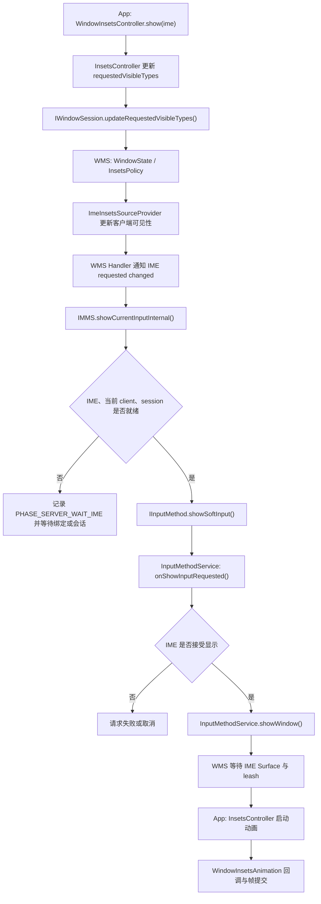

# InputMethodManager 与软键盘性能

软键盘的弹出横跨应用、`system_server` 与输入法（IME）三个进程，而且动画启动前还需等待输入法窗口具备可参与合成的 Surface 图层。因此，应用侧调用 `showSoftInput()` 本身的耗时几乎不涵盖用户实际等待的时间；如果只盯着应用主线程，很容易漏掉输入法冷启动、会话建立以及窗口控制权交接等耗时环节。

下文基于 Android 17（API 37，源码基线 `android-17.0.0_r1`）展开分析，重点拆解以下四个边界：

1. 显示请求从应用到达 IME 的路径；
2. `startInput`、IME 绑定和窗口显示的独立状态；
3. 应用布局与 `WindowInsetsAnimation` 各在哪个环节影响帧时间；
4. ImeTracker、`dumpsys input_method` 和 Perfetto 各自能定位哪些等待阶段。

此外，文中所说的“冷”“热”均用来区分连接与会话状态，并非预设固定时延。IME 实现、设备硬件性能、进程驻留状况、词库初始化以及当前系统负载都会显著改变结果，具体的性能结论应建立在同一设备、同一构建和同一输入法下的分位数统计之上。

## 1. 先分清三件事

### 1.1 输入连接、显示请求与屏幕可见是三个事件

当一个可编辑 View 同时获得 View 焦点与窗口焦点后，`InputMethodManager` 才会将其登记为当前服务目标（served view，即当前允许与输入法建立连接的 View），并为其新建或重启输入连接。输入法侧的生命周期回调正与这一过程相对应：

- `onStartInput(EditorInfo, restarting)`：新的编辑器开始输入，或现有输入连接被重启；
- `onStartInputView(EditorInfo, restarting)`：当前输入视图将显示，并准备接收该编辑器的输入；
- `onFinishInputView(finishingInput)`：当前输入视图结束；
- `onFinishInput()`：当前输入会话结束。

`showSoftInput()` 仅仅表达“希望显示当前 IME”。在输入连接已经建立的前提下，重新唤起暂时隐藏的 IME 可以直接进入 `onShowInputRequested()` 与 `showWindow()`，无需再次触发 `onStartInput()`。排查重复初始化问题时，应先核对初始化逻辑究竟挂载在哪个生命周期回调中。

<!-- gracker-diagram: ch03-05-connection-request-presentation -->


图：输入连接对应编辑器与 IME 的输入会话；显隐 API 表达显示意愿；最终 Insets 可见状态和目标显示帧还需分别确认。已有输入连接可以重复隐藏与显示，未必再次触发 onStartInput，初始化和显示耗时不能混算。

### 1.2 API 返回值只说明请求有没有被接纳

在 Android 17 中，调用 `InputMethodManager.showSoftInput(view, flags)` 需要满足以下前提：

- `view` 是当前服务目标；
- `view` 自身有焦点；
- 它所在的窗口也有焦点；
- 当前没有需要保留控制权的用户驱动 IME 动画；预测返回正在隐藏 IME 时属于例外。

该方法返回 `true` 仅意味着显示请求已被系统接纳并进入后续处理流程，并不代表输入法已经显示到屏幕上。由于回调同样难以可靠反映屏幕上的最终状态，带 `ResultReceiver` 的重载已在 API 36 弃用；对于目标版本为 API 36 及以上的应用，`hideSoftInputFromWindow()` 还存在兼容语义——即便最终可见性未发生改变，也可能返回 `true`。

实际上，系统窗口占用的区域与可见状态均通过 `WindowInsets` 表达，判断软键盘最终是否显示或隐藏，应以 `WindowInsets.Type.ime()` 的可见性为准。

另外，自 Android 16 起，`SHOW_IMPLICIT`、`SHOW_FORCED`、`HIDE_IMPLICIT_ONLY` 和 `HIDE_NOT_ALWAYS` 已不再影响平台处理逻辑。在 Android 17 中调用相关接口时应传入 `0`，或直接使用 `WindowInsetsController.show()` 与 `hide()`。

### 1.3 “动画开始”仍早于“用户看到完整键盘”

应用侧收到 IME 的 `WindowInsetsAnimation.Callback.onStart()` 时，表明客户端已经进入动画起始回调阶段。在正常下发 IME leash 的路径中，WMS 已经要求输入法窗口满足 `isDrawn()`、Insets 数据就绪且服务端可见，因此这一回调未必总是发生在首个 buffer 提交之前。但即便绘制就绪，也不代表目标 Display 已经完成 `present`，更不说明完整键盘已经呈现在用户眼前。测量时应当根据观测目的选择对应终点：

| 目标 | 建议终点 | 能回答的问题 |
|---|---|---|
| API 行为正确 | `WindowInsets.isVisible(Type.ime())` | 最终 Insets 状态是否可见 |
| 请求停在哪一层 | ImeTracker 的最终阶段（phase） | 客户端、服务端、IME 或窗口控制阶段是否等待 |
| 应用过渡是否流畅 | 应用 FrameTimeline 与主线程轨迹区段 | 应用是否错过帧截止时间 |
| IME 自身是否流畅 | IME 进程 FrameTimeline 与 RenderThread | 输入法窗口是否掉帧 |
| 用户端到端感知 | 屏幕录制或高速摄像 | 从操作到可见像素的总时间 |

## 2. Android 17 的显示主链路

在 Android 17 中，应用侧的软键盘显隐请求以 Insets 为主线；即便调用 `showSoftInput()`，在完成当前服务目标校验后，也会转交至当前 `ViewRootImpl` 的 `InsetsController`。下文将 WindowManagerService 简称为 WMS，将 InputMethodManagerService 简称为 IMMS。下面的流程图展示了请求进入 WMS、等待输入法就绪以及获取动画控制权的关键分界点：



图中的 leash 是 WMS 下发的 `SurfaceControl` 动画控制柄，应用借助它来变换输入法窗口图层，但并不会直接拿到输入法窗口的 `Surface`。

沿着这条主链路，有三个关键边界在排查时容易被忽略：

第一，`InsetsController` 通过 `IWindowSession.updateRequestedVisibleTypes()` 将期望可见的 Insets 类型上报给 WMS；WMS 更新目标窗口状态后，再由 `ImeInsetsSourceProvider` 将输入法可见性请求变化通知给 IMMS。若将这条现代路径简化为“应用直接通过 Binder 调用 IMMS”，便会漏掉 WMS 中间承担的状态机协调。

第二，IMMS 的 `showCurrentInputLocked()` 仅当以下三个对象同时就绪时，才会向输入法发出显示调用：

- `InputMethodBindingController.getCurIme()` 非空；
- 当前客户端非空；
- 当前客户端的 `mCurSession` 非空。

只要其中任一条件不满足，`ImeTracker` 就会进入 `PHASE_SERVER_WAIT_IME` 并暂存请求令牌（token），直到服务绑定或输入会话建立后再继续；条件齐备后进入 `PHASE_SERVER_HAS_IME`，随后通过 `performShowIme()` 调用 `IInputMethodInvoker.showSoftInput()`。

第三，输入法接受显示并执行 `showWindow()` 之后，应用侧也未必立刻开始播放动画。WMS 的 `ImeInsetsSourceProvider` 仍需等待输入法 Surface 完成绘制、Insets 几何信息就绪，且能够将带 leash 的控制权下发给目标窗口。如果客户端已收到控制对象但其中尚未包含 leash，`InsetsSourceConsumer.applyLocalVisibilityOverride()` 会将输入法 Insets 源临时覆写为不可见；若控制对象尚未到达，该方法则直接返回，不会覆盖服务端下发的可见性；一旦控制权被收回，`setControl()` 会恢复服务端最近一次下发的可见性。因此排查动画未启动时，需要分别核对控制对象、leash 与 Insets 可见状态，仅凭缺少控制权并不能判定 IME 不可见。

另外，Android 17 源码中已不存在独立的 `ImeInsetsSourceConsumer.java`，相关输入法分支已经合并进通用的 `InsetsSourceConsumer` 与 `InsetsController` 中，早期资料中的旧类名不再对应 `android-17.0.0_r1` 的实现。

<!-- gracker-diagram: ch03-05-show-through-wms-and-leash -->


图：应用 InsetsController 上报 requestedVisibleTypes，WMS / ImeInsetsSourceProvider 把 IME 请求变化通知 IMMS。IME 接口、当前 client、session 齐备后才向输入法发 show；输入法接受并 showWindow 后，还需满足窗口绘制、Insets 与 leash 条件，应用才取得控制对象并推进动画。

## 3. 冷启动、绑定和会话等待

### 3.1 用状态划分冷热路径

脱离运行环境的“冷启动 300 ms”这类数字缺乏可比性，归因前应先记录请求发起时系统所处的状态：

| 状态 | Android 17 证据 | 后续工作 |
|---|---|---|
| 显示热路径 | `mCurIme`、当前客户端、`mCurSession` 均存在 | IMMS 可直接向输入法发送显示请求 |
| 服务已连接、会话未就绪 | `mCurIme` 存在，`mCurSession` 为空 | 等待会话创建和客户端绑定 |
| 正在绑定 | `mMainConnection` 存在，`mCurIme` 为空 | 等待 `onServiceConnected()`、输入法初始化和会话创建 |
| 未绑定 | `mCurToken`、`mMainConnection` 为空 | 绑定服务，必要时启动输入法进程 |
| 绑定疑似卡住 | 绑定已发出但长时间没有 `mCurIme` | Android 17 在 3 秒阈值后重连主连接 |

其中的 `TIME_TO_RECONNECT_MS = 3000` 是框架判定“绑定长时间未能连上”的恢复阈值，不应视作正常冷启动的性能预算；统计性能报表时，应将触发重连的样本单独列为异常。

### 3.2 可见绑定会提高 IME 的进程重要性

`InputMethodBindingController` 通过多组服务绑定连接管理输入法进程生命周期：

- 主连接（main connection）负责维持输入法接口；具体绑定标志受 `lowerImeOomImportance` 开关影响；
- 可见连接（visible connection）在输入法要显示时增加，包含 `BIND_TREAT_LIKE_ACTIVITY`、`BIND_FOREGROUND_SERVICE`、`BIND_INCLUDE_CAPABILITIES` 和 `BIND_SHOWING_UI`；
- Android 17 还为特定多用户和工作资料场景准备后台连接（background connection）。

这套连接机制区分了“服务已绑定”与“界面正在显示”两种不同的进程重要性等级，但它并不能推导出统一的冷热启动耗时，也无法保证特定输入法必然常驻内存。进程是否存活、资源是否已加载、会话能否直接复用，都需要结合现场状态判定。

<!-- gracker-diagram: ch03-05-binding-readiness-states -->


图：未取得接口可能要等进程与服务绑定；接口已连接但会话为空，还要等 session；接口、client 与 session 都在才具备热显示请求条件。main connection 维持服务接口，visible connection 表达正在显示所需的重要性，不能从某一个绑定字段推导输入法必然常驻或固定耗时。

### 3.3 启动抑制配置不代表隔离进程

AOSP `android-17.0.0_r1` 中提供了以下布尔资源，用于控制“当非文本编辑器获得焦点时是否抑制输入法启动”，其默认值为 `false`：

```xml
<bool name="config_preventImeStartupUnlessTextEditor">false</bool>
```

设备厂商可以通过资源覆盖（OEM overlay）将其设为 `true`。开启后，IMMS 可以在当前焦点未落在文本编辑器上时避免拉起输入法，同时为配置清单中的特定输入法或应用保留例外。这一开关控制的仅仅是“何时触发输入法启动”，与输入法本身是否运行在隔离进程（isolated process）并无直接关联。

绑定状态还会间接影响其他子系统的输入调度。例如，当输入法尚未连接时，`AutofillSuggestionsController` 会暂存行内建议（inline suggestions）请求，待主连接的 `onServiceConnected()` 回调后再继续处理。源码能够确认该请求会被延后调度，至于这一行为究竟减少了多少次冷启动或节省了多少毫秒，仍需在目标设备上实测评估。

## 4. 应用侧如何可靠显示和确认 IME

在 Activity 刚创建时，View 焦点与窗口焦点可能尚未同时成立。下面这段 AndroidX 写法会将显示请求交给窗口对应的 Insets 控制器：

```kotlin
editText.requestFocus()
WindowCompat.getInsetsController(window, editText)
    .show(WindowInsetsCompat.Type.ime())
```

该调用负责发起显示请求；若业务逻辑依赖键盘的最终呈现状态，还应监听窗口 Insets 变化：

```kotlin
ViewCompat.setOnApplyWindowInsetsListener(root) { _, insets ->
    val imeVisible = insets.isVisible(WindowInsetsCompat.Type.ime())
    val imeBottom = insets.getInsets(WindowInsetsCompat.Type.ime()).bottom

    renderImeState(visible = imeVisible, bottomInset = imeBottom)
    insets
}
```

由于该监听器在布局调整与动画执行期间可能被多次回调，`renderImeState()` 内部应先比对新旧状态，避免相同数值重复触发数据刷新、页面导航或布局参数修改。

如果业务必须直接调用 `InputMethodManager`，则应确保在窗口获得焦点后再投递请求：

```kotlin
override fun onWindowFocusChanged(hasWindowFocus: Boolean) {
    super.onWindowFocusChanged(hasWindowFocus)
    if (!hasWindowFocus) return

    editText.requestFocus()
    editText.post {
        getSystemService(InputMethodManager::class.java)
            .showSoftInput(editText, 0)
    }
}
```

这里使用 `post` 是为了将调用排入 View 所在线程的消息队列，让当前服务目标状态有机会先完成同步；即便如此，请求真正执行时仍须满足窗口与 View 同时持有焦点的条件。

## 5. Insets 动画与帧时间

### 5.1 回调在哪个帧阶段执行

`ViewRootInsetsControllerHost.postInsetsAnimationCallback()` 会将任务投递至 `Choreographer.CALLBACK_INSETS_ANIMATION` 阶段。注册 `WindowInsetsAnimation.Callback` 后，应用会依次收到以下回调：

- `onPrepare()`：布局切到结束状态前保存起始几何信息；
- `onStart()`：Insets 已应用，可记录结束几何信息；
- `onProgress()`：动画每帧更新；
- `onEnd()`：动画结束，清理临时变换。

Android 17 的 `InsetsController` 为同步 IME 动画定义了 285 ms 时长，为无应用动画回调的 IME 动画定义了 200 ms 时长。需要留意，这两个数值仅描述 `android-17.0.0_r1` 的默认实现，不应作为应用自身的延迟指标；设备定制、交互式手势控制、动画中途取消及后续版本演进都可能采用不同路径。

### 5.2 `onProgress()` 中适合做什么

判断 Insets 动画是否引发卡顿时，可以重点检查以下事项：

- 每帧只读取已准备好的值并写入轻量属性，例如 `translation`；
- 不在回调中加载数据、解析资源、访问磁盘或同步等待锁；
- 避免每帧创建临时集合、修改复杂 `LayoutParams` 或触发整棵层级重新测量；
- 需要跟随键盘滚动时，先在 `onPrepare()`、`onStart()` 保存起止位置，再在 `onProgress()` 应用差值；
- 用自定义轨迹区段包住回调，确认耗时位于应用代码还是系统调度。

下面这段代码展示了用自定义跟踪区段标记应用回调开销的最小写法：

```kotlin
override fun onProgress(
    insets: WindowInsets,
    runningAnimations: MutableList<WindowInsetsAnimation>
): WindowInsets {
    Trace.beginSection("AppImeInsetsProgress")
    return try {
        applyPreparedTranslation(insets)
        insets
    } finally {
        Trace.endSection()
    }
}
```

在 Perfetto 中，这段轨迹区段的耗时仅反映应用回调自身；如果它很短而画面依然掉帧，仍需继续排查同一帧里的界面遍历（traversal）、`RenderThread`、输入法进程以及 SurfaceFlinger。

### 5.3 `adjustResize`、`adjustPan` 与 `adjustNothing`

| 模式 | 平台行为 | 性能检查重点 |
|---|---|---|
| `adjustResize` | 缩小窗口可用区域，使内容在输入法上方重新布局 | 测量与布局范围、滚动容器和每帧布局成本 |
| `adjustPan` | 平移窗口以尽量保持输入目标可见 | 平移后的交互与可见区域是否符合产品要求 |
| `adjustNothing` | 平台不为输入法调整窗口内容 | 应用是否正确处理 Insets、滚动焦点并处理动画 |

模式名称本身并不能直接换算成耗时：浅层 View 布局即便采用 `adjustResize` 也可能十分稳定，而手动处理 Insets 的复杂页面却可能每帧都在重复触发布局。选型时应先确保交互可访问性与焦点可见性，再用 FrameTimeline 与界面遍历轨迹区段实测验证。

从 Android 15 起，目标 SDK 35 及以上的应用默认采用内容延伸到系统栏边缘（edge-to-edge）的布局，在 Android 17 上也需按同一边界处理系统栏与输入法 Insets。启用 edge-to-edge 并不会取消输入法 Insets，应用依然要避免交互内容被软键盘遮挡；为兼容旧版本系统及 AndroidX 的 Insets 分发，Views 页面通常仍会配置 `adjustResize`。

至于 Compose 中的 `WindowInsets.ime`、`imePadding()` 与 Insets 消费语义，它们由 AndroidX Compose UI 实现，其重组与测量行为取决于应用集成的 AndroidX 版本，无法单凭 `frameworks/base` 的 Android 17 标签来推断。排查时需同步记录 Compose BOM 与库版本，并尽量收窄读取动态 Insets 的可组合函数（composable）作用域。

## 6. 自定义 IME 的性能边界

对于自定义输入法，“服务可用”“输入会话可用”与“首帧可见”需要拆开优化，避免把重资源加载卡在关键路径上。

### 6.1 服务与输入会话

- `InputMethodService.onCreate()` 只初始化服务级必需对象，词库、网络、皮肤和非当前语言资源按需加载；
- `onStartInput()` 可能因编辑器切换频繁执行，不要在这里同步打开大文件或等待模型初始化；
- 通过 `restarting` 和 `EditorInfo` 判断能否复用输入引擎状态；
- 输入连接建立前所需的最小资源优先，其余工作放到后台线程，并设计可取消任务，避免焦点已切走仍在占用 CPU。

### 6.2 输入视图与候选栏

- 首次创建输入视图时先提供可绘制的最小 UI，再补齐非关键资源；
- 候选结果高频变化时合并过时任务，只提交最新序列；
- 列表差异（Diff）计算可以离开主线程，View 变更仍回到主线程；
- 控制候选项中的图片解码、字体加载和对象分配；
- 分别跟踪输入法主线程、RenderThread 和 Binder 线程，避免把应用侧空闲误判成系统等待。

系统在显示期间建立的可见连接确实会提高输入法的进程重要性，但它无法替输入法缩短冷启动或初始化耗时，首帧弹出速度最终仍取决于输入法自身的服务与渲染实现。

## 7. 用 ImeTracker 定位请求停点

Android 17 的 `ImeTracker` 会为每一次显隐请求分配唯一令牌，并跨越客户端、`system_server` 与输入法记录流转阶段。令牌用来关联同一次请求在多个进程间的轨迹，阶段则标明了请求当前推进到了哪一步。常见的显示阶段如下：

| 阶段 | 说明 |
|---|---|
| `PHASE_CLIENT_VIEW_SERVED` | 请求 View 已通过当前服务目标检查 |
| `PHASE_CLIENT_INSETS_CONTROLLER_DISPATCH` | 请求已交给客户端 `InsetsController` |
| `PHASE_CLIENT_REPORT_REQUESTED_VISIBLE_TYPES` | 客户端准备上报请求可见的 Insets 类型 |
| `PHASE_SERVER_UPDATE_REQUESTED_VISIBLE_TYPES` | WMS 已接收窗口请求 |
| `PHASE_SERVER_UPDATE_CLIENT_VISIBILITY` | 输入法 Insets 源的客户端可见性更新 |
| `PHASE_SERVER_WAIT_IME` | 输入法接口、客户端或会话尚未齐备 |
| `PHASE_SERVER_HAS_IME` | IMMS 可以向输入法发请求 |
| `PHASE_IME_SHOW_SOFT_INPUT` | 输入法封装层正在处理显示请求 |
| `PHASE_IME_ON_SHOW_SOFT_INPUT_TRUE` | `onShowInputRequested()` 接受显示 |
| `PHASE_IME_SHOW_WINDOW` | 输入法进入 `showWindow()` |
| `PHASE_SERVER_GET_CONTROL_WITH_LEASH` | WMS 可下发带 leash 的控制对象 |
| `PHASE_CLIENT_ON_CONTROLS_CHANGED` | 应用客户端收到 Insets 控制对象 |
| `PHASE_CLIENT_ANIMATION_RUNNING` | 客户端动画运行中 |
| `PHASE_CLIENT_ANIMATION_FINISHED_SHOW` | 显示动画完成 |

`ImeTracker` 历史记录会完整保留请求类型、最终状态、持续时长、最终阶段以及请求窗口。分析时可结合请求停滞的阶段与最终状态收窄范围：

- 停在 `CLIENT_VIEW_SERVED` 之前：检查 View 焦点、窗口焦点、当前服务目标和调用时机；
- 长时间停在 `SERVER_WAIT_IME`：检查进程启动、服务绑定、会话创建和输入法崩溃；
- 已到 `IME_SHOW_WINDOW`，迟迟拿不到控制对象：检查输入法 Surface、窗口布局和 WMS 的 leash 条件；
- 已到 `CLIENT_ANIMATION_RUNNING`：把注意力移到应用、IME 和 SurfaceFlinger 的帧调度；
- 状态为 `FAIL`、`CANCEL` 或 `TIMEOUT`：先读最终阶段和原因（reason），不要只看“键盘没出来”的表象。

<!-- gracker-diagram: ch03-05-tracker-stop-and-frame-diagnosis -->


图：同一 ImeTracker token 贯穿跨进程请求。若停在 WAIT_IME，检查接口、绑定和 session；已 showWindow 却缺控制对象，检查 IME 绘制、Insets 与 leash；已进入 ANIMATION_RUNNING，再对齐 App、IME 和 SF 帧。FAIL / CANCEL / TIMEOUT 还需读最终阶段与原因，不能只用“键盘没出来”归因。

## 8. `dumpsys input_method` 应该看哪些字段

问题复现后，可立即导出完整的系统状态转储：

```bash
adb shell dumpsys input_method > input_method.txt
```

Android 17 的输出重点包含以下几块：

- `mStartInputHistory`：最近的输入启动记录；
- `mSoftInputShowHideHistory`：显隐原因、请求窗口、输入法目标等历史；
- `mImeTrackerService#History`：显示和隐藏请求及最终阶段；
- `mBindingController`：`mSelectedImeId`、`mCurImeId`、主连接、可见连接、`mCurIme`、显示屏与窗口可见性；
- `mCurClient`、`mImeBindingState`、`mEnabledSession`；
- `mVisibilityStateComputer` 中的 `mInputShown` 和最终输入法目标；
- 当前输入客户端与当前输入法的异步转储。

其中 `mMainConnection` 非空仅说明绑定已经创建或正在建立，`mCurIme` 非空才表示 `onServiceConnected()` 已经回调并提供了可调用的接口；至于输入会话是否就绪，则要查看 `mEnabledSession` 或客户端的当前会话状态。

另外，`mCurRootView` 属于应用进程侧 `InputMethodManager` 的字段，它可能出现在 IMMS 触发的客户端异步转储中，但 `system_server` 内 IMMS 自身维护的核心状态并不包含该字段。阅读转储文本时应留意缩进层级与进程来源，避免将客户端焦点状态误归入服务端。

## 9. IME 状态跟踪与 Perfetto

### 9.1 捕获 IME 状态转移

Android 17 支持通过以下命令启停 IME 状态追踪：

```bash
adb shell cmd input_method tracing start
# 复现一次问题
adb shell cmd input_method tracing stop
```

该命令会通知 IMMS、当前客户端与输入法同步开启状态跟踪，非常适合梳理输入法相关的状态切换顺序；至于 CPU 调度、帧截止时间以及 Surface 合成详情，仍需依赖 Perfetto 跟踪补全。

### 9.2 Perfetto 中的进程与轨迹区段

录制 Perfetto 跟踪时，应至少覆盖应用进程、`system_server`、输入法进程、RenderThread 与 SurfaceFlinger，并开启调度、Binder、View、WindowManager、图形与 FrameTimeline 数据源。Android 17 源码中可直接检索的关键轨迹区段包括：

- `IMMS.showCurrentInputInternal`
- `IMMS.hideCurrentInputInternal`
- `InputMethodBindingController.bindIme`
- `IMMS.onServiceConnected`
- `IC.showRequestFromApi`
- `IC.showRequestFromApiToImeReady`

需要留意的是，FrameTimeline 的帧异常类型（jank type）仅标注错过截止时间（missed deadline）、高延迟（high latency）、缓冲区持续排队（buffer stuffing）等最终结果，本身并不包含 `LAYOUT` 或 `MEASURE` 标签。要确认布局耗时是否拖垮了某一帧，必须展开应用主线程的界面遍历、测量与布局轨迹区段，并与该帧的截止时间对齐核查。

由于输入法窗口与应用窗口通常各自持有独立的 Surface，在一次键盘弹出过渡中，两侧的帧表现与动画前等待可能对应四种不同的故障组合：

1. 应用帧稳定，输入法窗口掉帧；
2. 输入法帧稳定，应用因 Insets 回调掉帧；
3. 两边提交都及时，SurfaceFlinger 或 GPU 未按时合成；
4. 动画前已经在绑定、会话或 leash 阶段等待。

只有把 `ImeTracker` 的阶段节点与 FrameTimeline 的帧结果放在同一条时间线上，才能把“弹出启动慢”与“动画过程掉帧”彻底区分开。

<!-- gracker-diagram: ch03-05-app-ime-display-frames -->


图：应用处理 Insets、布局和自身 HWUI 帧；IME 进程独立绘制键盘与候选栏。Insets 动画控制更新 IME leash，SurfaceFlinger 再把两侧可用 buffer 与几何状态合成到目标 Display。动画前的绑定、会话和控制权等待，以及动画中的两侧慢帧，需要分开统计。

## 10. 可复现的测量方法

开展严谨的 IME 性能实验时，建议完整记录以下环境与起始条件：

- Android 构建与 `ro.build.fingerprint`；
- 设备型号、刷新率和电源、温控状态；
- 输入法包名、版本、子类型（subtype）和主题；
- 应用版本、目标 SDK、View 或 Compose 及对应 AndroidX 版本；
- 第一次显示、进程驻留、服务已连接、会话已就绪等起始状态；
- 是否外接硬件键盘，是否启用无障碍服务；
- 至少记录 P50、P90、P95 分位数与异常样本，避免仅依赖单次结果。

可以将一次完整的显示请求拆分为以下六个测量区间：

| 区间 | 起点 | 终点 |
|---|---|---|
| 请求接纳 | API 调用 | 当前服务目标检查或 Insets 分发 |
| 服务端路由 | 上报请求的可见类型 | `SERVER_HAS_IME` 或 `SERVER_WAIT_IME` |
| 输入法准备 | `SERVER_HAS_IME` | `IME_SHOW_WINDOW` |
| 窗口就绪 | `IME_SHOW_WINDOW` | `SERVER_GET_CONTROL_WITH_LEASH` |
| 动画 | `CLIENT_ON_CONTROLS_CHANGED` | `CLIENT_ANIMATION_FINISHED_SHOW` |
| 用户感知 | 用户操作 | 屏幕上目标像素出现或动画完成 |

统计结果时必须将冷热样本严格分组——如果把首次进程启动与已建立会话的热启动样本混在一起求均值，得到的数值既代表不了常见交互路径，也难以指导具体优化。

## 11. 版本边界

- Android 11、API 30 引入可公开使用的 `WindowInsetsAnimation` 协同能力，是后续输入法动画分析的历史起点；
- Android 12—14 延续 Insets 控制模型，具体修复应按对应源码标签查证；
- Android 15、API 35 对目标 SDK 35 及以上应用强制 edge-to-edge，输入法 Insets 处理成为页面布局的必要部分；
- Android 16、API 36 起，传统显示和隐藏标志不再生效，带 `ResultReceiver` 的 `showSoftInput()` 重载被弃用；
- Android 17、API 37 的 `android-17.0.0_r1` 使用通用 `InsetsSourceConsumer`，并通过请求可见的 Insets 类型、`ImeInsetsSourceProvider`、IMMS 和 ImeTracker 串起显示路径。

以上结论以 `android-17.0.0_r1` 为基线，API 37 后续小版本或更新版 AndroidX 库引入的动画行为需另外查证；遇到特定季度版本、厂商定制或 Compose 行为差异时，仍应切换至对应的源码标签与依赖版本复核。

## 12. 源码索引

- [`InputMethodManager.java`](https://android.googlesource.com/platform/frameworks/base/+/refs/tags/android-17.0.0_r1/core/java/android/view/inputmethod/InputMethodManager.java)
- [`InsetsController.java`](https://android.googlesource.com/platform/frameworks/base/+/refs/tags/android-17.0.0_r1/core/java/android/view/InsetsController.java)
- [`InsetsSourceConsumer.java`](https://android.googlesource.com/platform/frameworks/base/+/refs/tags/android-17.0.0_r1/core/java/android/view/InsetsSourceConsumer.java)
- [`InputMethodService.java`](https://android.googlesource.com/platform/frameworks/base/+/refs/tags/android-17.0.0_r1/core/java/android/inputmethodservice/InputMethodService.java)
- [`InputMethodManagerService.java`](https://android.googlesource.com/platform/frameworks/base/+/refs/tags/android-17.0.0_r1/services/core/java/com/android/server/inputmethod/InputMethodManagerService.java)
- [`InputMethodBindingController.java`](https://android.googlesource.com/platform/frameworks/base/+/refs/tags/android-17.0.0_r1/services/core/java/com/android/server/inputmethod/InputMethodBindingController.java)
- [`ImeVisibilityStateComputer.java`](https://android.googlesource.com/platform/frameworks/base/+/refs/tags/android-17.0.0_r1/services/core/java/com/android/server/inputmethod/ImeVisibilityStateComputer.java)
- [`ImeInsetsSourceProvider.java`](https://android.googlesource.com/platform/frameworks/base/+/refs/tags/android-17.0.0_r1/services/core/java/com/android/server/wm/ImeInsetsSourceProvider.java)
- [`ImeTracker.java`](https://android.googlesource.com/platform/frameworks/base/+/refs/tags/android-17.0.0_r1/core/java/android/view/inputmethod/ImeTracker.java)
- [`ImeTrackerService.java`](https://android.googlesource.com/platform/frameworks/base/+/refs/tags/android-17.0.0_r1/services/core/java/com/android/server/inputmethod/ImeTrackerService.java)
- [Handle input method visibility](https://developer.android.com/develop/ui/views/touch-and-input/keyboard-input/visibility)
- [Control and animate the software keyboard](https://developer.android.com/develop/ui/views/layout/sw-keyboard)
