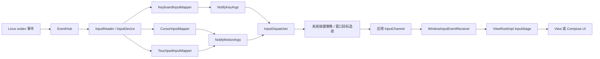
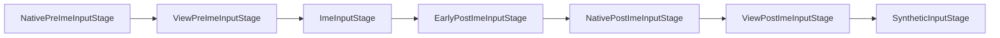
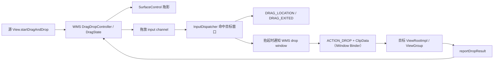

# 键盘、鼠标与指针输入性能 — 桌面模式交互管线

手机场景下的输入优化通常围绕触摸屏展开；而到了大屏、多窗口与桌面模式中，键盘、鼠标、触控板、悬停与跨窗口拖放都在触摸之外引入了额外的处理层：

- 键盘按键先经过系统策略和输入法（IME），目标由窗口焦点决定；
- 鼠标移动需要维护屏幕光标，窗口目标来自坐标命中；
- 触控板先识别移动、滚动、捏合和多指手势，应用平时收到的未必是原始触点；
- 悬停（hover）没有按下状态，却持续触发窗口命中、View 命中、指针图标解析和应用回调；
- 跨窗口拖放同时涉及 InputDispatcher、WindowManager、SurfaceControl 和应用主线程。

常规键盘与指针事件均通过输入通道（input channel）进入应用。只要应用未能及时完成已分发事件，`InputDispatcher` 对应连接的等待队列就会发生积压，进而可能触发输入分发超时（input dispatching timeout）。在跨窗口拖放场景中，位置更新消息仍可经由输入通道流转，而最终携带数据的 `ACTION_DROP` 则由 WindowManager 通过 Binder 回调投递。此外，无焦点窗口等待、辅助功能按键过滤以及拖放结果等待同样会影响交互响应，排查时需要与连接队列积压区分开来。

> 源码基线：AOSP `android-17.0.0_r1`，API 37；历史版本仅用于界定兼容范围。

## 1. 先建立一张完整的路径图

下图展示了不同输入设备事件的转换分支，以及它们汇入 `InputDispatcher` 后通往应用的共同主干；其中的 `evdev` 是 Linux 输入子系统向用户空间暴露事件的设备接口。



虽然三个映射器（mapper）共享 `EventHub → InputReader → InputDispatcher` 主路径，但各自承载的设备语义互不通用：

| 输入 | 原始内核事件 | Android 17 的主要转换者 | 常见应用事件 |
| --- | --- | --- | --- |
| 物理键盘 | `EV_KEY` | `KeyboardInputMapper` | `KeyEvent` |
| 鼠标 | `EV_REL`、按键、滚轮 | `CursorInputMapper` | `MotionEvent`，通常为 `SOURCE_MOUSE` |
| 触控板 | `EV_ABS` 多点槽位、按键 | `TouchpadInputMapper` + 手势识别库 | 普通模式通常表现为鼠标或已分类手势 |
| 触摸屏 | `EV_ABS` 多点槽位 | `MultiTouchInputMapper` | `SOURCE_TOUCHSCREEN` 的 `MotionEvent` |

值得注意的是，单个物理设备可以同时支持多种事件来源（source）。例如 `TouchpadInputMapper::getSources()` 会返回 `SOURCE_MOUSE | SOURCE_TOUCHPAD`，这代表该设备具备的能力集合；但落实到某一条具体事件上，`MotionEvent.getSource()` 未必同时携带两个标志——例如普通未捕获状态下的触控板移动由 `UncapturedGestureConverter` 生成，其事件来源仅为 `SOURCE_MOUSE`。

### 事件来源与设备能力

由于外设形态多样，仅凭设备名称往往难以判断输入类型，应用应同时核对 `InputDevice` 能力、事件来源、动作类型（action）、轴值（axis）与工具类型（tool type）：

- `SOURCE_MOUSE` 属于 `SOURCE_CLASS_POINTER`，坐标对应显示空间中的指针位置；
- `SOURCE_MOUSE_RELATIVE` 属于 `SOURCE_CLASS_TRACKBALL`，用于指针捕获（pointer capture）期间的相对移动；
- `SOURCE_TOUCHPAD` 属于 `SOURCE_CLASS_POSITION`，API 37 的绝对捕获模式用它报告触控板原始触点；
- `SOURCE_GAMEPAD` 描述按钮能力，摇杆轴通常来自 `JoystickInputMapper`，没有独立的 `GamepadInputMapper`。

这组来源分类直接决定了 `ViewRootImpl` 将事件派发给 `dispatchPointerEvent()`、`dispatchCapturedPointerEvent()` 还是 `dispatchGenericMotionEvent()`。

## 2. InputReader 如何把设备转换成 Android 事件

下面顺着数据流向，梳理内核上报的原始事件如何一步步转换为 Android 平台事件。

### 2.1 映射器由设备类别（device class）决定

`InputDevice::createMappers()` 会依据 `EventHub` 识别出的设备类别创建对应的映射器，核心分支如下：

- `KEYBOARD`、`DPAD`、`GAMEPAD` 组合出键盘事件来源，再创建 `KeyboardInputMapper`；
- `CURSOR` 创建 `CursorInputMapper`；
- 同时具有 `TOUCHPAD` 与 `TOUCH_MT` 时创建 `TouchpadInputMapper`；
- 其余 `TOUCH_MT` 设备才进入 `MultiTouchInputMapper`；
- `JOYSTICK` 创建 `JoystickInputMapper`。

因此，即使同样基于 `EV_ABS` 上报多点数据，触控板与触摸屏在映射器创建阶段就会分流至不同的处理路径。

### 2.2 键盘：扫描码、键码与字符是三层概念

`KeyboardInputMapper` 收到 `EV_KEY` 后，会根据扫描码及可选的 HID 用法码（usage）查表映射。`EventHub::mapKey()` 先检索按键字符映射文件（KCM），再检索按键布局（key layout），随后应用用户按键重映射及 KCM 中的按键行为（key behavior）。查表输出包含四部分信息：

- `scanCode`：接近 Linux 输入设备报告的物理按键编号；
- `keyCode`：Android 的 `KEYCODE_*` 语义键码；
- `metaState`：Shift、Ctrl、Alt、Meta 等组合状态；
- 策略标志（policy flags）：是否唤醒、是否为虚拟键等策略信息。

最终的字符生成还需结合当前键盘布局、修饰键状态以及输入法；遇到“死键”时会先暂存重音，待下一个按键到来再组合成字符。编写快捷键或输入映射逻辑时需注意：`scanCode` 不适合用作跨设备快捷键标识，而同一个 `keyCode` 在切换键盘布局后也可能映射出不同的字符。

### 2.3 鼠标：相对位移先更新系统光标

普通鼠标由 `CursorInputMapper` 处理 `REL_X`、`REL_Y`、滚轮及按键状态。在未捕获状态下，事件按以下顺序流转：

1. 相对位移先经过指针速度调节（pointer velocity control）；
2. 映射器先生成携带相对位移的 `NotifyMotionArgs`；普通未捕获鼠标的 cursor position 此时仍可为无效值；
3. 下游 `PointerChoreographer` 通过 `PointerController` 移动光标，补全屏幕 X/Y、cursor position 与目标 display ID，再继续转发 `SOURCE_MOUSE` 事件；
4. 未按按钮时通常是 `ACTION_HOVER_MOVE`，按下期间是 `ACTION_MOVE`；
5. 滚轮生成 `ACTION_SCROLL`，数值位于 `AXIS_VSCROLL` 和 `AXIS_HSCROLL`；
6. 按钮状态还会产生 `ACTION_BUTTON_PRESS`、`ACTION_BUTTON_RELEASE`，主按钮状态变化伴随 `ACTION_DOWN`、`ACTION_UP`。

经过上述处理，应用最终收到的指针坐标已经叠加了显示映射与速度曲线。由于鼠标 DPI、USB 或 Bluetooth 报告间隔、用户指针速度设置及显示刷新率均会影响采样表现，事件的实际频率与精度需在目标设备上实测确认，不宜预先假定固定数值。

<!-- gracker-diagram: ch03-06-device-conversion-and-cursor -->


图：键盘由 mapper 生成 KeyArgs；普通鼠标由 CursorInputMapper 处理相对移动与速度曲线；触控板先把多点硬件状态解释成光标或手势。PointerChoreographer 更新 PointerController 并补全普通指针的屏幕坐标、光标位置与 Display，再由下游分发器选择窗口。图省略其他透传或条件监听阶段。

### 2.4 触控板：普通模式先解释手势

与鼠标的“相对位移转光标”相比，触控板路径多了一层手势识别解释，原始触点需要依次流经以下组件才能变成平台事件：

```text
多点槽位
  → HardwareStateConverter
  → gestures library
  → UncapturedGestureConverter / 捕获模式 converter
  → NotifyMotionArgs
```

在普通模式下，单指移动会更新光标并上报 `SOURCE_MOUSE` 的悬停或移动事件，双指滚动转换为 `ACTION_SCROLL`，捏合与多指滑动则带有对应的手势分类（classification），部分系统手势还会被系统直接消费。掌压过滤、轻触点击（tap-to-click）、自然滚动、右键区域划分及加速曲线，都在进入应用前完成了这一层解释。

因此，虽然应用收到的是单条鼠标或手势语义的 `MotionEvent`，底层硬件往往上报了多个绝对触点，只是在进入应用之前已由平台完成了手势识别转换。

## 3. 指针捕获的适用场景与前提

指针捕获（pointer capture）主要面向第一人称视角游戏、远程桌面、三维编辑器等需要持续读取相对位移的应用；普通表单、列表和常规桌面窗口不应主动申请捕获指针。

启用指针捕获需满足三个前提：

- 所属 View 层级必须具有窗口焦点；
- 获取和失去捕获会触发设备重新配置，事件来源和运动范围（motion range）可能改变；
- 窗口失去焦点时捕获会被释放；焦点显示设备（focused display）改变时，`InputDispatcher` 也会强制关闭现有捕获。

### 3.1 鼠标捕获

当鼠标进入捕获状态后，`CursorInputMapper` 会将事件来源切换为 `SOURCE_MOUSE_RELATIVE`，关闭指针加速与缩放处理，应用则通过捕获回调直接读取相对移动量。在此期间系统光标隐藏，光标位置也不再更新。

### 3.2 API 37 的两种触控板捕获模式

Android 17 为触控板明确划分了两种捕获模式：

| 模式 | 事件来源 | 平台处理 | 适合场景 |
| --- | --- | --- | --- |
| `POINTER_CAPTURE_MODE_RELATIVE` | `SOURCE_MOUSE_RELATIVE` | 继续识别移动、按钮和滚动，再按相对量报告 | 游戏视角、远程桌面 |
| `POINTER_CAPTURE_MODE_ABSOLUTE` | `SOURCE_TOUCHPAD` | 跳过手势识别库，报告触控板坐标空间中的多点数据 | 自定义触控板手势、原始触点分析 |

这组模式由平台功能标志控制：无参数的 `requestPointerCapture()` 仅在 `pointerCaptureModes()` 与 `relativeCaptureModeByDefault()` 同时为真时等价于相对模式，否则请求的将是绝对模式。因此，当业务明确需要相对移动数据或原始多点触控板数据时，应显式传入对应的模式常量，避免依赖无参数的默认行为。

此外，绝对模式虽会附带 `AXIS_RELATIVE_X/Y`，但其 `getX(index)` 与 `getY(index)` 的坐标空间属于触控板表面，直接当作屏幕坐标使用会产生错位。

<!-- gracker-diagram: ch03-06-pointer-capture-coordinate-spaces -->


图：普通模式以显示光标坐标进行窗口命中；相对捕获把移动交给有焦点窗口，鼠标隐藏光标并关闭加速，触控板仍可解释移动和滚动；触控板绝对模式跳过 gestures，报告表面空间的多点数据。API37 模式受平台 flag 控制，无参数默认也依赖 flag，具体需求应显式表达并处理捕获变化回调。

在支持 API 37 指针捕获模式常量的项目中，可以通过显式参数声明捕获意图：

```kotlin
fun View.captureForCameraControl() {
    if (hasWindowFocus()) {
        requestPointerCapture(View.POINTER_CAPTURE_MODE_RELATIVE)
    }
}

override fun onCapturedPointerEvent(event: MotionEvent): Boolean {
    if (!event.isFromSource(InputDevice.SOURCE_MOUSE_RELATIVE)) return false
    cameraController.rotateBy(event.x, event.y)
    return true
}
```

在相对模式下，`event.x/y` 表示本次采样的相对移动增量。回调执行期间应当仅更新输入状态，将渲染计算留给帧循环处理，避免每收到一次硬件采样就触发一轮重计算。

## 4. 键盘从系统策略到应用的路径

### 4.1 系统策略与目标选择

追踪按键事件链路时，需要重点关注系统策略的介入时机。`KeyboardInputMapper` 构造出 `NotifyKeyArgs` 后，`InputDispatcher::notifyKey()` 会先调用系统输入策略（policy）的 `interceptKeyBeforeQueueing()`，`InputManagerService` 还会交由 `KeyGestureController` 检查系统组合键；在进入目标选择之前，系统策略还可通过 `interceptKeyBeforeDispatching()` 延迟或直接消费按键。

电源键、音量键、系统导航以及各类全局快捷键都可能在这一步结束分发，因此应用并不能确保收到所有物理按键事件。

未被系统策略消费的按键，随后按以下规则选定分发目标：

1. 事件带有效显示设备 ID（display ID）时使用该显示设备；
2. 显示设备 ID 无效时使用 `mFocusedDisplayId`；
3. 在目标显示设备上查找焦点窗口（focused window）；
4. 若焦点应用（focused application）已存在，但窗口尚未获得焦点，则进入“无焦点窗口”（no-focused-window）的等待与超时逻辑；
5. 对按键事件，分发器可按策略超时短暂等待先前未完成的输入，因为前一条点击可能打开新窗口并改变焦点；等待到期后，即使仍有未完成项，也会继续向当前焦点窗口发送按键。

上述第 5 条正解释了一个常见的跨设备现象：主线程中积压的鼠标事件在拖慢悬停响应的同时，也可能连带让紧随其后的键盘输入陷入等待。这一等待机制是为了保证跨输入类型的焦点切换顺序正确，与键盘硬件本身无关。

### 4.2 按键重复在 InputDispatcher

按键长按重复（key repeat）的控制分布在输入路径的多个位置：

- `EventHub` 打开设备时尝试用 `EVIOCSREP` 关闭内核重复；
- `KeyboardInputMapper` 忽略 Linux `EV_KEY value == 2`；
- `InputDispatcher` 保存最近按下的可重复按键，等入站队列（inbound queue）为空时合成重复事件；
- 第一条重复事件的 `repeatCount` 为 1，并带 `FLAG_LONG_PRESS`；
- 后续重复按 `keyRepeatDelay` 继续产生；
- 按键抬起（key-up）、设备重置、分发关闭等状态会清理重复状态。

`InputDispatcherConfiguration` 的默认配置为首次等待 500 ms、后续间隔 50 ms。由于这两个参数均可由系统重新配置，应用侧应依据 `repeatCount` 与事件时间戳推进业务状态，而不能把默认毫秒数当作固定定时器协议。

处理长按连续操作时，应把一次性初始化与可重复动作区分开，避免每次重复事件到来都产生额外副作用：

```kotlin
override fun onKeyDown(keyCode: Int, event: KeyEvent): Boolean {
    if (keyCode != KeyEvent.KEYCODE_DPAD_RIGHT) {
        return super.onKeyDown(keyCode, event)
    }

    if (event.repeatCount == 0) {
        selection.beginKeyboardMove()
    }
    selection.moveRightOneStep()
    return true
}
```

当系统驱动重复事件实现连续移动时，上述写法将初始化限定在首次按下阶段。如果每次重复都触发动画重启、I/O 读取或对象图重建，50 ms 的默认间隔很快就会导致主线程消息积压。

### 4.3 IME 位于 View 的 pre-IME 与 post-IME 之间

进入应用窗口后，按键事件依次经过以下处理阶段，其中的 pre-IME 与 post-IME 分别指输入法处理之前和之后：



- `dispatchKeyEventPreIme()` 发生在 IME 之前；
- `ImeInputStage` 可以异步处理，IME 返回未处理后才进入 post-IME；
- `ViewPostImeInputStage` 先调用 `dispatchKeyEvent()`，再检查修饰键快捷键、后备策略（fallback policy）和自动焦点导航。

从执行顺序上看，硬件键盘事件会先交给 IME 处理，若 IME 未消费再进入 View 的 post-IME 阶段；而软键盘输入通常直接经由 `InputConnection.commitText()`、`setComposingText()` 等编辑协议写入文本控件，未必对应一串 `KeyEvent`。

<!-- gracker-diagram: ch03-06-key-target-wait-and-ime -->


图：系统策略可消费或延迟按键；未消费的按键按显式 Display ID 或 focused display 查找焦点窗口。为等待可能改变焦点的前序输入，分发器可按策略有限等待；超时后仍可继续发送。应用内通常先经过 pre-IME / IME，再到 post-IME View。软键盘编辑协议不必生成相同 KeyEvent 序列。

因此，应用自定义的快捷键应按语义消费并返回 `true`，且只在 `ACTION_DOWN && repeatCount == 0` 时执行一次性命令，同时留出系统快捷键、IME 组合键与辅助功能的高优先级空间。

### 4.4 Rust 键盘过滤器位于 InputFlinger 主链中

原生监听器链（native listener chain）依次串联以下组件：

```text
InputReader
  → UnwantedInteractionBlocker
  → PointerChoreographer
  → InputProcessor
  → InputDeviceMetricsCollector（构建条件）
  → InputFilter
  → InteractionReporter（服务条件）
  → InputDispatcher
```

在这里，`InputFilter` 是一个 C++ 包装层，其内部的 Rust 过滤链仅处理键盘辅助功能；诸如 `notifyMotion()`、传感器、开关、振动器状态、设备重置和指针捕获变化等通知均由包装层直接透传给下游，`InputReader`、`PointerChoreographer`、`InputProcessor` 与 `InputDispatcher` 也依然由 C++ 实现。也就是说，Rust 目前仅承担键盘辅助功能过滤这一局部职责，InputFlinger 主体管线仍运行在 C++ 之上。

C++ 与 Rust 之间通过进程内 AIDL 接口交互，并由 `cxxbridge` 启动桥接代码建立调用入口：按键事件经 `IInputFilter.notifyKey()` 进入 Rust 链，过滤后通过 `IInputFilterCallbacks.sendKeyEvent()` 回到 C++ 监听器。这些调用均发生在同一个 InputFlinger 进程内部，不会产生跨进程 Binder 事务；不过 Slow Keys 延后接受的按键会由过滤线程的超时回调送往下游，因此这一链路并不保证全程同步或同线程执行。

该层包含三种辅助功能：粘滞键（Sticky Keys）保持修饰键生效状态，慢速键（Slow Keys）要求按键按住达到阈值，防抖键（Bounce Keys）忽略阈值内的重复按键。配置变更时，Rust 会从 `BaseFilter` 起依次包裹 Sticky、Slow 与 Bounce，因此三者同时启用时的执行顺序如下：

```text
BounceKeysFilter
  → SlowKeysFilter
  → StickyKeysFilter
  → BaseFilter
  → C++ callback
```

| 过滤器 | 设备与事件边界 | 语义 | 性能表现 |
|---|---|---|---|
| Bounce Keys | 非虚拟、受支持键盘；事件带 `SOURCE_KEYBOARD` | 同设备同 `keyCode` 的下一次 `DOWN` 落在阈值内时，丢弃该 `DOWN` 及配对 `UP` | 不设定时等待；快速重复按键消失 |
| Slow Keys | 与 Bounce 相同的受支持设备集 | 首个 `DOWN` 进入待定状态（pending），按住到阈值后才向后发送；提前 `UP` 则整次短按不再传递 | 接受的 `DOWN` 会有意延后一个阈值 |
| Sticky Keys | 受支持的非虚拟字母键盘 | 在修饰键 `UP` 时切换关闭、锁存或锁定（off / latched / locked）状态，并合并 `metaState` | 没有阈值等待，但会改变修饰键的传递方式与状态 |

在设备适配范围上，Bounce 与 Slow 支持非虚拟键盘（包括外接键盘以及内置 `Alphabetic` 字母键盘，外接非字母键盘也可能生效）；Sticky 的适用集合更窄，仅限非虚拟 `Alphabetic` 键盘。具体一台外设归属于哪个支持集合，需查看 `InputReader` 与 `InputFilter` 的 dump 输出，单凭外设名称无法推断。

Slow Keys 延后放行按键时，会将 `DOWN` 改写为新的 `downTime/eventTime`，并附加禁止按键重复的策略标志，其中的计时等待由名为 `InputFilter` 的线程及超时回调完成。遇到“短按稳定丢失”或“按键延迟恰好接近配置阈值”时，应优先检查 Slow Keys；而若属于 `InputDispatcher` 反压（下游处理过慢迫使分发端等待），通常会同步观测到目标选择异常、连接队列积压或应用线程阻塞。

Rust 过滤器的初始状态为关闭（disabled），安装任一过滤器后转为启用（enabled）。若“曾开启随后全部关闭”，Android 17 可能仍报告 `enabled`，但重建后的过滤链里只剩下负责原样透传的 `BaseFilter`——功能上不再具备 Bounce、Slow 或 Sticky 语义，仅可能多一次本地调用往返。这属于 `android-17.0.0_r1` 的内部实现细节，API 层面并未对此做出稳定性承诺。

<!-- gracker-diagram: ch03-06-rust-filter-local-chain -->


图：实际原生主链中，Rust InputFilter 位于 PointerChoreographer、InputProcessor 和条件 Metrics 之后，InteractionReporter 与 Dispatcher 之前。C++ 包装层只把启用的键盘事件交给 Rust；三过滤器同时开启时按 Bounce → Slow → Sticky → Base 执行，再回 C++ 下游。motion 等其他通知由包装层直接转发。

## 5. 鼠标悬停、滚轮与窗口命中

### 5.1 指针目标来自位置

键盘按键沿焦点窗口路由，鼠标与触摸等指针事件则通常依据显示坐标命中输入窗口。`InputDispatcher` 为每个显示设备维护窗口拓扑信息，以及当前的触摸与悬停状态：

- 悬停进入新窗口时生成 `HOVER_ENTER`；
- 离开旧窗口时生成 `HOVER_EXIT`；
- `ACTION_SCROLL` 不改变当前悬停窗口；
- 按下后的手势通常保持既有触摸目标，直到抬起或取消；
- 普通悬停不会自动改变窗口焦点。

窗口焦点始终由 WindowManager 的焦点策略裁决：鼠标点击可能触发焦点切换，多指触控板系统手势还可携带 `NO_FOCUS_CHANGE` 标志；相应地，应用代码也不应在每条悬停回调中主动调用 `requestFocus()`。

### 5.2 View 树的第二次命中

事件送达窗口后，`ViewRootImpl` 会对 `SOURCE_CLASS_POINTER` 调用根 View 的 `dispatchPointerEvent()`。鼠标悬停与滚轮事件会进入通用运动事件（generic motion）分发路径，再由 `ViewGroup` 根据窗口局部坐标命中子 View，并维护 View 级别的悬停进入与离开状态。

因此，窗口命中与 View 命中分属两级查找工作：

```text
InputDispatcher：显示坐标 → input window
ViewGroup：窗口局部坐标 → child View
```

过深的 View 树层级、频繁变化的几何变换属性以及在每次悬停时触发布局，都会放大第二级的分发成本。框架本身并不会因为悬停事件到达就无条件重绘整棵 View 树，画面重绘通常源自组件交互状态变更或应用自身调用了 `invalidate()`、`requestLayout()`。

<!-- gracker-diagram: ch03-06-hover-two-hit-tests -->


图：InputDispatcher 根据显示位置和窗口拓扑选择输入窗口，并维护窗口级 HOVER_ENTER / EXIT。应用 ViewRootImpl 处理窗口局部坐标后，ViewGroup 再命中子 View、维护 View 级悬停与指针图标。移动光标不等于应用已及时响应，也不会自动改变键盘焦点。

### 5.3 滚动的轴值

鼠标滚轮与相对捕获触控板的滚动操作以 `ACTION_SCROLL` 上报，应用需读取以下轴值：

- `AXIS_VSCROLL`；
- `AXIS_HSCROLL`；
- 必要时结合 `ViewConfiguration` 的水平、垂直滚动系数（scroll factor）转成 UI 距离。

由于不同外设可能上报离散刻度或高分辨率连续增量，业务逻辑宜先累加浮点偏移量并在帧边界统一提交，避免过早取整导致微小滚动量丢失。

## 6. 事件批处理、主线程积压与 ANR

### 6.1 事件批处理保留采样历史

应用侧的 `BatchedInputEventReceiver` 会尽量安排在 VSYNC 输入回调中消费可批处理的运动事件。原生层 `InputConsumer` 仅将彼此兼容的样本合并至同一批次，要求设备、事件来源、动作类型、显示设备、指针数量与指针属性完全一致。

合批之后，单个 `MotionEvent` 除了当前最新样本外，还会把较早的样本保留在历史记录（history）中。批处理减少的是 Java 层回调的调用次数，而没有按固定比例丢弃硬件采样；需要还原完整轨迹细节的组件可以通过循环遍历历史样本：

```kotlin
fun consumeMotion(event: MotionEvent, sink: (Long, Float, Float) -> Unit) {
    for (index in 0 until event.historySize) {
        sink(
            event.getHistoricalEventTime(index),
            event.getHistoricalX(index),
            event.getHistoricalY(index),
        )
    }
    sink(event.eventTime, event.x, event.y)
}
```

上述循环按时间顺序依次消费历史样本与当前样本。如果界面只关心最新光标位置，仅取末尾状态即可；绘图、手写笔迹或速度估算等场景才需要遍历完整历史。

此外，`ViewRootImpl` 中还有一处类似的合并取舍：尚未处理的 `ACTION_DRAG_LOCATION` Handler 消息只会保留最新一条。这一去重逻辑仅作用于拖放位置消息，并不覆盖所有悬停或指针移动事件。

### 6.2 输入超时与连接等待队列

事件写入应用输入通道后，`InputDispatcher` 会将对应的 `DispatchEntry` 放入该连接的 `waitQueue`，直到应用通过 `finishInputEvent()` 回传完成信号后才将其移除。

默认的输入分发超时基值为 5 秒，实际计时还会乘以硬件超时倍率，且具体窗口可以覆盖自身的超时配置。对于已经写入连接的事件，分发器都会检查等待队列中是否存在超时的未完成条目；连接超时规则并未给悬停事件设置单独豁免，只要悬停或移动事件在等待队列中超时，同样会触发无响应判定。

无焦点窗口则对应另一条独立的超时路径：当存在焦点应用、尚无焦点窗口，且有焦点型事件等待分发时开始计时；到期后若依然维持同一焦点应用且仍无焦点窗口，即便事件尚未进入任何连接的等待队列，也可能报告 ANR。排查响应超时问题时，需先分清属于哪一条超时路径，再去核查窗口焦点、配置超时值与完成回报状态。

连续高频的悬停、滚轮或按键重复事件，主要风险在于快速放大积压：

1. 一条事件在主线程执行了昂贵工作；
2. 后续事件继续进入出站队列、等待队列或输入通道；
3. 输入管道填满后，事件发布端返回 `WOULD_BLOCK`，分发器等待应用完成积压事件；
4. 最旧条目超时后，连接被标为无响应（unresponsive）；
5. 后续键盘还可能因“等待先前输入完成”而暂缓目标选择。

需要留意的是，后续重复事件的到来并不会重置等待队列中最旧条目的超时计时。

### 6.3 输入回调的工作量

输入回调中适合执行的工作：

- 更新少量输入状态；
- 执行有上限的命中或快捷键判断；
- 把渲染所需状态提交给下一帧；
- 对需要异步处理的数据做最小复制。

输入回调中应避免的操作：

- 同步文件、数据库或网络访问；
- 对整棵 UI 树调用 `requestLayout()`；
- 为每条悬停事件创建大量临时对象；
- 在锁内调用不可控的业务回调；
- 保存框架传入的 `MotionEvent` 供回调结束后继续使用。确需保存时使用 `MotionEvent.obtain()`，完成后 `recycle()`。

## 7. 多窗口、多显示与焦点

在多窗口与外接显示器场景中，输入焦点需要拆为两个独立概念理解：

- `FocusResolver` 记录各显示设备的焦点窗口令牌（focused window token）；
- `mFocusedDisplayId` 为没有指定显示设备的焦点型事件提供目标显示设备。

携带有效显示设备 ID 的键盘事件会投递到该显示设备的焦点窗口，未指定时则落到当前焦点显示设备；而鼠标事件通常自带显示设备绑定，并按屏幕坐标命中窗口。

当焦点显示设备发生切换时，`InputDispatcher` 会执行以下清理与通知动作：

- 取消旧焦点显示设备上尚未释放、且未指定显示设备的非指针事件；
- 通知系统策略焦点显示设备已经改变；
- 强制关闭现有指针捕获；
- 将旧、新焦点窗口令牌通过 `notifyFocusChanged()` 通知系统策略。

针对应用窗口的焦点事件则由 `onFocusChangedLocked()` 创建 `FocusEntry` 后派发，分析时应将其与焦点显示设备切换时的策略通知区分开。

因此，测试桌面模式下的交互管线时，仅覆盖“单显示器内两个 Activity 切换”远远不够，还应覆盖以下典型场景：

- 内屏与外屏之间移动鼠标；
- 外屏窗口持有键盘焦点；
- 点击后立即输入；
- 弹窗创建或销毁期间连续输入；
- 指针捕获期间拔掉设备、切换窗口或切换显示设备；
- IME 显示时使用硬件快捷键和 Tab 导航。

## 8. 跨窗口拖放的控制面与数据面

跨应用拖放会脱离常规 `MotionEvent` 的窗口分发路径，可以从控制面与数据面两个维度拆解：控制面负责维护拖放状态与目标窗口命中，数据面负责将携带内容的 `ClipData` 与 URI 权限交付目标窗口。下图展示了各个组件的职责边界（其中 WMS 即 WindowManagerService）：



拖放专用输入通道负责接收拖动过程中的指针，目标窗口经由普通 `InputChannel` 收到位置与离开消息，并由 `ViewRootImpl` 转换为 `ACTION_DRAG_LOCATION` 与 `ACTION_DRAG_EXITED`；而最终携带 `ClipData` 的 `ACTION_DROP` 则由 WMS 通过 `IWindow.dispatchDragEvent()` Binder 回调发送，并不走输入套接字的数据面。

### 8.1 移动阶段

拖放启动后，WMS 创建 `DragState`，将拖影的 `SurfaceControl` 图层放置到显示设备的覆盖层（display overlay），并将当前拖动的指针接管至拖放输入通道。随后 `InputDispatcher` 根据指针位置持续匹配目标窗口：

- 目标改变时向旧窗口发送拖放离开事件；
- 对当前目标发送拖放位置事件；
- `ViewRootImpl` 把坐标转换到应用窗口空间；
- `ViewGroup` 在窗口内部维护具体 View 的拖放进入、离开和位置状态。

由于拖影由 `SurfaceControl` 直接更新，目标应用无需为拖影重绘；不过目标应用仍可能因高亮反馈、边缘自动滚动或放置预览而产生额外的布局与绘制开销。

### 8.2 放下阶段

当拖动指针抬起后，`InputDispatcher` 会把最终命中的目标窗口、窗口局部坐标与原始坐标上报给 WMS，`DragState` 再向合法目标发送 `ACTION_DROP`；普通应用窗口直到这一步才拿到放置所需的 `ClipData`（能够拦截全局拖放的特权窗口另有单独的数据传递规则）。

若涉及 URI 访问权，还须满足额外条件：源端需同时设置 `DRAG_FLAG_GLOBAL` 以及 `DRAG_FLAG_GLOBAL_URI_READ` 或 `DRAG_FLAG_GLOBAL_URI_WRITE`；仅当存在拖放数据时，WMS 才会附带权限处理对象，供目标窗口调用 `requestDragAndDropPermissions()` 申请临时授权。待目标窗口回报是否消费后，WMS 结束本次拖放并广播 `ACTION_DRAG_ENDED`。

此外，WMS 对放下结果的回传单独设有 5 秒等待超时。这一计时属于拖放状态机，与输入通道的连接超时分属两个独立的观察点。

<!-- gracker-diagram: ch03-06-drag-position-versus-drop-data -->


图：WMS 建立 DragState、拖影与专用拖放通道；InputDispatcher 在拖动时按坐标找目标。普通目标窗口的 DRAG 位置 / 离开消息可经 InputChannel 到 ViewRootImpl；抬起时则先报告 WMS，再由 IWindow Binder 发送携带 ClipData 的 ACTION_DROP。目标 reportDropResult 后结束，URI 大数据应按权限异步读取。

### 8.3 ClipData 与大数据

跨进程拖放适合传递 URI、MIME 媒体类型描述以及少量文本。对于图片、视频或大文档，应通过 `content://` URI 指向 `ContentProvider`，由目标窗口调用 `requestDragAndDropPermissions()` 获取临时访问权后按需读取。

拖放场景的性能瓶颈除了受限于 Binder 事务缓冲区容量之外，权限授予、载荷序列化、ContentProvider I/O 以及目标端内容解码同样是不可忽视的开销来源。工程实现上建议遵循以下原则：

- `ClipDescription` 尽早、准确地表达 MIME；
- `ACTION_DRAG_STARTED` 只做轻量可接收判断；
- `ACTION_DRAG_LOCATION` 只更新必要的悬停状态；
- `ACTION_DROP` 校验 URI、MIME 和来源，再把耗时读取移出主线程；
- 使用完 URI 权限后及时释放。

## 9. View 与 Compose 的优化边界

平台源码边界涵盖的是事件从内核到应用窗口的传递路径。Jetpack Compose 属于 AndroidX 生态，其版本迭代独立于 `android-17.0.0_r1`；分析 Compose 的指针输入节点、协程或 `Modifier` 行为时，需要同步锁定项目所用的 Compose 版本。

### View 系统

- 快捷键优先在靠近窗口或页面入口的位置处理，避免多个子 View 重复匹配；
- 悬停只在“进入、离开、命中对象改变”时更新视觉状态；
- 滚动保留浮点累计量，在帧回调中统一提交；
- 自定义 View 的 `onResolvePointerIcon()` 避免创建重复资源；
- 方向键焦点顺序不稳定时，显式设置 `nextFocus*` 或验证 `FocusFinder` 结果。

### Compose

- 使用 `onPreviewKeyEvent`、`onKeyEvent` 或明确的快捷键层级表达消费顺序；
- `pointerInput` 的参数键（key）改变会重启其处理协程，应避免把每次重组都变化的对象作为键；
- 高频指针处理器只更新轻量状态，重计算放到可控的状态或帧边界；
- `Modifier` 顺序会影响命中、消费和语义，性能测试时保留可复现的 `Modifier` 链；
- 遇到指针性能问题时，同时记录 Compose 版本、编译器版本和平台版本，避免把 AndroidX 行为误归因于 Android Framework。

归根结底，View 与 Compose 在应用进程内共享同一条主线程与 `InputChannel`，单纯更换 UI 工具包无法消除主线程阻塞、焦点错乱或跨窗口命中问题。

## 10. 诊断：先定位慢在哪一段

### 10.1 原始设备层

排查外设输入延迟时，可先用 `getevent` 确认延迟是否已经存在于内核设备层：

```bash
adb shell getevent -lt
```

通过观察设备节点、`EV_KEY`、`EV_REL`、`EV_ABS` 与 `SYN_REPORT` 的时间戳及到达顺序（量产设备上可能受权限限制），如果底层上报间隔已经出现异常，应优先排查硬件、蓝牙链路、USB 集线器或内核驱动。

### 10.2 InputReader 与 InputDispatcher

随后借助输入服务的运行态转储检查设备映射、目标窗口选择与连接队列：

```bash
adb shell dumpsys input
```

重点核对以下状态：

- 设备类别、事件来源、映射器与运动范围；
- 焦点显示设备，以及各显示设备的焦点窗口；
- 指针捕获模式；
- Rust InputFilter 的启用状态和过滤器链，以及 Slow Keys 的待定/进行中 `DOWN` 与阈值；
- 触摸、悬停和拖放状态；
- 连接的出站队列、等待队列与响应状态；
- 按键重复的首次等待时间和后续间隔。

同时使用以下命令核对窗口层的焦点与拖放状态：

```bash
adb shell dumpsys window
```

将 WindowManager 中的焦点应用、焦点窗口、显示设备与拖放状态和 `dumpsys input` 对照。如果两份输出中的焦点状态不一致，应优先排查窗口生命周期、Surface 图层与输入窗口拓扑更新，再考虑调整 View 层的按键监听器。

### 10.3 Perfetto / 系统跟踪

Perfetto 系统跟踪（System Trace）能够把输入事件、线程调度与画面呈现对齐到同一条时间线上。采集配置应至少包含 `input`、WindowManager、View、调度与 FrameTimeline，再按同一事件 ID 或邻近时间片核对以下五个节点：

1. EventHub/InputReader 收到时间；
2. InputDispatcher 的入站、目标选择与分发；
3. 应用 `deliverInputEvent`；
4. 对应的主线程回调；
5. 帧开始、提交与显示。

常见现象与优先排查方向如下：

| 现象 | 优先检查 |
| --- | --- |
| `getevent` 已晚 | 设备、传输、驱动 |
| InputReader 到 InputDispatcher 间隔大 | 映射器、手势识别、输入线程调度 |
| InputDispatcher 等待目标 | 焦点、窗口创建、前序事件未完成 |
| 等待队列增长 | 应用未及时调用 `finishInputEvent`，通常是主线程阻塞 |
| 回调快，下一帧仍晚 | Choreographer、布局/绘制、RenderThread 或 SurfaceFlinger |
| 只有触控板异常 | 手势配置、捕获模式、事件来源分支 |
| 只有跨应用放下操作异常 | URI 权限、内容提供器 I/O、放下结果超时 |

### 10.4 应用内轻量测量

下面这段代码可用于在应用内抽样记录“从事件产生时间到回调开始执行”的耗时：

```kotlin
private fun inputAgeMs(event: InputEvent): Long {
    return SystemClock.uptimeMillis() - event.eventTime
}
```

`eventTime` 与 `uptimeMillis()` 采用同一单调时间基准。不过该差值将回调之前的全部等待混在了一起，单靠它无法拆出驱动、`InputReader`、`InputDispatcher` 与主线程队列各自占用了多少时间，需要分段定位时仍应结合 Perfetto。

## 11. 审查清单

### 语义正确性

- 是否用 `event.isFromSource()` 判断事件来源，而非设备名称？
- 是否区分 `SOURCE_MOUSE`、`SOURCE_MOUSE_RELATIVE` 与 `SOURCE_TOUCHPAD`？
- 是否读取滚动轴、按钮状态、重复次数和修饰键状态？
- 是否把软键盘文本输入误当成硬件 `KeyEvent`？
- 是否只在拥有窗口焦点时请求指针捕获？
- API 37 上是否明确选择触控板的相对或绝对捕获模式？

### 主线程成本

- 悬停/移动回调是否包含 I/O、全树布局或大对象分配？
- 是否按需要读取 `MotionEvent` 历史样本？
- 滚动和视角更新是否可以在一帧内合并？
- 按键重复是否反复启动一次性任务？
- `ACTION_DRAG_LOCATION` 是否只更新目标状态？
- `ACTION_DROP` 的内容提供器（ContentProvider）读取和解码是否移出主线程？

### 桌面场景覆盖

- USB 与 Bluetooth 键盘、鼠标；
- 传统滚轮与高分辨率滚轮；
- 单指、双指、多指触控板手势；
- 单窗口、多窗口、弹窗、外接显示器；
- 捕获期间切换焦点、切换显示设备或拔掉设备；
- 不同键盘布局、修饰键、长按重复；
- View 与当前项目固定版本的 Compose；
- URI 拖放、拒绝放下操作、目标进程退出。

## 12. 版本与源码边界

本文的平台行为结论核对范围如下：

- Android platform：`android-17.0.0_r1`
- API：37
- 核心原生层路径：`frameworks/native/services/inputflinger`
- 核心 Java 路径：`frameworks/base/core/java/android/view`
- 窗口拖放路径：`frameworks/base/services/core/java/com/android/server/wm`

Android 17 中尤为值得留意的变化是触控板指针捕获模式：源码同时提供了相对与绝对两种模式；在平台默认启用相对模式的配置下，无参数捕获仍会经过手势识别并报告相对移动与滚动，只有显式请求绝对模式，原始多点触控板数据才会以 `SOURCE_TOUCHPAD` 形式交给应用。此外，设备厂商仍可能调整输入设备配置、手势属性、超时倍率与窗口策略，具体数值应在目标设备上结合诊断输出与系统跟踪复核。

## 参考资料

- [AOSP `InputDevice.cpp`](https://cs.android.com/android/platform/superproject/+/android-17.0.0_r1:frameworks/native/services/inputflinger/reader/InputDevice.cpp)
- [AOSP `KeyboardInputMapper.cpp`](https://cs.android.com/android/platform/superproject/+/android-17.0.0_r1:frameworks/native/services/inputflinger/reader/mapper/KeyboardInputMapper.cpp)
- [AOSP `CursorInputMapper.cpp`](https://cs.android.com/android/platform/superproject/+/android-17.0.0_r1:frameworks/native/services/inputflinger/reader/mapper/CursorInputMapper.cpp)
- [AOSP `TouchpadInputMapper.cpp`](https://cs.android.com/android/platform/superproject/+/android-17.0.0_r1:frameworks/native/services/inputflinger/reader/mapper/TouchpadInputMapper.cpp)
- [AOSP `InputDispatcher.cpp`](https://cs.android.com/android/platform/superproject/+/android-17.0.0_r1:frameworks/native/services/inputflinger/dispatcher/InputDispatcher.cpp)
- [AOSP `InputFilter.cpp`](https://cs.android.com/android/platform/superproject/+/android-17.0.0_r1:frameworks/native/services/inputflinger/InputFilter.cpp)
- [AOSP Rust `input_filter.rs`](https://cs.android.com/android/platform/superproject/+/android-17.0.0_r1:frameworks/native/services/inputflinger/rust/input_filter.rs)
- [AOSP Rust keyboard filters](https://cs.android.com/android/platform/superproject/+/android-17.0.0_r1:frameworks/native/services/inputflinger/rust/)
- [AOSP `ViewRootImpl.java`](https://cs.android.com/android/platform/superproject/+/android-17.0.0_r1:frameworks/base/core/java/android/view/ViewRootImpl.java)
- [AOSP `View.java`](https://cs.android.com/android/platform/superproject/+/android-17.0.0_r1:frameworks/base/core/java/android/view/View.java)
- [AOSP `input_framework.aconfig`](https://cs.android.com/android/platform/superproject/+/android-17.0.0_r1:frameworks/base/core/java/android/hardware/input/input_framework.aconfig)
- [AOSP `DragDropController.java`](https://cs.android.com/android/platform/superproject/+/android-17.0.0_r1:frameworks/base/services/core/java/com/android/server/wm/DragDropController.java)
- [AOSP `DragState.java`](https://cs.android.com/android/platform/superproject/+/android-17.0.0_r1:frameworks/base/services/core/java/com/android/server/wm/DragState.java)
- [Android Developers：Android 17 行为变更](https://developer.android.com/about/versions/17/behavior-changes-all)
- [Android Developers：跟踪触摸和指针移动](https://developer.android.com/develop/ui/views/touch-and-input/gestures/movement)
- [Android Developers：处理键盘操作](https://developer.android.com/develop/ui/views/touch-and-input/keyboard-input/commands)
- [Android Developers：键盘焦点导航](https://developer.android.com/develop/ui/views/touch-and-input/keyboard-input/navigation)
- [Android Developers：拖放](https://developer.android.com/develop/ui/views/touch-and-input/drag-drop)
- [Android Developers：Compose pointer input](https://developer.android.com/develop/ui/compose/touch-input/pointer-input)
