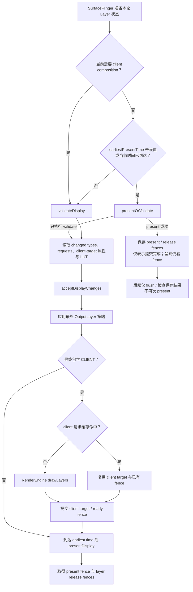

# HWC Overlay Plane 与合成降级排查

应用按时提交了 buffer，画面却依然迟到时，合成策略变化往往是重点嫌疑路径：原本交由显示硬件处理的 Layer（图层）转为 client composition 后，可能推高 GPU 合成负载，但也可能命中并复用既有的 client target。这一变化是否真正拖慢了呈现，必须结合实际绘制、fence 与呈现时刻进一步核实。排查时应从具体的 DisplayFrame 和 Layer 属性出发，沿着 HWC 的 validate/present 决策逐层验证；由于 plane（显示硬件合成平面）数量和单次协商得到的 composition type（合成类型）都只代表特定设备在当前帧的结果，跨设备仍需重新取证。

> 源码基线：AOSP `android-17.0.0_r1`（Android 17 / API 37）；内核 `android17-6.18-2026-06_r6`。

Composer HAL（显示合成器硬件抽象层）、显示驱动与 plane 分配策略主要由设备厂商实现。AOSP 源码确定的是接口语义与 SurfaceFlinger（系统合成服务）的调用流程，至于设备上的真实策略和硬件限制，则必须回到实机核对。

## 诊断边界：App 按时交帧，屏幕仍可能迟到

一次可见画面更新通常会在 FrameTimeline 中留下两类帧记录：

- **SurfaceFrame**：某个 App 或系统 Layer 生产并提交的一帧，通常关联 `surface_frame_token`（Surface 帧标识）。
- **DisplayFrame**：SurfaceFlinger 汇集本轮可见 Layer、完成合成并提交显示的一帧，关联 `display_frame_token`（显示帧标识）。

App 侧的 `Choreographer#doFrame` 和 RenderThread（渲染线程）slice 按时结束，并不代表 SurfaceFrame 已经按时 ready：buffer 提交、GPU 执行完成或 acquire fence，以及 FrameTimeline 对应截止时间都要逐项核实。即便生产者按时 ready，后续流程依然可能拖慢上屏——buffer 还要经过 BufferQueue（图形缓冲队列）、SurfaceFlinger latch（获取并采用缓冲区）与 composition strategy（合成策略），再由 RenderEngine（GPU 合成引擎）或 Composer HAL 完成合成，最后经 display driver（显示驱动）送往 panel scanout（面板逐行扫描显示）。后半程同样受时间预算约束，DisplayFrame 一旦在这里错过目标 VSync（垂直同步），用户感知到的依然是掉帧或延迟。因此排查应按前后两段展开：先确认生产者路径的时序，再下钻合成与显示提交，并持续把 App 自身与输入 buffer 的依赖留在检查清单中。

<!-- gracker-diagram: ch07-05-producer-ready-display-boundary -->


图：先确认生产者 buffer 已按时 ready，再检查后续链路。底部只示意一个缓冲区的主要依赖顺序，其他帧可流水交叠，不按实测时长绘制。

当以下几组信号同时出现时，重点往 HWC 合成方向排查：

- App 侧 SurfaceFrame 大多按时完成，但关联的 DisplayFrame 频繁出现 `SurfaceFlingerCpuDeadlineMissed`、`SurfaceFlingerGpuDeadlineMissed` 或 `DisplayHAL`（显示侧错过时限）。
- 问题在开启视频、相机、画中画、外接屏、系统浮层或高刷新率后复现，关闭其中某项条件后随之缓解。
- SurfaceFlinger 侧出现 GPU composition（GPU 合成），或同一 Layer 的最终 composition type 在 `DEVICE` 与 `CLIENT` 之间切换。
- RenderEngine、HWC validate/present（合成方式校验/显示提交）或 fence 等待时长与卡顿帧在时间窗口上吻合。

需要留意，composition type 发生变化本身属于正常机制。要立住“合成方式变化导致卡顿”的结论，除了观察到它与 DisplayFrame、GPU/DPU（图形/显示处理器）或 fence 异常对齐，还必须确认它处在最早拖延目标帧的依赖链上，并用同场景对照实验加以验证。


## 先分清 Surface、Layer 与显示合成对象

业务代码组织的是单个页面，SurfaceFlinger 面对的却是一组独立的 Layer。不同的内容输出载体，会直接改变 HWC 收到的合成输入：

| 输出形态 | SurfaceFlinger 看到的对象 | HWC 的选择空间 |
|---|---|---|
| 普通 View / Compose | 宿主 App Window Layer | 对宿主最终 buffer 选择 DEVICE 或 CLIENT |
| <code>Surface<wbr>View</code> | 宿主窗口与独立 child Surface | 视频、相机 Layer 可以独立参与每帧协商 |
| <code>Texture<wbr>View</code> | 外部 buffer 已由宿主 HWUI 采样进 App Window | HWC 看不到可以单独分配给视频矩形的 Layer |
| Tunneled Playback | sideband Layer 与厂商媒体路径 | 依赖 <code>SIDEBAND_<wbr>STREAM</code> capability、codec HAL 和 HWC |
| Protected content | 带安全约束的 Layer / buffer | 只能选择满足 secure composition 要求的路径 |

`SurfaceView` 会保留独立的 Layer，显示硬件因此有机会单独处理视频或相机画面（最终是否成行由 HWC 按帧协商）。`TextureView` 则把视频 buffer 交由宿主 RenderThread 采样进 App Window，虽然换取了更灵活的 View 变换、裁剪和 alpha（透明度），但在合成端也就不再存在独立的视频 Layer。

<!-- gracker-diagram: ch07-05-surfaceview-textureview-objects -->


图：SurfaceView 保留独立内容层，TextureView 的内容通常先进入宿主窗口 buffer。是否使用 device composition 仍由设备和当前层属性决定。

受保护内容的合成路径另有一套约束：设备既可能分配安全 plane，也可能通过受保护图形上下文执行安全合成。遇到黑屏、外接屏失败或截图不可见等问题时，需要逐项核对 DRM（数字版权管理）、secure decoder（安全解码器）、buffer usage（缓冲区用途标记）、HDCP（数字内容传输保护）与 Composer capability，仅靠 `DEVICE` 字段无法定位问题环节。

<!-- gracker-diagram: ch07-05-protected-sideband-capabilities -->


图：受保护图形与 sideband 媒体有不同约束。RenderEngine 的受保护路径也需 display、能力与内容条件满足；SIDEBAND_STREAM 是能力名，SIDEBAND 是合成类型。

此外，独立 producer（内容生产者）之间本来没有必须在同一显示周期同步更新的契约。因此，单个 DisplayFrame 完全可以合法地把“新宿主 UI + 旧视频 buffer”或“旧宿主 UI + 新视频 buffer”合成到一起。遇到字幕、遮罩与视频画面错位时，应核对目标 present 实际采用的 buffer 与 transaction（图层状态事务）以确认内容时间对齐，composition type 只负责说明合成方式。

<!-- gracker-diagram: ch07-05-independent-producer-content-time -->


图：示意独立队列可能采用不同进度的 UI 与视频；条长仅表示可选内容阶段，不是播放时长或设备测量。错位问题要核对实际采用的 buffer 与事务。

视频从 codec 提交到 Surface 后，仍须经过 queue、latch、合成与 present。完整的视频时序及 SurfaceView / TextureView 对比见 [13.11 视频 Overlay、Media3 与专业编解码管线](../ch13-rendering-pipelines/11-video-overlay-media3-codec-pipeline.md)。

## Composition 类型

排查工具展示的 composition type 源自 Composer3 AIDL（Android 接口定义语言）的 `Composition.aidl`，共有八个枚举值：

| 类型 | 语义 | 诊断时要注意 |
|---|---|---|
| <code>INVALID</code> | 无效占位值 | 不能作为有效策略 |
| <code>CLIENT</code> | SurfaceFlinger client 将 Layer 画进 client target，再用 <code>set<wbr>Client<wbr>Target</code> 交给设备 | 说明该 Layer 参加 GPU/client composition |
| <code>DEVICE</code> | 设备通过 hardware overlay 或相似机制处理 Layer | 不足以证明占用某个物理 plane |
| <code>SOLID_<wbr>COLOR</code> | 设备按 <code>set<wbr>Layer<wbr>Color</code> 直接生成纯色 | 能力不满足时，HWC 可要求改为 <code>CLIENT</code> |
| <code>CURSOR</code> | 类似 <code>DEVICE</code>，还允许异步更新 cursor 位置 | HWC 可改为 <code>DEVICE</code> 或 <code>CLIENT</code> |
| <code>SIDEBAND</code> | 设备接管 Layer 的内容更新与同步 | 只在声明 <code>SIDEBAND_<wbr>STREAM</code> capability 的设备上成立 |
| <code>DISPLAY_<wbr>DECORATION</code> | 为挖孔和屏幕圆角提供抗锯齿装饰 | 依赖 <code>get<wbr>Display<wbr>Decoration<wbr>Support()</code> |
| <code>REFRESH_<wbr>RATE_<wbr>INDICATOR</code> | 类似 <code>DEVICE</code>，更新不应重置 HWC 的 activity timer | 能力不足时可改为 <code>CLIENT</code> |

<!-- gracker-diagram: ch07-05-mixed-client-device-composition -->


图：混合合成中，CLIENT 内容进入 client target，再与设备侧 Layer 一起提交；client target 可能复用，CLIENT 数量要结合复用情况读，才对应得上 GPU 新绘制量。

`DEVICE` 的接口注释刻意表述为“hardware overlay or other similar means”。因此，看到 `DEVICE` 只能确认该层交给了设备处理，无法据此得出它是否独占物理 overlay plane、设备总计有几个 plane，或下一帧是否仍保持同样分配——统计 `DEVICE` Layer 数量来反推物理 plane 总数并不可靠。合成策略按当前帧的 Layer 状态实时适用，HWC 每帧都可能调整结果；条件允许时可跳过 validate，而 client target 也可能命中缓存复用，因此“类型为 CLIENT”和“本帧实际新执行了 GPU 合成”需分开记录。实际场景中混合合成非常普遍：部分 Layer 走 `CLIENT` 时，RenderEngine 会先将其绘制进一张 client target，HWC 再把这张 client target 与剩余的 `DEVICE`、`CURSOR` 等 Layer 一同提交显示。


## Overlay 能力没有通用的 plane 数字

设备上实际可用的硬件 plane 数量由各家厂商自行设计，不存在跨设备通用的固定数字。官方文档中出现的“四个 overlay plane”属于典型值与基准要求：HWC 概览用它说明“典型 Android 设备通常支持四个 overlay plane”，以及资源不足时会退回 GLES/client composition；Implement HWC 则将“至少四个 overlays”列为实现应支持的项目。这些文档描述是实现参考与门槛，并不代表所有设备都拥有至少四个独立物理 plane；具体某台设备的物理 plane 总数、当帧可用数量，均需以实机测量为准，普通应用也没有公开 API 可以查询或锁定硬件 plane。

在系统与 HAL 之间，`IComposerClient.getOverlaySupport()` 在底层支持时返回 `OverlayProperties`（不支持时可报 `EX_UNSUPPORTED`），用以描述以下能力：

- pixel format（像素格式）与 dataspace 在 standard、transfer、range（色彩标准、传递函数、范围）三个维度上的有效组合；
- DPU 能否对至少两个具有不同输入色彩空间的 overlay 进行色彩管理（`supportMixedColorSpaces`）；
- HWC 支持的 1D / 3D LUT（颜色查找表）属性。

即便该接口调用成功，返回的也只是上述静态能力集合；至于物理 plane 数量、各 plane 的缩放器配置、当帧实时分配结果以及厂商功耗策略，都要通过其他路径查询，且这套 HAL 接口不对应用 SDK 暴露。

<!-- gracker-diagram: ch07-05-overlay-capability-query-scope -->


图：getOverlaySupport 描述格式/色彩组合、混合色彩管理和 LUT 能力，不是 plane 计数或实时分配接口；返回成功与否，跟某层本帧是否获得硬件平面是两回事。

在实机上评估 overlay 分配时，至少需要同步核对以下八类约束：

| 约束 | 容易触发变化的现场 | 需要核对的内容 |
|---|---|---|
| Layer 数量与共享资源 | 双视频、相机预览、字幕、系统栏、悬浮窗并存 | 可见 Layer 集合、z-order、最终类型 |
| format / dataspace | YUV + RGBA、HDR + SDR、广色域 UI | buffer 格式、dataspace、颜色转换 |
| crop / scale / transform | 画中画、旋转动画、自由窗口、外接屏 | source crop、display frame、transform |
| alpha / blending | 半透明控制栏、圆角遮罩、模糊、淡入淡出 | plane blending 能力、client target |
| protected / sideband | DRM 视频、tunneled playback | secure path、capability、HWC/DRM 日志 |
| display decoration | 屏幕圆角、挖孔抗锯齿 | <code>DISPLAY_<wbr>DECORATION</code> 支持及最终类型 |
| 刷新率与分辨率 | 120 Hz、4K 外接屏、多显示器 | active mode、像素吞吐、带宽与时钟 |
| 厂商资源策略 | 温控、省电、writeback、并发显示 | 同机 HWC 日志、驱动 trace、功耗状态 |

格式转换、缩放器、混合单元与 plane 往往共享 DPU 内部资源。因此排查时除了清点 Layer 数量，还必须核对格式、色彩空间与缩放条件，才能分清究竟是“plane 耗尽”“特定格式不支持缩放”“HDR/SDR 混合超出色彩能力”，还是“厂商策略主动切回 client composition”。


## validate、presentOrValidate 与 present

常规的显示提交流程常被简化为“先调用 `validateDisplay()`（校验各 Layer 的合成方式），再调用 `presentDisplay()`（提交本轮显示）”。但源码中的实际提交包含快速分支：`HWComposer::getDeviceCompositionChanges()` 会根据条件调用 `presentOrValidate()` 尝试直接提交，只有条件不允许跳过校验时才执行 validate，并不会保证单次调用同时完成两者。


下面的流程图展示了未展开策略预测时的常规分支。r1 的快速触发条件是 `!frameUsesClientComposition && (!earliestPresentTime || steady_clock::now() >= earliestPresentTime)`——当未设置 `earliestPresentTime` 时允许直接尝试，否则必须已到达该时间点。此外，`prepareFrameAsync()` 还允许把策略预测与 client 准备并行起来，因此不同设备 trace 中各阶段的先后顺序，仍以实际采到的路径为准。

<!-- gracker-diagram: ch07-05-composition-strategy-prediction -->


图：策略预测允许 HWC 选择与提前准备并行；成功后可消费已准备的结果，失败时按实际策略收尾。底部是源码阶段关系示意，不是实测耗时。



图中 `presentOrValidate` 返回 present 成功（包装层 `state == 1`）只表示本轮提交调用已顺利完成，物理屏整帧是否扫描结束仍要看 fence；返回 `Validated` 则表明本轮仅完成了 validate，后续仍须读取 HWC 变更建议并继续提交。随后的 `presentAndGetReleaseFences()` 在 `validateWasSkipped` 为真时，仅负责 flush（提交）待执行命令并检查已保存的结果，不再重复 present。

整套调用链路在源码中对应三层分工：

1. `CompositionEngine/src/Display.cpp` 的 `chooseCompositionStrategy()` 调用 `HWComposer::getDeviceCompositionChanges()`；`applyCompositionStrategy()` 将 HWC 返回的 changed types（要求修改的合成类型）与 requests（显示或图层请求）应用到 Layer，并重新计算 `usesClientComposition`（是否需要客户端合成）。
2. `DisplayHardware/HWComposer.cpp` 决定执行 `presentOrValidate()` 还是 `validate()`，读取 changed types、display/layer requests 与 client-target 属性后，调用 `acceptChanges()`（接受 HWC 提出的修改）。
3. `CompositionEngine/src/Output.cpp` 的 `composeSurfaces()` 首先检查 `usesClientComposition`。需要 client 时，若命中 `ClientCompositionCacheHit` 可直接复用既有内容与 fence，未命中才执行 `RenderEngine::drawLayers()`；开启策略预测且命中时也可直接使用提前准备的结果。最后由 `Display::presentFrame()` 调用 `presentAndGetReleaseFences()`（提交显示并取得释放栅栏）。

<!-- gracker-diagram: ch07-05-client-composition-cache -->


图：常规 client 路径可因请求缓存命中而复用内容和 fence；未命中才新绘制。图省略无效 buffer 与错误退出，实际 GPU 工作需结合对应 slice 与 fence。

读取工具输出时要特别注意：如果同时显示了“客户端原始请求类型”与“validate 后的最终类型”，务必采用 `acceptDisplayChanges()` 之后最终生效的类型，避免把初始的 `DEVICE` 请求误认为当帧的实际合成方式。


## 证据采集：从 DisplayFrame 回到合成决策

取证应遵循固定顺序：先定位迟到的 DisplayFrame，确认本轮是否用到 GPU composition，再下钻查看 Layer composition、RenderEngine/HWC slice（时间区间）与 fence。每一步都必须锚定到具体时刻与具体 Layer，静态快照仅适合用于前后对照。


### FrameTimeline：定位责任范围

FrameTimeline 从 Android 12 起可用。排查时先以 SurfaceFlinger 的 Actual Timeline（实际时间线）作为第一道分界——它贯通 SurfaceFlinger、Composer 与 Display HAL，适合把问题初步收窄到 App、SurfaceFlinger CPU、SurfaceFlinger GPU 或 DisplayHAL。由于 SurfaceView 的应用侧轨道仍有覆盖局限，涉及视频与相机场景时还要补看 Layer 与 HWC 的逐帧记录。

下面的查询列出已结束且带有 jank 标记的候选区间，同时保留 SurfaceFrame/DisplayFrame 类型、进程身份与 GPU composition 字段。需要注意的是，带有 jank 标记并不意味着必然发生 late present；若只查实际迟到的帧，可进一步限定 `present_type = 'Late Present'`。

```sql
select
  actual.id as slice_id,
  actual.ts,
  actual.dur,
  actual.dur / 1e6 as wall_dur_ms,
  case when actual.surface_frame_token is null
       then 'DisplayFrame' else 'SurfaceFrame' end as frame_kind,
  actual.surface_frame_token,
  actual.display_frame_token,
  actual.jank_type,
  actual.present_type,
  actual.gpu_composition,
  actual.layer_name,
  actual.upid,
  process.pid,
  process.name as process_name
from actual_frame_timeline_slice as actual
left join process using (upid)
where actual.dur >= 0
  and actual.jank_type is not null
  and actual.jank_type != 'None'
order by actual.ts;
```

拿到查询结果后，先依据 `frame_kind` 分流，因为同一张表同时容纳了 SurfaceFrame 与 DisplayFrame。`surface_frame_token` 与 `display_frame_token` 属于不同命名空间，数值碰巧相等不代表两者存在关联，必须结合 flow、Layer/进程身份与 `display_frame_token` 配对。此外，DisplayFrame 的 `gpu_composition` 字段在 r1 中按是否记录了 GPU fence 来设置，仅表示该帧记录过 GPU fence——逐层最终类型、物理 plane 分配以及本帧实际新增的 GPU 重绘量都需另外核对，复用 client 内容时依然可能沿用既有 fence；同理，看到 `gpu_composition = 0` 时，也必须回到逐层最终类型核实所有 Layer 是否均为 DEVICE。


FrameTimeline 返回的三类显示侧原因，各自对应不同的下钻入口：

- `SurfaceFlingerCpuDeadlineMissed`：重点核对 SurfaceFlinger 主线程、validate/present 阻塞、Layer 数量与 transaction 压力。需要留意，这段 slice 度量的是墙钟时间，同时包含 CPU 执行、调度等待、Binder/HWC 同步调用与阻塞，并不等于纯 CPU 执行时长或硬件工作时间。
- `SurfaceFlingerGpuDeadlineMissed`：检查 RenderEngine client target、GPU fence、色彩空间转换以及 client composition 覆盖的像素面积。
- `DisplayHAL`：表明 SurfaceFlinger 已按时交付给显示侧，但未能赶上目标 VSync 呈现，需转向排查 HWC/display driver、present fence、显示模式切换与带宽瓶颈。

上述三类信号标明的只是继续深挖的方向。以 `SurfaceFlingerGpuDeadlineMissed` 为例，它既可能源自高像素面积的 client composition，也可能源于 GPU 降频或其他 GPU 负载争用。


### SurfaceFlinger Layer trace 与 Winscope：查看最终 Layer 状态

圈定责任范围后，下一步是读取每一层的最终属性。从 Android 15 起，Winscope trace（窗口与图层跟踪）已接入 Perfetto：采集 Layer trace 需配置 `android.surfaceflinger.layers` 并开启 `TRACE_FLAG_COMPOSITION` 以记录 composition type 与 visible region（可见区域），启用 `TRACE_FLAG_HWC` 则可附加更多非结构化的 HWC 元数据。

以下最小配置适用于短时、可重复的实验室复现：

```text
buffers {
  size_kb: 65536
  fill_policy: RING_BUFFER
}
duration_ms: 10000
data_sources {
  config {
    name: "android.surfaceflinger.frametimeline"
  }
}
data_sources {
  config {
    name: "android.surfaceflinger.layers"
    surfaceflinger_layers_config {
      mode: MODE_ACTIVE
      trace_flags: TRACE_FLAG_COMPOSITION
      trace_flags: TRACE_FLAG_HWC
      trace_flags: TRACE_FLAG_BUFFERS
    }
  }
}
```

由于 `MODE_ACTIVE` 及 HWC/buffer 标志会增加采集开销与内存占用，只建议用于受控的短时间测试；对性能敏感的长时采集应改用官方建议的 generated/bugreport（系统生成/错误报告）模式，并根据设备构建确认可保留的 composition 信息。上述 adb/Winscope 流程均以官方要求的 `userdebug` 或 `eng`（工程调试）构建及相应权限为前提。此外，该最小配置仅覆盖 FrameTimeline 与 Layer 状态；排查 CPU 调度、Binder、RenderEngine/HWC slice 或 GPU 负载时，仍需按设备能力补齐 ftrace/atrace 与对应数据源。


在 Winscope 中同步核对目标时间窗口内的四项信息：

- 视频、相机、App Window、系统栏与弹窗是否分别独立成 Layer；
- Layer 的 parent（父图层）、z-order、crop、transform、alpha、dataspace 与 buffer 更新节奏；
- validate 之后的 composition type 是否发生变更；
- client target 是否出现，且变化时机是否与卡顿 DisplayFrame 对齐。

需要留意一个工具变化：Winscope 旧版界面曾提供单独的“HWC”标记，该显示项从 Android 15 起已经废弃，排查时应直接查看采集配置对应的 composition 字段、原始属性和源码定义。

### dumpsys：做复现前后的静态对照

在逐帧 trace 之外，建议同时保留静态快照做对照：`dumpsys SurfaceFlinger` 或 `adb exec-out dumpsys SurfaceFlinger --proto` 适合抓出正常态与异常态快照，用于比对 Layer 数量、visible region、z-order、buffer format、dataspace 与 composition 状态。由于文本输出字段会随 Android 版本与厂商构建差异而变动，自动化脚本使用前应先校验当前设备实际暴露的字段。

使用 dumpsys 时还须留意时间粒度：它只反映执行命令瞬间的近邻状态。若 composition type 在逐帧跳变，静态快照很可能恰好采到正常帧，此时仍需借助 Layer trace 或 HWC 日志补全逐帧变化过程。


### SurfaceFlinger、RenderEngine 与 HWC slice：定位耗时段

核对完 Layer 状态后，进入 `/system/bin/surfaceflinger` 进程轨道，按时间戳找出卡顿 DisplayFrame 对应的 `composite`、CompositionEngine、HWC validate/present、RenderEngine `drawLayers` 与 fence wait。slice 名称随源码版本、atrace category（跟踪类别）和厂商埋点而变化，跨版本检索前应先在目标构建上核对一遍。

定位出的耗时异常可归入以下四个分支：

1. **Layer 未按时 ready（就绪）**：卡点位于 acquire fence（缓冲区可读栅栏）、BufferQueue 或 producer 延迟，HWC 只是被动等待的下游。
2. **SurfaceFlinger CPU / validate 延迟**：过多 Layer、事务处理、HWC validate 或同步 device composition 占用了 SurfaceFlinger 主线程时间。
3. **client target 延迟**：`usesClientComposition` 为真，RenderEngine `drawLayers` 或 GPU fence 迟到。
4. **present 之后延迟**：耗时落在 Composer HAL、display driver、present fence 或面板扫描时序中。

只有第 2～4 类问题在时间上与合成类型变化、显示配置或 HWC 约束相吻合时，才适合围绕 overlay / composition strategy 展开优化。


### Fence 与 kernel：确认所有权何时释放

> 注（Android 17 r1）：接口规范区分物理显示的开始呈现与虚拟输出写完，因此不能把 present fence 简称为“整帧完成显示”；此外，SF FrameTimeline 采用的是 pacesetter fence，多屏场景仍须逐 display 核对 HWC 结果。

对于物理显示，present fence 在本帧合成结果开始出现在屏幕（video mode）或开始向面板内存传输（command mode）的 VSync 时刻发出 signal——它标记的是呈现起点，整帧扫描与像素响应是否完成并不能仅凭这一时刻判断；对于虚拟显示，则在输出 buffer 写完且可读时 signal。HWC layer release fence（图层释放栅栏）表示硬件已读完旧的 Layer buffer，待缓冲队列所有权等条件满足后即可安全复用写入；它约束的是旧 buffer 的写入许可，至于该 Layer 新画面或整屏的呈现时刻，仍要读取 display present fence。Fence 基础机制见 [2.8 BufferQueue、Gralloc 与 Sync Fence](../../part1-fundamentals/ch02-rendering/08-bufferqueue-gralloc-sync-fence.md)。

<!-- gracker-diagram: ch07-05-fence-scopes-and-ownership -->


图：Acquire 约束读、release 约束旧缓冲复用；display present fence 的物理/虚拟显示含义不同。三类 fence 各自回答一个问题；队列所有权、整帧像素显示完成，都不是单个 fence 能给出的结论。

在内核侧，`android17-6.18-2026-06_r6` 通过 dma-buf（设备间共享缓冲区）、dma-fence 与 `sync_file` 提供跨 codec、GPU、SurfaceFlinger、HWC 和驱动的缓冲同步基础设施。AOSP common kernel（通用内核）定义的是通用同步机制，具体 SoC（片上系统）的 plane 分配逻辑仍需在厂商 Composer HAL、DPU/display 驱动和设备 tracepoint（跟踪点）中查找。

## 典型场景怎样控制测试条件

实际排查中最容易触发合成策略变化的现场集中在四类：视频叠加、相机预览、多窗口与高刷新率。以下分别说明测试条件的控制方式。

### SurfaceView 视频 + 字幕、弹幕或控制栏

视频 Layer、宿主 UI、系统栏与各类弹窗会共同参与 HWC 协商。当打开半透明控制栏导致某一帧转为 `CLIENT` 时，诱因可能是 blending、色彩空间、scale（缩放）或硬件资源竞争，若简单归结为“多了一个浮层”就会漏掉真实瓶颈。

对照测试应在同一台设备上固定视频分辨率、HDR 状态、刷新率与窗口尺寸，每轮仅切换一个浮层，同步采集每组的最终 composition、FrameTimeline、RenderEngine、GPU/DPU 频率和 fence 数据。


### TextureView 视频

TextureView 会将视频纹理预先采样进宿主窗口。因此即便宿主 App Window 最终走上 `DEVICE`，视频也未必获得了独立的硬件 overlay；而当瓶颈卡在宿主 RenderThread 的 texture acquire（纹理获取）、采样或 GPU 绘制阶段时，HWC trace 里呈现的就只剩下下游合成结果。


选型 SurfaceView 与 TextureView 时，需要综合权衡动画与裁剪诉求、端到端延迟、功耗、安全内容约束以及保留独立 Layer 的收益。如果仅仅为了减少 Layer 数量而把视频改迁至 TextureView，反而可能让 HWC 失去硬件直通合成的机会。

### 相机预览 + 业务标注

相机预览通常携带 YUV 格式、固定宽高比、旋转变换与动态 crop；叠加人脸框、扫描框、AR（增强现实）特效、模糊或半透明蒙层后，又会引入额外的 blending 与 GPU 负载。

此类测试的基准记录至少应包含预览分辨率、帧率、Surface 类型、横竖屏、浮层开关以及录制状态。定位时需把“预览 producer 产出慢”“App 标注提交晚”与“HWC composition 切换”三段原因分别隔离。


### 画中画、多窗口与外接屏

画中画与自由窗口会改变 crop、scale、圆角、系统装饰与 z-order，外接屏还会同时引入不同的分辨率、色彩空间、刷新率与 bandwidth（带宽）条件。同一个 Layer 在内屏全屏状态下走 `DEVICE`，切到外屏或 PIP（画中画）后改为 `CLIENT`，可能是合理的逐屏协商结果。

取证时应记下 display id（显示屏标识）、active mode、窗口 bounds（边界）、transform 与 Layer stack（图层堆栈）。多显示器场景还需按 physical display id 逐屏核对 HWC 提交、配置与 present fence。在 r1 中，`SurfaceFlinger::onCompositionPresented()` 将 pacesetter display 的 present/GPU fence 传入 FrameTimeline 的 `setSfPresent()`，这意味着单一 SF DisplayFrame 轨道呈现的是 pacesetter 视角，各块物理屏的覆盖情况与 `display_frame_token` 的对应关系都必须单独核对。

<!-- gracker-diagram: ch07-05-multi-display-pacesetter-scope -->


图：r1 按 physical display id 管理 HWC fences，但传给 SF FrameTimeline 的是 pacesetter fence。外屏与其他输出的结论，要靠各自的 HWC/驱动记录，token 反推物理屏这条路走不通。

### 高刷新率、温控与省电模式

120 Hz 压低了单帧时间预算，高分辨率提高了像素吞吐量，而温控与省电模式又可能下调 GPU、DPU 或内存带宽上限。由于 Qualcomm、MediaTek、Pixel 等平台的 HWC 策略属于厂商私有实现，缺乏公开文档说明时，相关策略行为只能通过目标设备实测确认。

复测时应分别覆盖低温稳态与升温后稳态、60/90/120 Hz 各档刷新率，以及正常与省电模式。需要注意，即便 composition type 保持不变，实际像素工作量、缓存命中率、输入 ready fence、共享 GPU/带宽和显示等待仍可能剧烈波动。只要发现延迟，依然应先找到最早拖慢目标帧的依赖，再排查时钟、温控、内容与显示配置。


## 优化动作：根据证据选择拆分或合并

物理 plane 如何分配最终由 HWC 按帧协商决定。App 与上层通常先通过调整输入 Layer 结构、buffer 属性与动画组合来改善合成条件；具备系统或厂商源码权限时，还可以进一步调优 Composer HAL/驱动策略与资源管理。无论调整哪一层，都必须在目标设备上复验功能正确性、呈现时序与功耗变化。

### 独立 Surface 的取舍

- 对于无需独立高频刷新且无安全保护要求的小型 UI Surface，可评估合并进宿主 View/Compose 树，减少 Layer 数量与 HWC 状态管理成本。
- 对于视频、相机或高频独立 producer，采用 `SurfaceView` 有助于减少宿主 GPU 采样并争取 device composition 的机会。
- 若盲目合并导致生成更大的 client target、丧失 YUV/secure plane 支持或增加全屏采样开销，性能与功耗反而可能恶化。

“减少 Layer”与“保留独立视频 Layer”分别面向不同瓶颈，最终取舍应依据目标设备上实测的 composition 结果、GPU 耗时、功耗与视觉约束。

<!-- gracker-diagram: ch07-05-split-merge-surface-tradeoffs -->


图：按独立更新、安全和视觉需求选择结构，再比较 composition、GPU、呈现与功耗。z-order 调整可以改变合成输入；物理 plane 的分配仍由 HWC 按帧协商。

### 控制 HWC 难处理的属性组合

- 缩小持续存在的半透明、模糊与圆角遮罩的覆盖面积及持续时间。
- 避免在同一段转场动画中同时叠加大幅度 scale、rotation、crop 与 alpha 变化。
- 在 HDR/SDR、广色域与外接显示场景中优先确保正确的 dataspace，色彩正确性高于单纯追求 `DEVICE`。
- protected 与 tunneled 路径必须满足安全与媒体 capability，secure 约束属于硬性条件。

此外，`SurfaceView#setZOrderMediaOverlay()` 与 `setZOrderOnTop()` 仅调整受支持的 z-order 层级关系，并不直接申请物理 plane；`SurfaceControl.Transaction#setRelativeLayer()` 同样只定义 Layer 间的相对顺序，普通应用调用还会受到 API 与权限约束。

### 按设备和状态控制策略

相同的 UI 组合在不同 Composer HAL 上完全可能得出不同的合成策略。在多机型上验证分档策略时，测试记录至少应包含机型、SoC、Android build、显示模式、窗口模式、温控状态与内容类型。只有在厂商日志或实机测试中确认了具体限制之后，才适合增加针对性分支；规格表或网络流传的 plane 数量汇总只能当作初步参考，最终仍以目标设备实测为准。

## 修改后验证：既证明合成方式变化，也证明用户受益

每次优化都应保留修改前基线，并通过单变量对照实验验证效果，结果建议按以下维度对齐记录：

| 维度 | 修改前 | 实验 | 判定 |
|---|---|---|---|
| 可见 Layer 与属性 | Layer 数、format、dataspace、crop、alpha | 只记录本次变更 | 排除同时变化的其他因素 |
| 最终 composition | 每个目标 Layer 的类型序列 | 类型是否稳定或按预期改变 | 证明合成策略变化 |
| FrameTimeline | SF CPU/GPU/DisplayHAL 与 late present | 卡顿次数和连续性 | 证明显示结果改善 |
| RenderEngine | <code>draw<wbr>Layers</code>、client target 面积与 GPU fence | 耗时是否下降 | 证明 client composition 成本变化 |
| HWC / fence | validate、present、present/release fence | 等待是否转移到其他阶段 | 防止问题转移到显示侧 |
| 功耗与频率 | GPU/DPU/内存频率、温度、功耗 | 同环境对比 | 防止用功耗换帧率 |

单凭 FPS、主线程耗时或单次 dumpsys 快照都不足以宣布优化成功。一份扎实的验证结论必须同时满足四点：目标 DisplayFrame 呈现改善；合成类型或 fence 的变化方向与假设一致；同设备同条件复测结果稳定可重现；视觉质量与设备功耗没有引入新的回退。


## 线上可观测性

普通应用既没有获取逐帧 HWC composition type 的稳定公开 API，也无法直接统计物理 plane 利用率。线上监控能够采集的是一组代理信号，它们与合成退化相关，但只能间接反映 HWC 侧的状态：

- JankStats、FrameMetrics 或自有帧指标，并附带页面和交互标签（注意这些应用/窗口指标各有覆盖范围，独立视频 Surface 或 SF/display 的完整逐帧细节仍需依赖实验室 trace）；
- SurfaceView / TextureView、视频/相机/PIP/多窗口等场景标签；
- Android 版本、build、机型、SoC、刷新率、分辨率、温控与省电状态；
- 代表性机型在实验室采集的 Perfetto、Winscope、dumpsys 与 HWC 日志样本。

线上与线下的分工非常明确：线上代理信号用来圈定问题高发的设备与场景，实验室 trace 用来确认 composition 到底发生了什么变化及其诱因。若直接把线上代理指标等同于“CLIENT composition 率”，反而容易带偏排查方向。


## 版本边界

- **Android 12 / API 31**：FrameTimeline 成为分析显示卡顿责任范围的主要数据源，SurfaceView 应用侧轨道仍有覆盖限制。
- **Android 13 / API 33**：Composer HAL 开始以 AIDL Composer3 为平台主接口，旧 HIDL/HWC2 文档仍有历史参考价值。
- **Android 15 / API 35**：Winscope trace 接入 Perfetto；旧 Winscope 的 HWC UI 标记开始废弃。
- **Android 17 / API 37**：composition type、skip-validate、client target 与 fence 结论均按 `android-17.0.0_r1` 核对。

## 源码与资料

- [`Composition.aidl`](https://android.googlesource.com/platform/hardware/interfaces/+/android-17.0.0_r1/graphics/composer/aidl/android/hardware/graphics/composer3/Composition.aidl)：Android 17 composition type 定义与切换条件。
- [`OverlayProperties.aidl`](https://android.googlesource.com/platform/hardware/interfaces/+/android-17.0.0_r1/graphics/composer/aidl/android/hardware/graphics/composer3/OverlayProperties.aidl) 与 [`IComposerClient.aidl`](https://android.googlesource.com/platform/hardware/interfaces/+/android-17.0.0_r1/graphics/composer/aidl/android/hardware/graphics/composer3/IComposerClient.aidl)：overlay capability 查询内容。
- [`HWComposer.cpp`](https://android.googlesource.com/platform/frameworks/native/+/android-17.0.0_r1/services/surfaceflinger/DisplayHardware/HWComposer.cpp) 与 [`HWC2.cpp`](https://android.googlesource.com/platform/frameworks/native/+/android-17.0.0_r1/services/surfaceflinger/DisplayHardware/HWC2.cpp)：validate、presentOrValidate、accept 与 fence 包装。
- [`CompositionEngine/src/Display.cpp`](https://android.googlesource.com/platform/frameworks/native/+/android-17.0.0_r1/services/surfaceflinger/CompositionEngine/src/Display.cpp) 与 [`Output.cpp`](https://android.googlesource.com/platform/frameworks/native/+/android-17.0.0_r1/services/surfaceflinger/CompositionEngine/src/Output.cpp)：策略应用、RenderEngine client composition 与 present。
- [Hardware Composer HAL](https://source.android.com/docs/core/graphics/hwc) 与 [Implement HWC](https://source.android.com/docs/core/graphics/implement-hwc)：系统合成模式、同步与 HAL 接口背景。
- [Perfetto FrameTimeline](https://perfetto.dev/docs/data-sources/frametimeline)：SurfaceFrame / DisplayFrame、jank 分类与 SQL 表。
- [Winscope adb capture](https://source.android.com/docs/core/graphics/winscope/capture/adb) 与 [SurfaceFlinger viewer](https://source.android.com/docs/core/graphics/winscope/analyze/sf)：Android 17 Layer trace 配置及字段含义。
- [`sync_file.c`](https://android.googlesource.com/kernel/common/+/refs/tags/android17-6.18-2026-06_r6/drivers/dma-buf/sync_file.c) 与 [`dma-fence.h`](https://android.googlesource.com/kernel/common/+/refs/tags/android17-6.18-2026-06_r6/include/linux/dma-fence.h)：固定 kernel tag 下的 fence 基础机制。

- [SurfaceFlinger.cpp](https://android.googlesource.com/platform/frameworks/native/+/android-17.0.0_r1/services/surfaceflinger/SurfaceFlinger.cpp)
- [HWC fence 接口定义](https://android.googlesource.com/platform/hardware/libhardware/+/android-17.0.0_r1/include_all/hardware/hwcomposer2.h)
- [DisplayCommand.aidl](https://android.googlesource.com/platform/hardware/interfaces/+/android-17.0.0_r1/graphics/composer/aidl/android/hardware/graphics/composer3/DisplayCommand.aidl)
- [FrameTimeline.cpp](https://android.googlesource.com/platform/frameworks/native/+/android-17.0.0_r1/services/surfaceflinger/Scheduler/FrameTimeline.cpp)
- [SurfaceFlinger Layer trace 配置 schema](https://android.googlesource.com/platform/external/perfetto/+/android-17.0.0_r1/protos/perfetto/config/android/surfaceflinger_layers_config.proto)
- [AIDL Composer HAL](https://source.android.com/docs/core/graphics/aidl-hwc)
