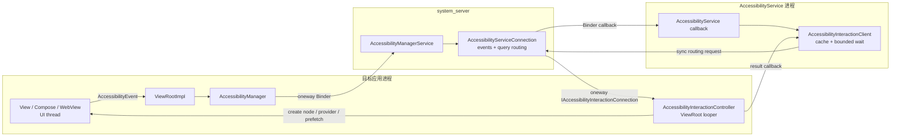
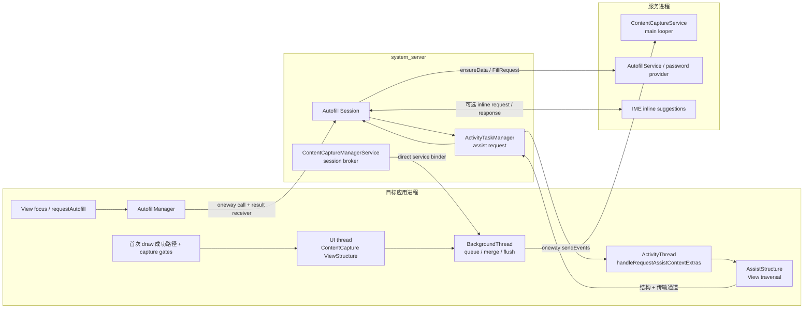

# Accessibility（无障碍）、ContentCapture 与 Autofill 性能

Accessibility、ContentCapture 与 Autofill 都会读取或描述界面状态，但三者的触发条件、采集范围和服务端组件各不相同。这类卡顿通常源于高频事件、视图树遍历、跨进程传输或第三方服务处理，排查时应先把开销定位到具体链路与进程，再着手优化。

> 源码基线：Android 17 / API 37，AOSP `android-17.0.0_r1`；全文讨论 framework、Binder、应用 UI 线程和无障碍服务进程，不涉及需要厂商内核 trace 标签才能识别的专有机制。

排查无障碍性能开销时，不能只看“无障碍是否开启”这一单一状态。无障碍框架既服务屏幕阅读器、开关控制、放大与语音控制，也被测试自动化等工具广泛使用；不同服务在订阅的事件类型、读取窗口内容的能力、节点查询频率、输入模式与内部实现上差异很大，实际影响必须拆开评估。

## 无障碍事件、节点查询与服务开销

### 两条方向相反的性能链

无障碍框架中容易影响流畅性的工作主要分布在两条路径上：

- **事件上报**：应用将点击、焦点、文本、滚动或窗口内容变化上报给系统，系统再按各服务的订阅配置分发事件。
- **节点查询**：`AccessibilityService` 主动查询窗口或节点，目标应用在 ViewRoot 所在线程构造 `AccessibilityNodeInfo`，随后通过回调返回结果。由于 ViewRoot 负责连接界面树与窗口系统，普通应用中这项工作通常运行在主线程消息循环上。

下图展示了两条路径的数据流向与实际等待结果的一方。

<!-- gracker-diagram: ch07-06-a11y-opposite-directions -->


图：上排是事件上报，下排是节点查询。应用不等待服务业务回调完成；查询结果通常由目标 ViewRoot looper 生成，服务查询线程等待。图省略输入过滤等独立路径。

<details>
<summary>对应 Mermaid 源码（保留，可展开）</summary>



</details>

两条路径的阻塞等待方向正好相反：事件通过 `oneway` Binder 调用上报，应用发出事务后即可继续执行，`AccessibilityService` 何时处理由服务进程自行安排；而节点查询则是服务侧在等待结果，目标应用需要在自己的 ViewRoot looper（消息循环）上生成节点。因此定位阻塞时，第一步要先判断当前问题落在哪条路径，再顺着对应的等待方向排查。

### 事件上报：oneway 调用的剩余成本

`IAccessibilityManager.aidl` 将 `sendAccessibilityEvent()` 声明为 `oneway`，调用方发出事务即返回。以常规 View 事件上报为例，前 4 步运行在调用方侧，第 5 步由 `system_server` 异步处理，双方按各自的时间线推进：

1. View 或 ViewParent 创建并填充 `AccessibilityEvent`；
2. `AccessibilityManager` 检查当前启用状态以及 `mRelevantEventTypes`（记录当前已绑定服务关心的事件类型）；
3. 将事件对象序列化写入 Parcel（Binder 传输参数的数据容器）；
4. Binder 驱动接收该 `oneway` 事务并入队；
5. `system_server` 的 Binder 线程校验权限、用户、窗口与事件来源信息。

可见 `oneway` 免去的只是等待远端方法返回的时间；事件创建、字符串复制、Parcel 序列化与 Binder 入队仍由调用方承担。事件频率过高时，依然会明显消耗 UI 线程 CPU、Binder 传输缓冲区以及 `system_server` 资源。

<!-- gracker-diagram: ch07-06-oneway-event-cost -->


图：oneway 免去的是等待远端方法结束，构造、复制、序列化和入队仍有成本。轨道只示意异步关系，起点与条长不代表实测时延。

#### system_server 怎样过滤和排队

事件进入 `system_server` 后，`AccessibilityManagerService.sendAccessibilityEvent()` 会先校验调用用户与包名、更新活动窗口和无障碍焦点，并在需要时让 WindowManager 重新计算可访问窗口；随后遍历当前用户已绑定的无障碍服务。

每个 `AbstractAccessibilityServiceConnection` 会按以下条件决定是否接收事件：

- 服务声明的 `eventTypes`；
- 服务声明的 `packageNames`；
- 事件来源是否被标记为对无障碍重要；
- 服务是否请求了 `FLAG_INCLUDE_NOT_IMPORTANT_VIEWS`；
- 敏感事件是否仅向 `isAccessibilityTool=true` 的服务开放；
- 当前服务是否拥有对应的访问权限。

这里需要区分“业务需要事件”和“缓存一致性需要事件”两条独立的判断线。在 `notifyAccessibilityEvent()` 中，即使 `clientWantsEvent` 为假，只要连接启用了无障碍缓存且事件属于 cache-critical 类型，系统仍可能继续投递（随后仍会检查访问权限）。到达服务客户端后，框架会先更新缓存，仅在 `serviceWantsEvent=true` 且连接有效时才回调服务的 `onAccessibilityEvent()`。因此分析流量时，应把 Binder 事件计数与业务回调计数分开看：前者反映 Binder 通信量，后者反映服务真正执行的业务逻辑量。每个满足分发条件的连接都会收到一份事件副本，再投递到 `mEventDispatchHandler`。

<!-- gracker-diagram: ch07-06-event-cache-business-gates -->


图：系统兴趣判断与缓存一致性是两个入口；通过权限与连接检查后，客户端仍先维护缓存，再判断是否运行服务业务回调。

当 `notificationTimeout > 0` 时，同一服务通常只会保留同类型事件中最新的一条待发送记录。但 `TYPE_WINDOW_CONTENT_CHANGED` 是个例外：它会绕开这组 `mPendingEvents` 合并逻辑，每条消息仍通过 `sendMessageDelayed(..., mNotificationTimeout)` 延迟投递——虽然少了合并去重，投递延迟却依然存在，评估事件去重效果时要把它单独拿出来看。

<!-- gracker-diagram: ch07-06-event-timeout-merge-exception -->


图：notificationTimeout 为正时，普通事件按类型替换待发项；内容变化事件不走这组替换，但仍应用配置的投递延迟。

在 View 端还有一层内容变化节流机制：`ViewRootImpl.SendWindowContentChangedAccessibilityEvent` 会合并可兼容的 change types（变化类型），并依据 `ViewConfiguration.getSendRecurringAccessibilityEventsInterval()` 安排发送间隔。此外，在 r1 实现中，`AccessibilityEvent.obtain()` 每次都会创建新对象，`recycle()` 为空方法；评估内存分配与发送频率时，应直接结合节流配置与实际事务计数。

> 注：从 API 33 起，`AccessibilityEvent.obtain()` / `recycle()` 等对象池 API 已停用，本文按 AOSP `android-17.0.0_r1` 实现核对，不再将其视为对象池复用的依据。

<!-- gracker-diagram: ch07-06-viewroot-content-change-throttle -->


图：ViewRoot 在发送前合并兼容变化，再按 recurring interval 调度；这是源端节流。r1 的 obtain/recycle 不再说明对象池复用。

#### 高频从哪里产生

| 事件类别 | 常见来源 | 分析重点 |
|---|---|---|
| `TYPE_VIEW_SCROLLED` | 列表、滚动容器、虚拟节点 | 每次滚动是否都附带大量文本，或触发额外节点查询 |
| <code>TYPE_<wbr>WINDOW_<wbr>CONTENT_<wbr>CHANGED</code> | 子树、文本、状态、内容描述变化 | change type、source、ViewRoot 合并情况 |
| <code>TYPE_<wbr>VIEW_<wbr>TEXT_<wbr>CHANGED</code> | 输入框、编辑器、自定义文本控件 | 是否手动重复发送，Parcel 文本是否过大 |
| 焦点事件 | 键盘焦点、无障碍焦点、虚拟节点 | touch exploration（触摸探索）与焦点移动节奏 |
| 窗口事件 | Activity、Dialog、PIP、系统窗口变化 | WMS 可访问窗口计算与服务窗口查询 |

事件总数只能反映通信频率。单个事件携带的文本体积、是否进一步触发节点查询、服务能否命中缓存，以及目标应用生成节点的复杂度，都会影响最终开销。

### 节点查询：工作落在目标应用的 ViewRoot looper

再看节点查询路径。`getRootInActiveWindow()`、`event.source` 等按节点 ID 查询的常规接口以及 `findFocus()`，可优先尝试读取当前连接的 `AccessibilityCache`（按 ID 查询还取决于 `bypassCache` 标志），命中即可直接返回。相比之下，`AccessibilityInteractionClient` 中按文本或 View ID 搜索走的是另一套查询路径，查询前没有缓存短路，`refresh()` 等调用也可能绕过缓存，具体 API 能否命中缓存需逐一核对。

<!-- gracker-diagram: ch07-06-node-cache-api-boundary -->


图：常规按 ID 查询和 findFocus 可利用缓存，refresh/bypass 与文本、View ID 搜索要按各自实现核对。缓存策略会改变目标应用工作量。

查询请求先经 `AccessibilityServiceConnection` 定位到目标窗口的 `IAccessibilityInteractionConnection`，再进入目标应用的 `AccessibilityInteractionController`。该 controller 绑定在 `ViewRootImpl.mHandler` 所在线程的 looper 上，因此常规 View 树的节点构造与应用的 UI 工作跑在同一个线程中。

节点创建有两种入口：

- 普通 View 调用 `View.createAccessibilityNodeInfo()`，进而执行 `onInitializeAccessibilityNodeInfo()`；
- 暴露虚拟节点的控件调用 `AccessibilityNodeProvider.createAccessibilityNodeInfo()`（虚拟节点没有一一对应的实体 View，常见于画布、自绘控件和 WebView 内部内容）。

这正解释了 trace 中一个常见现象：应用本身没有触发界面刷新，主线程上却出现了无障碍节点构造开销。背后发起查询的可能是另一个进程中的 `AccessibilityService`，也可能是测试工具使用的 `UiAutomation`；此外，r1 的部分 ContentCapture flag 路径同样会构造节点，后文会单独说明。

#### prefetch（预取） 策略与查询规模

单次查询究竟会拉回多少节点，取决于 prefetch 策略。框架提供了 ancestors（祖先节点）、siblings（同级节点），以及 hybrid、depth-first、breadth-first 三种后代遍历顺序，并附带三条边界约束：

- 预取结果列表的节点数上限为 `MAX_NUMBER_OF_PREFETCHED_NODES = 50`。可中断模式会先返回请求节点，再单独回传预取列表；不可中断模式则把请求节点计入同一个结果列表。需要注意，这个上限既不约束所有节点查询 API 的返回量，也不限制单个 provider 回调的执行时长；
- 可中断 prefetch 判断是否有待处理消息时，调用的是 controller 自身的 `PrivateHandler.hasMessagesOrCallbacks()`，检测范围仅限于以该 handler 为 target 的消息，ViewRoot 共享 Looper 队列中的其他输入消息需另行查看；
- 客户端会根据近期观测到的窗口滚动事件判断滚动状态，并在相应的按 ID 查询中清除 prefetch flags；绕过缓存或缓存被禁用时同样可能清除这些标志。

<!-- gracker-diagram: ch07-06-prefetch-batch-and-interruption -->


图：客户端可在滚动、禁用缓存或 bypass 时清除预取标志；两种返回模式的计数范围不同。PrivateHandler 只检测以自身为 target 的消息与回调；这些消息仍位于关联 Looper 的共享队列中，不能视为独立队列。

因此，一次 `getRootInActiveWindow()` 查询的实际负载，要结合缓存命中情况与 prefetch 实际放行的节点数来确认。排查时建议同步记录请求 API、prefetch flags、缓存是否命中、虚拟节点 provider 以及实际返回的节点数。

在耗时分布上，服务侧先通过同步的 `IAccessibilityServiceConnection` 方法完成系统路由，再进入 `AccessibilityInteractionClient` 等待结果；后一阶段的超时常量为 5000 ms，发生在发起查询的服务线程上。它既不代表整个 API 的统一耗时上限，也不会在超时瞬间取消已在目标应用上运行的节点回调。对于目标应用而言，更大的风险在于 ViewRoot looper 被节点创建任务占满，导致同一线程上的输入分发、traversal（测量、布局与绘制）或帧回调被迫延后。


### 成本应按四个进程位置拆开

| 位置 | 工作 | 卡顿表现 |
|---|---|---|
| 目标应用 | 事件构造与 Parcel 写入；节点创建、provider 查询、prefetch | UI 线程 CPU 增长，frame callback 或 traversal 排队 |
| `system_server` | 权限过滤、窗口状态维护、bound service 遍历、事件复制与排队 | Binder 或 `system_server` CPU 上升、锁竞争 |
| <code>Accessibility<wbr>Service</code> | <code>on<wbr>Accessibility<wbr>Event()</code>、cache miss 后的查询、业务处理 | 服务主线程阻塞、事件积压、反馈延迟 |
| Binder 与调度 | oneway event、query request、result callback | 线程唤醒、Parcel 处理开销、目标线程调度延迟 |

同时开启两个服务时，性能开销也未必是单个服务时的两倍。对比差异时，各服务的 `eventTypes`、`packageNames`、`notificationTimeout`、读取窗口内容的 capability、缓存利用情况与查询策略，往往比服务数量本身更具解释力。

Touch exploration（触摸探索）、按键过滤、手势观察和屏幕放大功能还会直接介入输入处理链。若观测到点击延迟或手势响应变化，需把输入过滤开销与 `AccessibilityEvent` / `AccessibilityNodeInfo` 开销分开核对；按键过滤的系统路径见 [3.1 Input 分发、拦截与安全边界](../../part1-fundamentals/ch03-input/01-input-dispatch-interception-security.md)。


### 应用侧：保持语义正确，再去掉无意义工作

优化无障碍开销有一条前提：可操作节点必须保留、状态对用户可见、必要事件正常发出，性能只能从这三者之外的冗余工作中省出来。如果无障碍语义残缺，依赖屏幕阅读器、语音控制或开关控制的用户可能连基本操作都无法完成。

#### `importantForAccessibility` 只处理装饰与重复语义

纯装饰图片、分隔线，以及语义已由父控件完整表达的重复子元素，适合设置为 `importantForAccessibility="no"`。`no` 只作用于当前节点，不会自动隐藏重要的后代节点；`NO_HIDE_DESCENDANTS` 则会将自身及整个子树标为不重要，仅适合已在上层提供等价语义与操作的容器。此外，若服务声明了 `FLAG_INCLUDE_NOT_IMPORTANT_VIEWS`，框架依然可能纳入这些节点；importance 并无隐私隔离作用，也不能保证所有查询都会等比例减少节点数。

<!-- gracker-diagram: ch07-06-a11y-importance-scope -->


图：no 针对当前节点，NO_HIDE_DESCENDANTS 声明整个子树不重要。服务请求包含不重要节点时，实际可见范围仍会变化。

下面的 XML 示例仅将无交互、无信息价值的装饰图片移出无障碍树：

```xml
<ImageView
    android:id="@+id/cardDecoration"
    android:layout_width="match_parent"
    android:layout_height="wrap_content"
    android:importantForAccessibility="no"
    android:src="@drawable/card_decoration" />
```

需要守住的边界是：按钮图标、错误提示、金额与开关状态这类用户需要感知或操作的元素，必须保留在无障碍树中。

#### 节点回调内只读取已准备好的状态

在列表滚动、焦点移动或自动化查询期间，`onInitializeAccessibilityNodeInfo()` 与 `AccessibilityNodeProvider` 可能被高频调用，而它们通常直接运行在应用 UI 路径上。因此回调内部应当只读取已经准备好的状态，把网络、磁盘或数据库读取，以及大型 JSON 解析、位图分析、全量集合排序等耗时操作移出回调。

以下自定义 View 在业务状态变更时预先生成语义文本，节点查询时仅读取已有字段。从 API 34 起，还可以在节点上声明内容变化的最小处理间隔供服务参考（注意这不会自动减少应用发往系统的事件总数）：

```kotlin
class PriceTickerView(context: Context) : View(context) {
    fun updatePrice(price: BigDecimal, change: BigDecimal) {
        contentDescription = formatPriceForAccessibility(price, change)
        invalidate()
    }

    override fun onInitializeAccessibilityNodeInfo(info: AccessibilityNodeInfo) {
        super.onInitializeAccessibilityNodeInfo(info)
        info.className = PriceTickerView::class.java.name

        if (Build.VERSION.SDK_INT >= Build.VERSION_CODES.UPSIDE_DOWN_CAKE) {
            info.minDurationBetweenContentChanges = Duration.ofMillis(500)
        }
    }
}
```

这个示例把文本格式化前移到了业务数据更新处：`View.setContentDescription()` 在描述变化时通知无障碍框架，后续节点初始化只需直接读取 View 已保存的属性。`AccessibilityService` 可读取节点声明的最小间隔，并据此节流来自该节点的内容变化事件。`setMinDurationBetweenContentChanges()` 适合进度条、计时器、实时行情这类高频变化但无需逐次播报的控件，具体间隔按用户可理解的更新节奏设定，而焦点、错误提示、可操作状态与关键结果仍应及时上报。


批量更新列表时，将真实内容临时设为 `NO_HIDE_DESCENDANTS` 往往会引发更多副作用：当前焦点节点丢失、节点树结构震荡，甚至触发额外的变化事件。列表更新仍应通过增量数据配合准确的 change type，交给 ViewRoot 或控件库自身的事件合并机制处理。

#### RecyclerView

标准 RecyclerView 路径下，节点与集合信息主要由当前附着的 item 和 LayoutManager 提供，一次常规节点查询并不会遍历全部数据集；如果使用了自定义 delegate 或 provider 扩展了虚拟层级，仍需另行核对。应用侧更常见的额外开销主要来自以下四点：

- item delegate（列表项无障碍代理）动态拼接复杂的描述文本；
- 每次 bind（绑定数据）都重复创建并安装 delegate，或生成大量 action；
- 滥用全量 `notifyDataSetChanged()`，导致语义信息与可见内容大面积失效；
- item 的语义状态未随数据同步更新，迫使服务反复调用 `refresh()`。

对应改法也很明确：利用 `DiffUtil` / `ListAdapter` 精确刷新发生变化的条目，复用稳定的 delegate 实例，并在业务状态变更时同步更新简洁的 `stateDescription`、文本与 action。


### Compose：按逻辑控件设计 semantics tree（语义树）

Compose 在 UI 树之外单独维护一棵 semantics tree，供无障碍服务和测试工具读取；哪些 layout node（布局节点）会进入 semantics node，取决于它是否附带语义属性。例如为 `Column` 添加 `Modifier.semantics {}`，并不意味框架每次都会递归重建整个 `Column` 的全部子树。

排查时应区分两种语义视图：

- **unmerged tree（未合并树）**：保留各个独立的 semantics node，`AccessibilityService` 会结合 `mergeDescendants` 自行处理；
- **merged tree（合并树）**：测试 API 默认读取的视图，会依据 `mergeDescendants` 与 `clearAndSetSemantics` 合并简化节点。

Material 与 Foundation 中的 `Button`、`clickable`、`toggleable` 等组件已内置了合理的语义与合并规则。编写自定义组件时，可以精简装饰性或重复节点，同时完整保留逻辑控件应有的说明与操作：

- 装饰性或重复内容可使用 `hideFromAccessibility()`，同时保留自动化测试所需的语义；装饰性 `Icon` / `Image` 可设置 `contentDescription = null`，空字符串无法统一隐藏任意组件；
- 一组文字、图标与单一点击动作可按逻辑控件合并；
- 子项拥有独立交互动作时，需保留独立语义节点；
- `clearAndSetSemantics` 会覆盖无障碍服务和测试工具看到的子树语义，上线前应验证 TalkBack、Switch Access、Voice Access 以及自动化测试；
- 动画每帧变化但用户无需逐帧感知的数值，避免每帧写入语义属性。

由于 Compose 属于独立的 AndroidX 依赖库，其性能表现应按项目实际锁定的 Compose 版本核对，Android 17 平台版本标签无法替代库版本。

<!-- gracker-diagram: ch07-06-compose-two-semantics-views -->


图：同一界面可有合并与未合并两种语义视图。合并应服务于逻辑操作；节点更少要以语义和测试正确性都保住为前提。

### AccessibilityService 开发者：缩小订阅与查询范围

若具备 `AccessibilityService` 源码控制权，优化通常应从精简服务配置与查询策略着手。

下面以面向残障用户的辅助工具为例：配置中仅订阅目标包名下的点击与窗口切换业务事件，并声明读取窗口内容所需的能力。`isAccessibilityTool=true` 应如实反映工具用途，真正决定性能开销与数据访问范围的是事件订阅与 capability 等实际配置，同时缓存维护事件仍会走前述独立路径。

```xml
<accessibility-service
    android:accessibilityEventTypes="typeViewClicked|typeWindowStateChanged"
    android:accessibilityFeedbackType="feedbackSpoken"
    android:notificationTimeout="100"
    android:packageNames="com.example.target"
    android:canRetrieveWindowContent="true"
    android:isAccessibilityTool="true" />
```

若服务确需适配所有应用，`packageNames` 应按实际业务需求配置；能力范围需与产品功能匹配，仅在确实需要读取窗口内容时才申请相应 capability（能力声明）。

服务侧建议遵守七项工程约束：

1. `eventTypes` 仅订阅功能所需的事件类型，场景切换时可通过 `setServiceInfo()` 动态收窄。
2. 为可合并事件设置合理的 `notificationTimeout`，并对绕开合并的 `TYPE_WINDOW_CONTENT_CHANGED` 单独实测。
3. 保证 `onAccessibilityEvent()` 快速返回，把网络、磁盘、模型推理与大规模解析转交工作线程。
4. 优先消费事件自带字段与明确的 source（来源节点），仅在缓存未命中时再发起节点查询。
5. 避免每个事件都调用 `getRootInActiveWindow()`，也不应从根节点反复全树扫描同一目标节点。
6. 跨线程仅传递所需的稳定字符串、ID、业务值或显式复制的快照，避免持有大对象与过期语义状态（无需再以 r1 中已停用的事件对象池回收机制解释此约束）。
7. 记录查询 API、缓存命中/未命中、返回节点数及业务触发原因，以便与目标应用 trace 对齐。

在服务主线程同步等待节点查询结果期间，服务收到的其他事件也可能被迫排队。因此高频查询根节点不仅加重目标应用 UI 线程负担，也会拖慢服务自身的响应反馈。


### 测量条件与 A/B 设计

#### A/B 条件

对照实验须先固定基准条件：设备机型、build（系统构建版本）、刷新率、机身温度、账号数据与交互脚本保持一致，至少比对以下四组：

1. 不启用目标服务；
2. 仅启用目标服务；
3. 目标服务与用户常用服务同时启用；
4. 服务功能不变，但精简了 event types（事件类型）、节点查询与后台工作的版本。

停用用户辅助服务的测试只能在受控测试设备上、在用户明确知情的前提下进行；面向线上产品优化流畅度时，应从应用自身与可控服务的配置入手，保持用户的 `AccessibilityService` 原状。

#### Perfetto：定位线程和帧

采集 trace 时，至少需要涵盖 FrameTimeline、应用主线程、`system_server`、`AccessibilityService` 进程、Binder driver、sched、freq 以及应用自定义业务 slice（时间片标记，其中 sched / freq 记录线程调度与 CPU 频率）。分析时沿着以下顺序逐项检查：

- App frame（应用帧）迟到之前，主线程是否出现节点查询任务或耗时较长的 `onInitializeAccessibilityNodeInfo()`；
- 事件上报的 oneway Binder 事务数量与 Parcel 体积是否异常；
- `system_server` 是否忙于可访问窗口计算、服务过滤或持锁等待；
- 服务主线程是否停在 `AccessibilityInteractionClient` 中等待查询结果；
- 节点结果返回后，服务是否随即进入长时间的 CPU、I/O 或 Binder 操作。

`BinderProxy.transactNative` 仅说明发生了一次 Binder 调用，调用意图仍需结合 interface / method（接口与方法）、调用进程及回调时序判断。由于事件上报与节点查询方向相反，必须先辨明路径再向下归因。


#### Android 17 accessibility trace

在面向调试和工程验证的 `userdebug` 与 `eng` 构建上，可启用系统专用的 accessibility trace。以下命令仅开启核心接口类型，以减少无关无障碍调用对缓冲区的挤占：

```bash
adb root
adb shell cmd accessibility start-trace -t \
  IAccessibilityManager \
  IAccessibilityServiceConnection \
  IAccessibilityInteractionConnection \
  IAccessibilityInteractionConnectionCallback \
  AccessibilityService

# 复现目标操作

adb shell cmd accessibility stop-trace
adb pull /data/misc/a11ytrace/a11y_trace.winscope
```

r1 源码明确禁止在面向普通用户的 user build 上启用该 trace。由于 `stop-trace` 会异步写入 Winscope 文件，执行 `adb pull` 前应先确认文件已落盘。Tracing 会记录调用参数、线程与调用栈并引入明显开销，只适合短时间复现定位。


#### dumpsys 的用途与局限

`adb shell dumpsys accessibility` 可用于查看当前用户处于 bound、enabled、binding 或 crashed 状态（已连接、已启用、正在连接或已崩溃）的服务列表；每个 bound service 的输出还包含 label、feedback type、capabilities、event types、`notificationTimeout` 与 accessibility button 请求。

配置状态检查到此即可，事件频率与查询频率还需借助其他工具测量：AOSP dump 仅提供配置视图，并不输出通用的“Event Dispatch Statistics”或“Interaction Connection Pool”计数器，在 AOSP 设备上需改用 trace、自有计数或服务日志统计；若厂商版本扩展了额外字段，报告中应注明对应的 build。

### 归因表

| 现象 | 还缺的证据 | 更可能的负责位置 |
|---|---|---|
| App 主线程长时间执行节点回调 | 查询来源、node / provider、prefetch、返回数量 | App 自定义 View、Compose adapter 或 WebView provider |
| App 有大量短 oneway event transaction | 事件类型、source、文本大小、ViewRoot 合并 | App 事件设计或高频状态更新 |
| 服务主线程停在 <code>Accessibility<wbr>Interaction<wbr>Client</code> | cache miss、目标窗口、callback 时间 | 目标 App UI、`system_server` 路由或服务查询策略 |
| 服务收到事件后长时间运行 | <code>on<wbr>Accessibility<wbr>Event()</code> 后续 CPU/I/O | AccessibilityService 实现 |
| `system_server` 中 A11yMS 段变长 | bound service 数、窗口计算、锁和 CPU 调度 | framework、WMS 或设备系统实现 |
| 开启 touch exploration 后输入节奏变化 | `InputFilter`、手势 / 按键配置、事件与帧 | Accessibility input path（无障碍输入路径），不能只看节点树 |

归因必须落到具体执行路径上：“开启无障碍后变慢”只是现象起点，报告中需写清究竟是事件上报、节点查询、节点构造、服务处理还是输入过滤引入了瓶颈。

### 运行时上下文与隐私

`AccessibilityManager.isEnabled()` 返回的是框架当前是否启用了无障碍事件发送。正如 Javadoc 所提示，不应将产品的 UI 差异或交互逻辑挂在这个状态上——专门分叉出的分支往往缺乏充分测试，反而会让辅助技术用户拿到维护较差的体验。该状态更适合作为性能监控的上下文标签，结合节点查询、输入辅助与具体服务能力一并分析。

性能监控可采集以下受控上下文信息：

- `accessibility enabled` 状态；
- `touch exploration enabled` 状态；
- 当前页面是否包含 SurfaceView、WebView、Compose 或大量虚拟节点；
- 测试设备上已启用服务的数量与反馈类型。

由于 `getEnabledAccessibilityServiceList()` 会触发跨 Binder 查询，调用应放在低频路径上。此外，已启用的服务清单可能暴露敏感的用户设备状态，线上采集前须通过隐私评审，优先上报匿名化的能力类别与数量，能够定位具体应用的组件名称应保留在本地。


### Android 12—17 版本边界

- **Android 12 / API 31**：`AccessibilityServiceInfo.isAccessibilityTool()` 成为公开 API，系统可以区分面向残障用户的辅助工具和其他服务。
- **Android 13 / API 33**：新增节点 prefetch strategy 与 `MAX_NUMBER_OF_PREFETCHED_NODES = 50`；多项 `obtain()` / `recycle()` 对象池 API 被废弃。
- **Android 14 / API 34**：新增 `setMinDurationBetweenContentChanges()` 和 accessibility data sensitive（无障碍数据敏感）能力，为高频内容节流和敏感事件过滤提供公开接口。
- **Android 17 / API 37**：按 `android-17.0.0_r1` 核对。事件仍通过 oneway `sendAccessibilityEvent()` 上报；服务连接仍按配置过滤/延迟；节点请求仍进入目标 ViewRoot looper，并受缓存、prefetch 策略和 50 节点上限约束。

平台版本无法替代 `AccessibilityService`、TalkBack、Compose、WebView 与厂商 framework 的具体版本。任何以百分比形式给出的性能结论，都应写明设备型号、服务版本、页面结构、交互脚本与 trace 条件，更换设备后仍须重新验证。


### 无障碍源码与资料

- [`AccessibilityEvent.java`](https://android.googlesource.com/platform/frameworks/base/+/android-17.0.0_r1/core/java/android/view/accessibility/AccessibilityEvent.java) 与 [`AccessibilityService.java`](https://android.googlesource.com/platform/frameworks/base/+/android-17.0.0_r1/core/java/android/accessibilityservice/AccessibilityService.java)：已停用对象池、缓存维护事件与业务回调门控。

- [`AccessibilityManager.java`](https://android.googlesource.com/platform/frameworks/base/+/android-17.0.0_r1/core/java/android/view/accessibility/AccessibilityManager.java) 与 [`IAccessibilityManager.aidl`](https://android.googlesource.com/platform/frameworks/base/+/android-17.0.0_r1/core/java/android/view/accessibility/IAccessibilityManager.aidl)：客户端状态、相关事件过滤和 `oneway` 上报。
- [`AccessibilityManagerService.java`](https://android.googlesource.com/platform/frameworks/base/+/android-17.0.0_r1/services/accessibility/java/com/android/server/accessibility/AccessibilityManagerService.java)：事件安全检查、窗口更新与 bound service 分发。
- [`AbstractAccessibilityServiceConnection.java`](https://android.googlesource.com/platform/frameworks/base/+/android-17.0.0_r1/services/accessibility/java/com/android/server/accessibility/AbstractAccessibilityServiceConnection.java)：事件类型、包名、敏感数据、重要性与 `notificationTimeout` 处理。
- [`AccessibilityInteractionClient.java`](https://android.googlesource.com/platform/frameworks/base/+/android-17.0.0_r1/core/java/android/view/accessibility/AccessibilityInteractionClient.java) 与 [`AccessibilityInteractionController.java`](https://android.googlesource.com/platform/frameworks/base/+/android-17.0.0_r1/core/java/android/view/AccessibilityInteractionController.java)：cache、5000 ms 等待、ViewRoot handler、节点创建和 prefetch。
- [`ViewRootImpl.java`](https://android.googlesource.com/platform/frameworks/base/+/android-17.0.0_r1/core/java/android/view/ViewRootImpl.java) 与 [`View.java`](https://android.googlesource.com/platform/frameworks/base/+/android-17.0.0_r1/core/java/android/view/View.java)：事件上报、窗口内容变化合并与节点初始化。
- [`AccessibilityNodeInfo.java`](https://android.googlesource.com/platform/frameworks/base/+/android-17.0.0_r1/core/java/android/view/accessibility/AccessibilityNodeInfo.java) 与 [`AccessibilityServiceInfo.java`](https://android.googlesource.com/platform/frameworks/base/+/android-17.0.0_r1/core/java/android/accessibilityservice/AccessibilityServiceInfo.java)：prefetch、最小内容变化间隔、事件订阅与服务配置。
- [`AccessibilityTraceManager.java`](https://android.googlesource.com/platform/frameworks/base/+/android-17.0.0_r1/services/accessibility/java/com/android/server/accessibility/AccessibilityTraceManager.java) 与 [`AccessibilityController.java`](https://android.googlesource.com/platform/frameworks/base/+/android-17.0.0_r1/services/core/java/com/android/server/wm/AccessibilityController.java)：trace 命令、user build 限制与输出文件。
- [AccessibilityManager API](https://developer.android.com/reference/android/view/accessibility/AccessibilityManager)、[AccessibilityServiceInfo API](https://developer.android.com/reference/android/accessibilityservice/AccessibilityServiceInfo) 与 [创建 AccessibilityService](https://developer.android.com/guide/topics/ui/accessibility/service)：公开接口契约。
- [Compose semantics](https://developer.android.com/develop/ui/compose/accessibility/semantics) 与 [merging/clearing](https://developer.android.com/develop/ui/compose/accessibility/merging-clearing)：merged / unmerged tree 和语义边界。


## 内容捕获、自动填充与视图结构传输

无障碍服务聚焦于交互辅助，而 ContentCapture 与 Autofill 分别服务于页面内容理解和表单自动填充。三者都可能遍历同一棵视图树，但触发开关、作用范围和归因方法各不相同，排查时必须独立核对。

首先分清两者的入口差异：ContentCapture 持续向系统选定的服务上报界面内容变化；Autofill 则由会话、字段焦点或显式请求触发，仅在需要新结构或生成响应时采集窗口快照，且在合适条件下可以复用已有上下文。至于视图树遍历是否发生、执行几次，完全取决于触发条件：一次焦点切换可能触发全新遍历，也可能只复用既有上下文；单个会话可能只采集一次，也可能采集多次，对应的数据模型和进程流向也随之变化。

当密码管理器、IME 与 WebView 同时在场时，更要把各条路径产生的开销拆开看。

### 三个容易混在一起的数据模型

开始定位前，先区分三套框架各自的数据载体与消费者：

| 框架 | 主要数据对象 | 生成方式 | 常见消费者 |
|---|---|---|---|
| Accessibility | `AccessibilityEvent`、<code>Accessibility<wbr>Node<wbr>Info</code> | 事件上报；服务按需查询节点 | TalkBack、Switch Access、自动化工具 |
| ContentCapture | `ContentCaptureEvent`、轻量 `ViewNode` / `ViewStructure` | 初始结构报告；View 出现、消失、文本变化等增量事件 | 系统选中并授权的 <code>Content<wbr>Capture<wbr>Service</code> |
| Autofill | `AssistStructure`、`FillRequest` | Autofill 会话触发后采集应用窗口结构 | `AutofillService`、密码管理器、Credential Manager 相关提供方 |

ContentCapture 的常规采集采用自有的 `ContentCaptureEvent` 与轻量 `ViewNode`，增量更新时并不会重建完整的 `AssistStructure`；真正承载完整结构快照的是 Autofill 管线。如果把这三者统称为“无障碍全树扫描”，就会混淆究竟是谁发起了请求、工作落在哪条线程，优化位置也无从下手。


下图展示了 ContentCapture 与 Autofill 各自的调用走向。

<!-- gracker-diagram: ch07-06-contentcapture-autofill-directions -->


图：两列各有会话和授权条件。ContentCapture 连接建立后事件直送服务；Autofill 由系统请求应用构建结构并路由给提供方，相邻的工作要按各自的触发者分开认。

<details>
<summary>对应 Mermaid 源码（保留，可展开）</summary>



</details>

从流向可以看出：ContentCapture 会话由 `system_server` 协调建立，连接就绪后，应用便通过服务提供的 direct Binder 将事件批次直接发往服务，无需每批都再绕道 `system_server`；而 Autofill 的结构请求则是由 `system_server` 反向发给应用，在应用主线程采集完毕后再转交数据提供方。两条路径可能在相同时间窗口内并存，但时间重叠只代表两边都在运行，至于是否重复采集了同一份界面结构，仍要依据各自的数据对象与触发条件核对。

### ContentCapture：初始 UI 遍历与后台事件管线

#### `system_server` 负责会话，事件直送服务

在 Activity 创建阶段，`ContentCaptureManager` 通过 `IContentCaptureManager.startSession()` 请求 `ContentCaptureManagerService` 建立会话。这个 AIDL 接口为 `oneway`，结果通过 `IResultReceiver` 异步返回；服务端完成权限、用户、组件与 allowlist（允许列表）校验后，会把 `IContentCaptureDirectManager` Binder 交给应用。

拿到 direct Binder 后，后续事件便不再逐批经过 `system_server`：`MainContentCaptureSession` 直接调用直连接口的 `sendEvents()`，将装载一批 `ContentCaptureEvent` 的 `ParceledListSlice` 发往 `ContentCaptureService`，该接口同样为 `oneway`。

<!-- gracker-diagram: ch07-06-contentcapture-broker-and-direct -->


图：系统代理决定会话与连接，后续 sendEvents 由应用直达 ContentCaptureService。oneway 返回与服务 main looper 已处理完成是不同边界。

与无障碍事件上报相似，`oneway` 免去的只是发送方等待远端返回这一段；应用侧依然要承担事件构造、文本复制、Parcel 写入以及 Binder 入队的开销，如果服务端消费过慢，还会进一步挤占异步 Binder 配额与系统 CPU。

#### 初始结构生成仍在 UI 线程

初始结构的生成则直接发生在 UI 线程上。首次走通 `performDraw()` 成功路径且初始报告标志有效时，`ViewRootImpl` 会调用 `performContentCaptureInitialReport()`——这里的 draw 指绘制路径走通（画面此时未必已经上屏），且仍需通过启用状态、根节点 importance 与 session 等门控校验。通过后，框架先调用根 View 的 `dispatchInitialProvideContentCaptureStructure()`，再由 `ViewGroup.dispatchProvideContentCaptureStructure()` 递归遍历允许采集的子节点，各节点通过 `onProvideContentCaptureStructure()` 填充结构信息。

这段工作直接嵌入在 ViewRoot 的 traversal 路径中。若自定义 View 在结构回调里执行磁盘、数据库或网络读取，或是临时解析大型对象，就会直接拖长这一次主线程帧工作。

<!-- gracker-diagram: ch07-06-contentcapture-initial-report-gates -->


图：初始报告在 ViewRoot 绘制成功路径中执行，经过启用、根节点和 session 检查后遍历；回调耗时会延长对应 UI 任务。

遍历范围由 `importantForContentCapture` 与 View 的启发式判断共同决定。`no` 仅排除当前节点，框架仍可能继续访问其子节点；`noExcludeDescendants` 才会把整棵子树排除在采集之外。一旦父节点启用了 exclude-descendants（排除后代）模式，即便子节点显式标为重要，也不会再进入此次采集。

<!-- gracker-diagram: ch07-06-contentcapture-importance-pruning -->


图：普通容器 no 只排除自身，重要后代仍可被寻找；exclude-descendants 模式由祖先约束后代。根节点初始报告还有独立入口检查。

#### 后续变化按 traversal 批量转交

初始结构上报之后，后续界面变化走批量异步管线。View 的出现、消失与交互变更先记录在 `AttachInfo` 中，`ViewRootImpl` 在 traversal 收尾阶段调用 `notifyContentCaptureEvents()`，由主会话通过 `mUiHandler` 准备对应的 `ViewStructure`——在 r1 中该 handler 绑定应用主 looper，普通应用窗口通常与它同线程，若涉及自建 ViewRoot 则需单独核对 looper 归属。读取完属性后，事件转入应用进程的 `BackgroundThread`：

<!-- gracker-diagram: ch07-06-contentcapture-dynamic-thread-handoff -->


图：动态 View 报告先准备结构，再交给后台；文本等通知还可经过独立事件队列。消失 ID 不需要重建对应 View 结构，图省略交互类细节。

- `ConcurrentLinkedQueue` 汇集来自不同线程的事件；
- 输入法处于组合候选文本期间产生的 composing 事件，可与同一节点的待发事件合并；
- 连续的 disappeared 事件可合并为一个携带多个 ID 的事件；
- 当缓冲区达到 `maxBufferSize`，或遇到会话边界、显式 flush、idle timeout、text-change timeout 时触发发送（这里的 flush 指尝试派发当前缓冲批次；若遇空批次、禁用状态或 direct Binder 尚未就绪则可能直接返回或延后，服务端是否实际收到并处理仍需服务侧证据确认）；
- 批次经由 direct `oneway` Binder 发往 `ContentCaptureService`。


分析 ContentCapture 开销时必须两端兼顾：既看 UI 线程上的 `ViewStructure` 准备，也看后台线程上的事件合并、Parcel 写入与 Binder 发送；只看其中一侧很难拼出完整耗时。

此外，r1 还提供了一组按 flag 与采集条件启用的桥接路径：`newHeuristicsForImportanceEnabled()` 允许部分非 TextView 的结构准备调用 `View.createAccessibilityNodeInfo()` 补充描述；`enableExportAssistVirtualNodeToCcapi()` 在配合 provider 与对应条件时，可在 ContentCapture 后台线程导出虚拟子节点。这条桥接仅服务于 ContentCapture 自身的结构描述，由相应 flag 和采集条件触发，与 `AccessibilityService` 发起的无障碍查询或 `AccessibilityEvent` 驱动的常规采集属于不同路径。在 trace 中看到节点回调时，应先核对调用栈、flag 与执行线程。

<!-- gracker-diagram: ch07-06-contentcapture-optional-node-bridge -->


图：r1 可按开关复用节点语义或导出虚拟子节点；这条路径服务于 ContentCapture 自己的结构描述，常规事件模型保持原样，AccessibilityService 那边的查询另有入口。

#### 服务回调运行在服务主线程

事件批次抵达服务端后，`ContentCaptureService` 的 direct Binder stub（接收 Binder 调用的服务端对象）将消息投递到服务进程的 main looper，按事件类型分派：普通内容事件进入 `onContentCaptureEvent()`，会话创建与销毁由对应的生命周期回调处理。一旦回调内部执行大规模解析、同步 I/O 或模型推理，服务自身的事件队列就会发生积压；由于应用侧调用是 `oneway`，应用通常照常运行，这类积压往往表现为服务响应滞后、异步 Binder 压力升高或系统 CPU 占用上升。

<!-- gracker-diagram: ch07-06-contentcapture-service-main-queue -->


图：内容与生命周期回调在服务主 looper 分派。服务回调慢首先影响其队列与反馈，是否进一步影响 App 仍须按传输和调度证据判断。

ContentCapture 的结构体积与采集耗时不存在跨设备通用阈值：节点字段数、文本长度、虚拟层级、更新频率、服务配置和设备 CPU 性能都会改变实际耗费，类似“500 个 View 固定耗时 30–100 ms”的数字仅对当时的特定测试条件成立。

### Autofill：会话等待、AssistStructure 与提供方响应

#### 焦点进入才是常见入口

标准 View 获得焦点时会间接触发 `AutofillManager.notifyViewEntered()`，自定义控件也可在用户触发自动填充操作时显式调用 `requestAutofill()`。Autofill 的流程通常从这类焦点事件或显式请求启动，完整的结构采集也等待这些时机，View 树刚构建完成时并不会自动触发。

虽然 `IAutoFillManager` 是 `oneway` 接口，但 `AutofillManager` 的 `addClient()` 与 `startSession()` 会携带 `SyncResultReceiver`，通过结果通道等待会话建立完成，保护超时常量为 5000 ms。由于焦点事件多由 UI 线程处理，在 trace 中遇到 `SyncResultReceiver` 等待时，应顺着 Binder flow（跨进程调用流）继续追查 `system_server` 创建 Autofill 会话的耗时。


需要注意，5000 ms 只是异常保护上限，正常等待耗时仍以实测为准；系统契约中也并不存在“每次 Binder 固定消耗 5–10 ms”的规律。

#### AssistStructure 在应用主线程采集

会话就绪后，当 Autofill Session 需要新响应时，会通过 `ActivityTaskManager.requestAutofillData()` 向应用请求 assist data（辅助上下文数据）。应用侧的 `ActivityThread.handleRequestAssistContextExtras()` 在主线程创建 `AssistStructure`（描述当前窗口与可填充节点的快照）。构造时会枚举 Activity 的 ViewRoot 并调用根 View 的 `dispatchProvideAutofillStructure()`：

1. `View.onProvideAutofillStructure()` 写入资源 ID、尺寸、可见性、autofill type、hints、value 等字段；
2. `View.onProvideAutofillVirtualStructure()` 允许 WebView、自绘控件等暴露没有对应实体 View 的虚拟节点；
3. `ViewGroup` 筛选需要纳入结构的子节点并递归采集；
4. `ActivityThread` 记录 acquisition start / end（采集开始 / 结束），再将结构的传输通道回传给 `system_server`。

<!-- gracker-diagram: ch07-06-autofill-assist-main-thread -->


图：ActivityThread 处理 Autofill 类型的 assist 请求时创建结构，枚举窗口并调用结构回调。采集时间戳结束后仍可能存在异步补齐和多轮取数。

这些结构回调与应用 UI 渲染共用主线程。虚拟层级可以通过 `asyncNewChild()` / `asyncCommit()` 在异步任务中补齐；而 `AssistStructure.waitForReady()` 会在传输通道开始写出结构时等待异步子节点，超时预算为 5000 ms。在常规跨进程读取中，这段等待发生在应用处理 Binder 取数请求的线程上，与 Activity 主线程遍历分开统计；一旦超时，传输头中的窗口数将被置为 0。同时，`ActivityThread` 记录的 acquisition start / end 早于后续的惰性传输阶段，因此异步补齐、分段传输以及提供方响应的总耗时仍需单独计量。

<!-- gracker-diagram: ed07-06-three-wait-budgets -->


图：三行是独立调用路径：服务线程在同步路由返回后等节点结果；Autofill 调用线程按需等客户端状态/session ID；AssistStructure 惰性取数时，应用处理 Binder 请求的线程可等异步子节点。各自 5000 ms 是阶段保护预算，不能相加估算正常或端到端耗时。节点超时不取消应用任务，会话结果也不等全部建议生成；虚拟子节点超时可令传输头窗口数为 0，主线程 acquisition 之后的等待、分段传输与提供方响应仍需另计。

#### 大结构采用分段传输

`AssistStructure` 采用分段传输机制，无需将整个对象塞进单次 Binder transaction：`ParcelTransferWriter` 在 Parcel 达到 `IBinder.MAX_IPC_SIZE` 边界后写入 continuation token（续传令牌），接收方凭令牌继续拉取下一段。随后 `Session.AssistDataReceiver` 调用 `ensureDataForAutofill()` 收齐完整数据，建立代表本次填充上下文的 `FillContext`，进而构造 `FillRequest`。

分段传输能有效控制单批数据体积；不过 r1 是在写完一个 entry 之后才校验 `IBinder.MAX_IPC_SIZE`，因此体积异常庞大的单个字段或节点仍有触发传输失败的风险。此外，节点遍历、字段复制、序列化、反序列化与多次 Binder 往返的开销依然存在。排查报告中应记录当次采集的 window 数、node 数、文本规模、采集时长与分段次数，避免直接套用“中等页面 1–5 MB”之类的经验估算。

<!-- gracker-diagram: ch07-06-assiststructure-chunked-transfer -->


图：结构先报告通道，系统再按片段读取；应用通道端等待异步子节点并写数据。分段控制批次体积；检查发生在写入之后，异常大的单个 entry 仍有传输失败的风险。

#### 密码管理器、IME 与结构采集的关系

用户选用的 `AutofillService` 通常由密码管理器提供，而 IME inline suggestions（输入法内联建议）只是呈现 Autofill 候选数据集的一种交互界面：在 IME 与提供方均支持、且当前请求启用了 inline 的路径下，Autofill Session 会向 IME 获取可选的 `InlineSuggestionsRequest`，随 `FillRequest` 一并交给提供方，再协调建议的渲染与 IME 展示；若不支持或请求为空，则仍走其他建议 UI 路径。

这层协作会增加 `system_server`、提供方、IME 与渲染服务之间的 IPC 和等待，也可能与软键盘弹出动画在时间上重叠。不过该协作直接复用了既有的结构数据：IME 无需为此重新构建一份 `AssistStructure`，主、次提供方路径也可以共享已有的 `FillContext`，因此提供方数量与应用 View 树的遍历次数之间并无线性换算关系。

<!-- gracker-diagram: ch07-06-autofill-inline-optional-path -->


图：inline 是可选展示路径，IME 参与内联请求与建议展示，无须为此独立再建一份 AssistStructure。候选晚到应沿系统、提供方、IME 与渲染分段取证，遍历次数与提供方数量之间没有换算关系。

IME 自身的启动、`InputConnection` 与窗口动画开销见 [3.5 InputMethodManager 与软键盘性能](../../part1-fundamentals/ch03-input/05-input-method-manager-performance.md)；Binder 等待与异步事务容量分析可结合 [1.9 Android IPC 全景与 Binder 性能](../../part1-fundamentals/ch01-architecture/09-ipc-binder-performance.md)。

### 把成本按线程和进程拆开

| 位置 | ContentCapture | Autofill | trace 中的表现 |
|---|---|---|---|
| 应用 UI 线程 | 初始结构遍历；动态节点的 `ViewStructure` 准备 | 等待会话结果；遍历 `AssistStructure` | frame / traversal 延长、主线程 waiting 或 Runnable |
| 应用后台线程 | 事件合并、buffer、Parcel、direct Binder | 通常不负责遍历标准 View 的 `AssistStructure` | `BackgroundThread` CPU、Binder transaction |
| `system_server` | 会话、allowlist、服务连接 | Session、assist request、`FillContext`、IME 协调 | Autofill / ATM handler、Binder、锁与调度 |
| <code>Content<wbr>Capture<wbr>Service</code> | 主线程逐个处理增量事件 | 无 | 服务 main looper 积压 |
| `AutofillService` / 密码提供方 | 无 | 解析 `FillRequest`、生成 dataset、处理认证 | provider CPU / I/O、response latency |
| IME | 无 | inline request、展示与交互 | IME main/render、窗口动画 |

当应用 UI 线程出现较长的 traversal 时，先确认触发方是 ContentCapture 初始报告还是 Autofill assist request；若后台 `sendEvents()` 变长，则检查事件批次、Parcel 体积与 Binder 异步压力。若出现候选建议迟到但 App 帧时间正常的情况，应继续拆解系统路由、提供方响应、IME 与建议渲染各段时延以定位瓶颈——App 帧正常只说明当前未观察到帧超时，端到端响应时延仍须沿着整条跨进程链路分段核对。

### 应用侧结构设计

#### 让登录字段保留明确语义

下面的 XML 为登录字段提供了稳定的 hints（字段类型提示），并将纯装饰图片标为对 ContentCapture 与 Autofill 不重要。ContentCapture 的常规遍历会据此过滤，而 Autofill 的实际纳入范围仍受请求 flags 和设备选项影响，因此这份配置只是基础声明，两种结构最终是否都排除了装饰节点，仍须结合具体请求模式核对。

```xml
<LinearLayout
    android:layout_width="match_parent"
    android:layout_height="wrap_content"
    android:orientation="vertical">

    <ImageView
        android:layout_width="match_parent"
        android:layout_height="96dp"
        android:importantForAutofill="no"
        android:importantForContentCapture="no"
        android:src="@drawable/login_decoration" />

    <EditText
        android:id="@+id/username"
        android:layout_width="match_parent"
        android:layout_height="wrap_content"
        android:autofillHints="username"
        android:importantForAutofill="yes"
        android:inputType="textEmailAddress" />

    <EditText
        android:id="@+id/password"
        android:layout_width="match_parent"
        android:layout_height="wrap_content"
        android:autofillHints="password"
        android:importantForAutofill="yes"
        android:inputType="textPassword" />
</LinearLayout>
```

`autofillHints` 有助于提供方准确识别字段用途，但系统必要的结构采集仍会正常执行；用户名、密码、地址、银行卡等需要自动填充的字段应完整保留，精简范围主要针对纯装饰性元素。

只有在整块容器内都不存在任何可填充字段或可采集内容时，才适合考虑使用 `noExcludeDescendants`：ContentCapture 会据此跳过整棵子树，后续子树内新增的有效内容服务也将无法感知。Autofill 的同名属性虽表达相同意图，但请求 flags 与系统配置仍可能要求包含更多节点，涉及复用组件与动态页面时应做好回归验证。

从 Android 14 / API 34 起，Autofill 会综合 importance、其他 View 属性、请求 flags 与系统配置选项来共同决定是否触发以及纳入哪些节点；手动触发请求、compat mode（兼容模式）、PCC detection（Autofill 的字段分类检测流程）或设备策略，都可能将原本标为不重要的节点重新纳入结构。因此 `importantForAutofill` 属于语义提示，具体能精简多少结构取决于当次请求的组合判断。

<!-- gracker-diagram: ch07-06-autofill-importance-request-gates -->


图：字段类型提示改善识别，不省略系统必要采集。实际结构由 importance、请求 flags、View 属性与设备选项组合决定，回归应覆盖相关请求模式。

#### 保持结构回调纯内存

`onProvideAutofillStructure()`、`onProvideAutofillVirtualStructure()` 与 `onProvideContentCaptureStructure()` 应当只读取已经就绪的 UI 状态，避免以下耗时操作进入回调：

- 数据库、文件、网络和跨进程查询；
- 为生成描述临时解码图片或解析整份文档；
- 对全量业务集合排序、去重或格式转换；
- 等待锁、`Future` 或主线程之外的渲染进程；
- 每次回调重新构造固定不变的 hints、资源映射与长文本。

对于自绘控件与虚拟层级，应保持稳定的 `AutofillId` 以便框架在多次请求间识别同一节点，同时仅暴露当前可交互、语义完整的节点。ContentCapture 下的多个虚拟节点可通过 `notifyViewsAppeared()` / `notifyViewsDisappeared()` 批量上报，Autofill 的异步虚拟节点则必须在时限内调用 `asyncCommit()`；批量接口可以减少通信次数，但哪些节点需要上报仍由产品语义决定。

#### 避免重复触发

标准的 `TextView`、`EditText` 等内置控件已经自动接入了 Autofill 与 ContentCapture。自定义组件仅在以下四类情形才需要主动补充通知：

- 虚拟节点进入、离开或数值变化；
- 自绘文本发生用户可感知的语义变更；
- 用户明确触发“自动填充”操作；
- 子 ContentCaptureSession 的上下文发生切换。

反之，在每次 `onDraw()`、动画帧或数据未变更的 bind 回调中反复调用 `requestAutofill()`、`notifyValueChanged()` 或发送 ContentCapture 文本通知，只会白白制造冗余开销；焦点在相邻控件间频繁来回切换，同样会引发额外的会话更新、结构采集和建议弹窗闪烁。


`ContentCaptureManager.getContentCaptureConditions()` 通过带超时的结果接收器向系统服务查询采集条件（例如浏览器据此按 URL 判断是否上报虚拟页面），这项查询放在低频初始化路径中即可。

### 隐私边界也会改变性能路径

`ContentCaptureService` 需要声明 `android.permission.BIND_CONTENT_CAPTURE_SERVICE` 系统绑定权限；面向普通应用的 `CAPTURE_CONTENT` 运行时授权流程在 Android 14 中并不存在，平台上也没有提供 `RedactionRule` / `ContentCaptureContext.addRedactionRule()` API，数据脱敏应依托平台实际提供的能力实现。

`ContentCaptureManager.setContentCaptureEnabled()` 已在 API 37 标记为 deprecated，在 r1 中当弃用 flag 与面向 target SDK 37+ 的 compat change 同时生效时，该调用变为 no-op（不执行任何操作）；平台文档指引敏感窗口通过 `WindowManager.LayoutParams.FLAG_SECURE` 退出 content capture。不过 `FLAG_SECURE` 还会同时限制系统截图与非安全显示，仅适合有明确安全隔离需求的窗口，性能优化仍应选用其他控制手段。

页面内部更细粒度的控制仍应使用 `importantForContentCapture`。Autofill 对敏感数据另有一套清理与访问规则，其信任边界取决于用户选用的 provider：当密码字段需要由密码管理器填充时，应保留正确的 Autofill 结构，并依据字段敏感性、请求 flags、允许值以及填充/保存阶段来核对框架的清理规则——需要注意，“框架会清理”是按这些条件逐项生效的，并不意味着所选提供方在任何阶段都接触不到密码值；ContentCapture 自身的采集范围则由 ContentCapture 配置独立管理即可。


### WebView 与跨框架页面

WebView 既可以通过 `onProvideAutofillVirtualStructure()` 向 Autofill 暴露 HTML 虚拟节点，也能通过 `ContentCaptureSession` 上报虚拟页面内容，因此认为“WebView 会完全绕过系统 Autofill”并不准确。

当同一个 WebView 同时接入两条管线时，开销可能来自以下四个部分：

- Autofill 会话触发的 `AssistStructure` 与虚拟节点构建；
- ContentCapture 初始结构与后续增量事件；
- WebView 渲染进程侧准备虚拟节点的语义数据；
- provider、IME 与 `ContentCaptureService` 各自的处理负载。

两者之间是否存在重复计算取决于具体 WebView 版本与实现。因此诊断时应同步记录 WebView provider 版本、页面 DOM（文档对象模型）规模、虚拟节点数、目标字段、ContentCapture 采集条件与 Autofill request ID，再通过 trace 判断究竟是哪条路径占用了 UI 线程。


### 观测与复现

#### Perfetto 中使用源码存在的标记

采集 Perfetto trace 时需打开 `view`、`am`、`wm` 等 atrace 类别，并包含 app、`system_server`、provider 与 IME 的线程调度和 Binder 数据。源码中能够直接对应到实现位置的 slice 包括：

- `dispatchContentCapture() for ...`：ViewRoot 初始 ContentCapture 遍历；
- `flushContentCapture for ...`：ViewRoot 焦点相关的 flush 调用范围（服务侧是否处理完毕仍需查看服务侧证据）；
- `sendEventAsync`：ContentCapture 后台处理 view-tree appearing / appeared 事件之间的异步标记，不代表跨进程端到端采集时长；
- `notifyContentCaptureEvents`：应用 `BackgroundThread` 处理动态事件，不包含此前在主 looper 上执行的结构准备；
- `handleRequestAssistContextExtras`：应用主线程处理 assist 请求的入口（Autofill 只是其中一种 request type，该标记还服务于其他 assist 用途，归因前须先确认 request type）。

至于 `android.content_capture.request`、`android.content_capture.process`、`android.autofill.request` 与 `android.autofill.process`，AOSP 对应类中并无这些定义；若在实机 trace 中见到同名标记，需确认是否出自厂商、provider 或应用自定义埋点。


#### dumpsys 确认服务与会话

以下命令可用于确认当前设备上两套服务的启用状态、会话与配置，具体输出字段可能随厂商 build 变动：

```bash
adb shell dumpsys content_capture
adb shell dumpsys autofill
```

`dumpsys` 适合查明“当前启用了哪个服务、建立了哪些会话以及配置选项”，但无法替代帧时间、线程 slice、Binder flow 与结构规模等运行时数据。此外，命令输出中可能包含账号、字段、组件或采集条件等敏感信息，外发共享前需先行脱敏。

#### 一轮可复核的 A/B

测试时使用受控测试账号并固定 provider 版本，保持设备温度、刷新率、页面内容、IME、账号状态与操作脚本一致，至少采集以下五组对照：

1. 进入页面但不聚焦 Autofill 字段；
2. 聚焦字段并等待 provider 返回建议；
3. 分别在开启与关闭 IME inline suggestions 下重复同一操作；
4. 对比 ContentCapture 服务允许该页面与不允许该页面时的同一操作；
5. 对比移除回调中耗时操作或排除无关虚拟子树后的版本。

每组均需记录 App frame、主线程 `handleRequestAssistContextExtras`、ContentCapture 初始 slice、`BackgroundThread`、`AssistStructure` acquisition 时长、provider 首次响应时间以及 IME 建议出现时间。在用户日常使用的设备上，密码管理器、辅助服务和内容采集组件应保持原样，所有对比实验均在受控测试设备上执行。


### 归因检查表

| 现象 | 需要补充的证据 | 可能的修复位置 |
|---|---|---|
| 首屏 draw 后主线程出现长任务 | <code>dispatch<wbr>Content<wbr>Capture()</code>、节点数、回调栈 | App 自定义 ContentCapture structure、无关子树 |
| 聚焦输入框时主线程处于 waiting | Autofill `startSession`、result receiver、`system_server` flow | Autofill Session、`system_server` 锁或调度 |
| 主线程执行大量结构回调 | <code>handle<wbr>Request<wbr>Assist<wbr>Context<wbr>Extras</code>、request ID、virtual nodes | App View / WebView / custom provider |
| 应用 BackgroundThread CPU 高 | ContentCapture queue、flush reason、batch size、文本长度 | App 事件频率、虚拟节点报告 |
| 密码建议出现较晚但帧正常 | provider response、IME inline request、render service | `AutofillService`、IME 或 inline 渲染 |
| <code>Content<wbr>Capture<wbr>Service</code> 事件积压 | 服务 main looper、每事件处理时间、I/O | <code>Content<wbr>Capture<wbr>Service</code> 实现 |
| 大结构出现多段 Binder | window/node/文本规模、partial transfer 日志 | App 结构设计、虚拟层级、字段体积 |

分析报告至少应写明触发字段、request / session ID、目标线程、provider / IME / WebView 版本与结构规模。只记一句“开启密码管理器后变慢”，无法把会话等待、结构遍历、服务响应和建议 UI 展示四段的开销区分开。

### Android 8—17 版本边界

- **Android 8.0 / API 26**：Autofill Framework 和 `importantForAutofill` 进入公开 API。
- **Android 10 / API 29**：`ContentCaptureManager`、`ContentCaptureSession` 和 `ContentCaptureService` 进入公开 API。
- **Android 11 / API 30**：`importantForContentCapture` 和 IME inline suggestions 相关公开 API 可用。
- **Android 14 / API 34**：Autofill 对 importance、其他 View 属性和优化选项的组合判断发生变化，早期版本的固定包含规则就此失效。
- **Android 17 / API 37**：按 `android-17.0.0_r1` 核对。ContentCapture 使用 UI 结构准备、应用 `BackgroundThread` 缓冲和 direct `oneway` Binder；Autofill 仍通过 `ActivityThread` 构建 `AssistStructure`。`setContentCaptureEnabled()` 在 API 37 已 deprecated，目标 SDK 37 及以上版本应按照 `FLAG_SECURE` 契约处理敏感窗口。

这些路径主要位于 framework 与应用/服务进程之间，理解其流转并不依赖 `android17-6.18-2026-06_r6` kernel tag；虽然 Binder 驱动、线程调度与内存压力会影响实际时延，但上述调用关系本身未引入 Android 17 内核专属机制。

### ContentCapture 与 Autofill 源码与资料

- [`SyncResultReceiver.java`](https://android.googlesource.com/platform/frameworks/base/+/android-17.0.0_r1/core/java/com/android/internal/util/SyncResultReceiver.java) 与 [`IContentCaptureManager.aidl`](https://android.googlesource.com/platform/frameworks/base/+/android-17.0.0_r1/core/java/android/view/contentcapture/IContentCaptureManager.aidl)：结果等待与异步会话入口。

- [`ContentCaptureManager.java`](https://android.googlesource.com/platform/frameworks/base/+/android-17.0.0_r1/core/java/android/view/contentcapture/ContentCaptureManager.java)、[`MainContentCaptureSession.java`](https://android.googlesource.com/platform/frameworks/base/+/android-17.0.0_r1/core/java/android/view/contentcapture/MainContentCaptureSession.java) 与 [`IContentCaptureDirectManager.aidl`](https://android.googlesource.com/platform/frameworks/base/+/android-17.0.0_r1/core/java/android/view/contentcapture/IContentCaptureDirectManager.aidl)：会话、后台队列、事件合并、flush 和 direct `oneway` Binder。
- [`View.java`](https://android.googlesource.com/platform/frameworks/base/+/android-17.0.0_r1/core/java/android/view/View.java)、[`ViewGroup.java`](https://android.googlesource.com/platform/frameworks/base/+/android-17.0.0_r1/core/java/android/view/ViewGroup.java) 与 [`ViewRootImpl.java`](https://android.googlesource.com/platform/frameworks/base/+/android-17.0.0_r1/core/java/android/view/ViewRootImpl.java)：两套 structure 回调、importance、初始报告、动态事件和 AOSP trace slice。
- [`ContentCaptureManagerService.java`](https://android.googlesource.com/platform/frameworks/base/+/android-17.0.0_r1/services/contentcapture/java/com/android/server/contentcapture/ContentCaptureManagerService.java) 与 [`ContentCaptureService.java`](https://android.googlesource.com/platform/frameworks/base/+/android-17.0.0_r1/core/java/android/service/contentcapture/ContentCaptureService.java)：会话代理、direct service Binder 与服务 main-looper 回调。
- [`AutofillManager.java`](https://android.googlesource.com/platform/frameworks/base/+/android-17.0.0_r1/core/java/android/view/autofill/AutofillManager.java) 与 [`IAutoFillManager.aidl`](https://android.googlesource.com/platform/frameworks/base/+/android-17.0.0_r1/core/java/android/view/autofill/IAutoFillManager.aidl)：焦点触发、会话状态、`oneway` 调用和结果接收器等待。
- [`ActivityThread.java`](https://android.googlesource.com/platform/frameworks/base/+/android-17.0.0_r1/core/java/android/app/ActivityThread.java) 与 [`AssistStructure.java`](https://android.googlesource.com/platform/frameworks/base/+/android-17.0.0_r1/core/java/android/app/assist/AssistStructure.java)：主线程采集、虚拟节点等待与分段 Binder 传输。
- [`Session.java`](https://android.googlesource.com/platform/frameworks/base/+/android-17.0.0_r1/services/autofill/java/com/android/server/autofill/Session.java) 与 [`AutofillInlineSuggestionsRequestSession.java`](https://android.googlesource.com/platform/frameworks/base/+/android-17.0.0_r1/services/autofill/java/com/android/server/autofill/AutofillInlineSuggestionsRequestSession.java)：assist request、FillContext、provider 与 IME inline suggestions 协作。
- [Autofill 优化指南](https://developer.android.com/identity/autofill/autofill-optimize)、[View API](https://developer.android.com/reference/android/view/View) 与 [ContentCaptureManager API](https://developer.android.com/reference/android/view/contentcapture/ContentCaptureManager)：公开属性、版本行为与 API 37 弃用边界。
